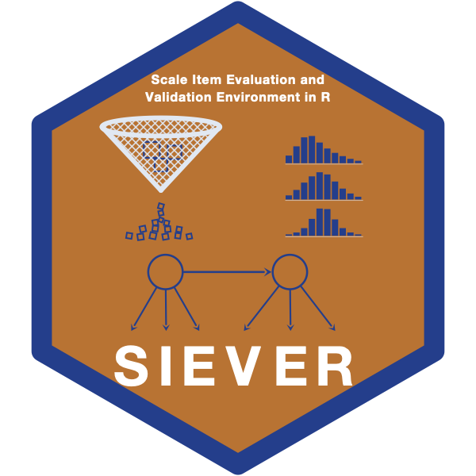
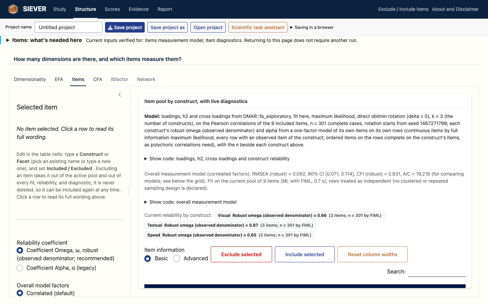
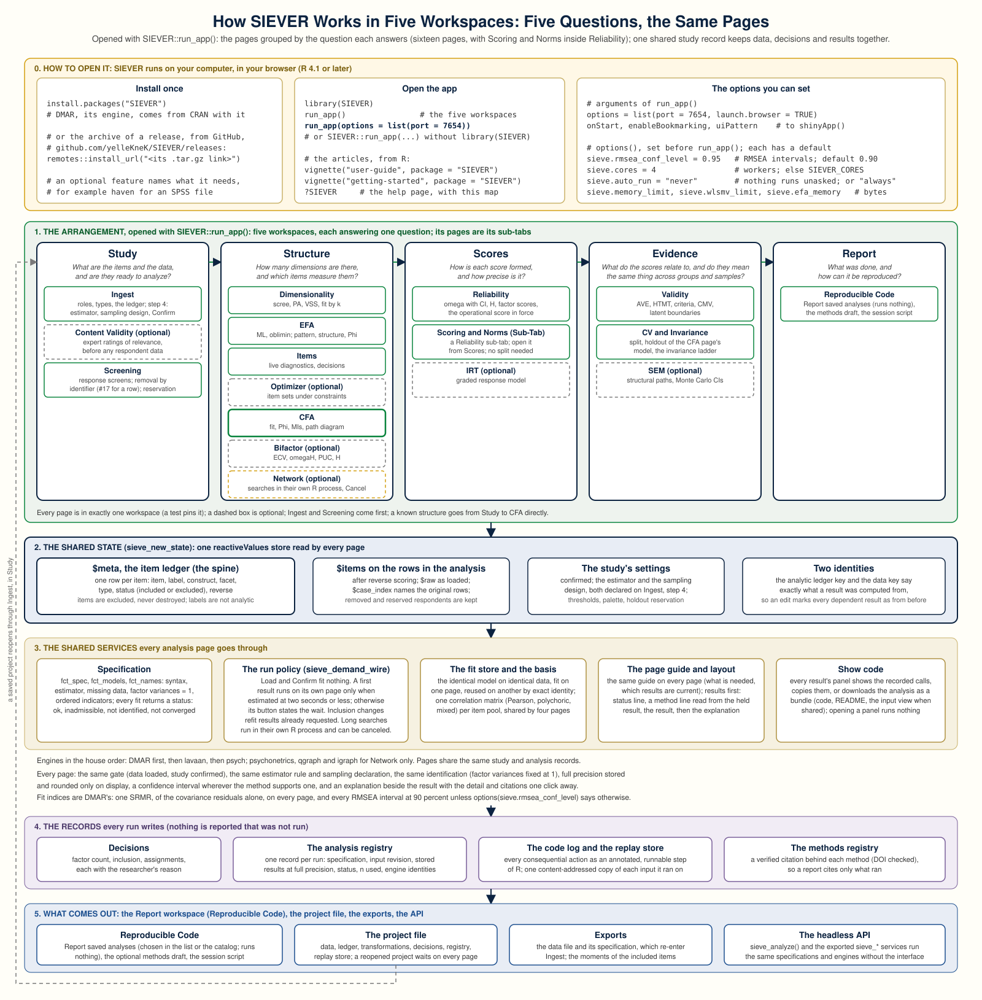

# SIEVER 

**Scale Item Evaluation and Validation Environment in R (SIEVER)** is an
interactive environment for developing constructs and instruments, evaluating
score interpretations and intended uses, and preserving the evidence and
researcher decisions behind them.

**Theory-informed and evidence-supported psychometric decision making.**
We do not automate psychometric judgment. We make psychometric judgment more
informed, transparent, reproducible, and defensible.

A continuing scientific project is the intended unit of work: construct meaning
and intended use, content and response processes, alternative item sets and
models, score definitions, evidence and uncertainty, researcher decisions,
frozen claims, and subsequent evaluation. Version 0.9.0 connects several of
these parts through project files, versioned definitions, decision records,
revision-bound analyses, and frozen claims with appended evaluations. A full
multistudy evidence registry and exposure-controlled validation pipeline remain
extensions; the current application does not certify a scale as valid.

## Quick Start

Install SIEVER from CRAN. DMAR, its engine, and the other packages it
imports come with it:

```r
install.packages("SIEVER")
library(SIEVER)
run_app()  # Study, Structure, Scores, Evidence and Report
```

Before a release reaches CRAN, or to install exactly the archive submitted to
CRAN, use the archive attached to its GitHub release (Installation and Use,
below).

SIEVER requires DMAR 1.1.0 or later. It checks the installed DMAR when it
loads and explains an incompatible build instead of producing partial results;
update DMAR and restart R if that check fails. Saved scientific records retain
the engine build used for each calculation.

Choose the bundled nine-item example, press **Load**, review the item definitions,
and visit **Screening**, **CFA**, and **Reliability**. Save the project and export
its session script to keep the decisions and calculations together. The
user guide (`vignette("user-guide", package = "SIEVER")`) covers
every page, control, default and run rule in the order a study uses them, and
Getting Started (`vignette("getting-started", package = "SIEVER")`)
walks through a first session. For a technical report, the Standards
crosswalk (`vignette("standards-crosswalk", package = "SIEVER")`) maps each
output to the chapters on validity, reliability/precision and fairness of the
*Standards for Educational and Psychological Testing* (2014) and lists the
evidence those chapters call for that SIEVER does not provide. The package
from CRAN and the release archive on GitHub (Installation and Use, below)
include these articles. When
installing from the source on GitHub, add `build_vignettes = TRUE` to
`remotes::install_github()`; that needs knitr, rmarkdown and Pandoc (RStudio
includes Pandoc).



## How SIEVER Is Organized

The five workspaces group pages by the question each answers: Study,
Structure, Scores, Evidence and Report. The shared study record keeps the
same data, item decisions and analysis history across pages.



Use SIEVER when you need to connect item content, theoretical assignments,
statistical evidence, and documented decisions in one revisable study. Prefer a
latent structural model when the question concerns relations among constructs.
The public R API supports headless analyses and a reviewable computational record.
Twelve of its functions are marked experimental in their help: the item
response evidence (the six `sieve_irt_*()` functions), the longitudinal
invariance functions (`sieve_longitudinal_spec()`, `sieve_run_longitudinal()`,
`sieve_longitudinal_compare()` and `sieve_longitudinal_contrasts()`),
`sieve_anchor_sensitivity()` and `sieve_ordinal_fit_impact()`. Their arguments
and the form of their results may change in a later release without a period
of deprecation.

## Working in the environment

Load data and review variable roles, response scales, keying, construct and
facet assignments. With a theoretical assignment basis, CFA, content review,
reliability, and validity predictions provide the normal route; optional EFA can
challenge the structure. Optimization is unavailable under that basis. With an
empirical basis, groupings remain provisional and researcher-requested
optimization can generate candidates under an explicit objective. Neither route
makes the assignments scientifically true, and selecting Theoretical does not
establish that a model was specified before data exposure.

The project bar is available from every main tab. **Save project**, **Save project
as**, and **Open project** use the existing `.siever.rds` format. In a browser,
saving prepares a download. The application cannot verify that the browser kept
the file or overwrote a local destination; the changed indicator clears only
when the researcher acknowledges the prepared copy. Save As requires a distinct
name. Failed or canceled downloads do not establish a saved project.

The Items tab offers Basic and Advanced views, adjacent corrected construct and
facet item-rest correlations, and explicit Exclude selected and Include selected
actions. Exclusion keeps the raw column and metadata. Item-rest correlations
compare a scored item with the available-item mean of the other active items in
its construct or nested facet. Undefined values have a reason and the analytic
pair count is available in the details. Facets with identical names in different
constructs remain distinct.

EFA fits the exact requested number of factors. Selected-model-only runs do not
request a range. Fit indices queue the selected model first and then
other requested models in a bounded background process; stale or canceled jobs
cannot replace the primary model. Direct correlated-facet CFA is separate from
the construct-to-facet higher-order model. The Reliability tab offers construct,
facet, and combined scopes, with alpha and omega, sample information, uncertainty,
and the actual interval method. An unidentified two-item omega does not suppress
a computable two-item alpha.

Table widths are stored in this browser by table and semantic column identity;
they survive redraws and view changes. Reset column widths removes that table's
preference. These browser preferences do not travel with a project file; saved
presentation and analysis settings do.

Recorded session steps retain their data and ledger revisions; a step without a
saved input revision is labeled as history and is not replayed. Generated scoring syntax has an explicit raw
or processed input contract, item-specific reversal bounds, and a construct to
score-column mapping. Available-item mean scores may represent different content
for respondents with different missing responses; complete-score reliability
does not by itself evaluate that policy.

## Scientific task assistance

**Scientific task assistant** is available in the project bar. Describe a goal,
prepare a concise plan, inspect its specification and computational cost, and
run a supported local CFA or reliability task through the same statistical
services used by the direct interface. Other tasks guide content review,
external predictions, interpretation of conflicting evidence, decision records,
and the next validation study. Construct definitions retain their earlier
versions. Frozen claims retain their wording and revision while evaluations are
appended as supported within stated limits, contradicted, inconclusive, failed,
or not yet evaluated. Prior human exposure remains a declaration the software
cannot verify. A late split is internal assessment.

Optional OpenAI and Anthropic adapters accept an explicit model identifier and a
session-only key. Prepare and inspect the exact payload, then authorize that
payload before sending. Respondent data are excluded; private item wording is
included only on request. Provider responses are proposals, never executable R
or automatic edits to constructs, scoring, or frozen claims. Credentials are
excluded from project files, scripts, and proposal records. Local tasks need no
provider. The adapters are tested with mocks; a provider's account access,
current model availability, and live responses require separate verification.
No empirical improvement in task completion or scientific accuracy is claimed.

## The environment and its engines

SIEVER organizes scientific work around established computational tools. Their
strengths are complementary; overlap in coefficients does not establish that
they organize research in the same way.

| Tool | Contribution and relationship to SIEVER |
|---|---|
| [psych](https://personality-project.org/r/psych/) and DMAR | Statistical procedures and supporting numerical infrastructure. DMAR supplies reliability, validity-related methods, and other services used here; it is related infrastructure. |
| [EFAtools](https://mdsteiner.github.io/EFAtools/) | Factor analysis and dimensionality workflows, diagnostics, and comparisons. |
| [lavaan](https://lavaan.ugent.be/) | Latent-variable estimation and associated measurement-model tools. |
| [mirt](https://philchalmers.github.io/mirt/docs/index.html) | Item-response modeling and diagnostics. |
| [ShinyItemAnalysis](https://journal.r-project.org/articles/RJ-2018-074/) | An accessible psychometric analysis, teaching, test-evaluation, and reporting environment; the closest GUI comparison among these examples. |
| General AI assistants | Conversational assistance; assess scientific task success and access to verified project context, rather than fluency alone. |

These tools already support substantial workflows and reproducible analyses.
SIEVER must earn its intended distinction through coherent persistence of
construct meaning, evidence, sample exposure, uncertainty, and judgment. No claim
of market uniqueness or methodological novelty follows from that ambition.

## Installation and Use

Install the released version from CRAN, as in Quick Start. The archive of
each release, the file submitted to CRAN with its articles built, is also
attached to the release on the Releases page of the GitHub repository.
`remotes::install_url()` installs that archive with the packages SIEVER
imports, from CRAN. The remotes package is not installed with SIEVER, so
install it first:

```r
install.packages("SIEVER")  # the released version, from CRAN
# or the archive of this release, from GitHub, with remotes
install.packages("remotes")
remotes::install_url(
  "https://github.com/yelleKneK/SIEVER/releases/download/v0.9.0/SIEVER_0.9.0.tar.gz"
)
# or the source on GitHub, building the articles
remotes::install_github("yelleKneK/SIEVER", build_vignettes = TRUE)
library(SIEVER)
run_app()
```

List the articles with `vignette(package = "SIEVER")` and open one with, for
example, `vignette("user-guide", package = "SIEVER")`.

The installation above resolves the packages SIEVER imports, not the optional ones.
Each optional feature needs the packages below; the app says what is missing
where it is needed, and nothing else depends on them.

| Optional feature | Install | Without it |
|:---|:---|:---|
| SPSS (.sav) and Stata (.dta) files, and a labeled .sav export (Ingest) | `haven` | CSV files and the bundled examples |
| SVG path diagrams where R's own SVG device is unavailable (CFA, SEM) | `svglite` | PDF and PNG diagrams |
| The Network page, a trial | `psychonetrics` (it installs qgraph and igraph) | the page says what to install |
| Ordered-item MI sensitivity analysis | `mice`, `lavaan.mi` | install both to request imputation and pooled WLSMV fits |
| Provider requests of the optional assistant | `httr2` (1.1.0 or later) and `jsonlite` | local tasks only; nothing is sent |
| Building the articles when installing from GitHub | `knitr`, `rmarkdown`, and Pandoc | the articles come built with the CRAN package |

```r
install.packages(c("haven", "svglite", "psychonetrics"))
```

### Options You Can Set

`run_app()` takes these arguments:

| Argument | What it does |
|:---|:---|
| `options` | A list passed to `shiny::shinyApp()`, for example `list(port = 7654, launch.browser = TRUE)`. |
| `onStart`, `enableBookmarking`, `uiPattern` | Passed to `shiny::shinyApp()`. |
| `...` | Not used: any other argument stops the call with the reason. `run_app(port = 7654)` says the port goes inside `options`, `run_app(sieve.cores = 4)` says to set `options(sieve.cores = 4)` first, and `workspaces` is explained (there is no such argument: the five workspaces are the only arrangement of the pages). |

These are set with `options()` before `run_app()`, or before a SIEVER function
is called, and hold for the R session. Each has a default, so none needs to
be set.

| Option | What it sets | Default |
|:---|:---|:---|
| `sieve.rmsea_conf_level` | The level of every RMSEA interval and of the interval of the unbiased SRMR beside the SRMR; every other interval is at 95% unless a page's confidence level input sets another. | 0.90 |
| `sieve.cores` | The number of worker processes for the work that runs on several: the bootstraps, the Items page's diagnostics, and the exploratory fits by number of factors (the parallel analysis runs in one process). A setting is honored up to 64. The Dimensionality page's Workers input starts at it and goes up to the option's value when it is set, and otherwise to the default computed with a ceiling of 64 rather than 8. The environment variable `SIEVER_CORES` is read when the option is not set. | The machine's cores less one, at most 8; 1 on Windows; at most 2 under `R CMD check` |
| `sieve.auto_run` | What runs without being asked: `"never"` makes every result wait for its button, and `"always"` runs a first result on its page whatever its estimated time. | A first result runs by itself when estimated at two seconds or less |
| `sieve.memory_limit` | The memory, in bytes, one fit may plan to hold at its peak, estimated before it starts; a larger fit is refused with its estimate and the ways forward. | Three quarters of physical memory |
| `sieve.wlsmv_limit` | The estimated peak memory, in bytes, one fit of ordered items may need, when it should differ from `sieve.memory_limit`. | `sieve.memory_limit` |
| `sieve.efa_memory` | The memory, in bytes, the exploratory workers running at once may plan to hold; it limits how many run at once. | 8e9 |

```r
options(sieve.cores = 4, sieve.auto_run = "never")
run_app(options = list(port = 7654))
```

Every page has the same name in its workspace. Study offers a suggested
route and a direct link for the chosen goal. Scoring and Norms sits inside
Reliability, with a direct link from the Scores heading.

The package uses DMAR, lavaan, and psych for statistical computation,
haven for supported data files, and base R graphics for its model diagrams.
Diagram coefficients come from the fitted model. The embedded color palettes
require no additional palette package.

The longer exploratory computations (the EFA page's solution and its factor
count comparison, the Dimensionality page's parallel analysis, Very Simple
Structure and model fit by k, and the Items tab's factor analysis) and the
Network search run in a separate R process (callr, which SIEVER imports), so a
long computation leaves the session usable and can be canceled; `sieve_efa_fit_by_k()` remains callable directly from R. Optional
provider and file-format packages are checked only when their corresponding
feature is used. The app uses the system's fonts (Source Sans 3 where it is
installed), so opening it fetches nothing from a font service.
