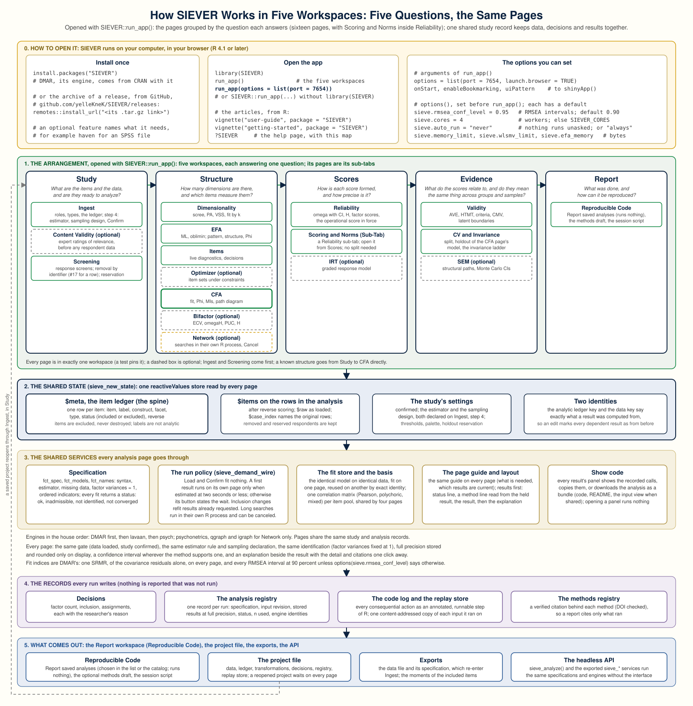

```{r setup, include = FALSE}
knitr::opts_chunk$set(collapse = TRUE, comment = "#>", fig.width = 6.5, fig.height = 4)
set.seed(1)
# R CMD check rebuilds every vignette under a time limit. The bootstrap in
# this article is run when the vignette is built, so its result is printed
# below, and it is not run again by the check.
during_check <- nzchar(Sys.getenv("_R_CHECK_PACKAGE_NAME_"))
```

## What SIEVER Is For

Theory-informed and evidence-supported psychometric decision making guides the
project. We do not automate psychometric judgment. We make psychometric judgment
more informed, transparent, reproducible, and defensible. The project bar provides
Save project, Save project as, Open project, and Scientific task assistant on
every page.
Browser saves prepare downloads; acknowledge a kept copy to clear the changed
indicator.

Theoretical assignments preserve the specified map and exclude optimization;
optional EFA can still challenge the model. Empirical assignments are provisional.
Selecting Theoretical does not establish prespecification. In Items, Basic and
Advanced views retain construct and facet item-rest correlations and reversible
exclusion. CFA can model selected facets directly, separately from a higher-order
construct model. Reliability can report constructs, facets, or both.

The assistant can prepare and execute a bounded local analysis plan through the
same services as the direct tabs. Versioned construct definitions, frozen claims,
and appended evaluations preserve uncertainty and conflicting evidence. External
model review requires inspection and authorization of its exact payload; a model
proposal never changes scientific objects automatically.

SIEVER (say it as "siever," one who sieves) is an action-oriented
environment for applied psychometrics: you bring an item pool larger than
the scale you intend to keep, and the environment walks you through
winnowing it, with the methodology explained at every step and the
equivalent R recorded for every action. This vignette does two things at
once: it narrates what a session in the app looks like, and it *runs* the
same analyses the app would record, on the bundled example, so you can see
that nothing in SIEVER is a black box. The chunks below run the same
analyses the app records, in the same engines (DMAR, lavaan, psych); where
the app's session script would call a SIEVER service instead (the response
screens, the reservation, the diagram), the chunk calls that service or the
base R it wraps.

The tabs. The core path is Ingest, Screening, Dimensionality, EFA, Items,
CFA, Reliability, Validity, and CV and Invariance. With a theoretical
structure the CFA tab can be opened directly after Confirm; nothing on it
waits for the Dimensionality, EFA or Items tabs. The optional tabs, each
saying so when opened, are Content Validity, Optimizer, Bifactor, Network,
IRT, SEM, and Reproducible Code. The five workspaces group these pages by
question: Study (Ingest, Content Validity, Screening), Structure
(Dimensionality, EFA, Items, Optimizer, CFA, Bifactor, Network), Scores
(Reliability, including Scoring and Norms, and IRT), Evidence (Validity,
CV and Invariance, SEM), and Report (Reproducible Code). Study offers a
suggested route with a direct link. The Scores heading opens Scoring and
Norms directly. The vignette follows the core
path through these workspaces.

The map shows how to open SIEVER and the settings you can choose, the five
workspaces and their pages, the shared study record, the services every page
goes through, the records every run writes, and what comes out. The user
guide (`vignette("user-guide", package = "SIEVER")`) and the help page
`?SIEVER` show it as well.

```{r map-workspaces, echo = FALSE, out.width = "100%", fig.cap = "How SIEVER works in the five workspaces, opened with run_app().", fig.alt = "How SIEVER works in the five workspaces: how to install and open it and the options you can set, the workspaces Study, Structure, Scores, Evidence and Report with their pages, the shared state and services, the records, and the outputs."}

```

The example is the Holzinger and Swineford (1939) primary nine mental
tests (n = 301, two schools), shipped through the DMAR package, with three
theorized ability factors: Visual, Textual, and Speed.

```{r load}
library(DMAR)
library(lavaan)

items <- c("t1_visual_perception", "t2_cubes", "t4_lozenges",
           "t6_paragraph_comprehension", "t7_sentence", "t9_word_meaning",
           "t10_addition", "t12_counting_groups_of_dots",
           "t13_straight_and_curved_capitals")
d <- holzinger_swineford[, c("school", items)]
theory <- list(
  Visual  = items[1:3],
  Textual = items[4:6],
  Speed   = items[7:9]
)
nrow(d)
```

In the app this is the **Ingest** tab: you choose the file, press Load
(step 2), assign items to constructs in the grid, and confirm each item's
measurement level with Confirm the study (step 4). These nine tests are
continuous, so the levels confirm automatically; ordered or binary items
would ask for your confirmation because they change the estimator
(polychoric or tetrachoric correlations with WLSMV rather than maximum
likelihood). The study's estimator is chosen once here, and every page
that fits a model offers the same control, with the study's estimator (set
on the Ingest tab) first and then follow the item types (ML with FIML,
DMAR's default, when every item is continuous, WLSMV when any is ordered or
binary), MLR with FIML (for markedly non-normal items), ML with FIML, ML on
the complete cases, or WLSMV.

## What Runs by Itself, and What Waits

Once the study is confirmed, some results appear without a click and
others wait for a button. One rule decides it for the whole app, and the
About dialog and the page guide state it. A first result runs by itself
only when its page is shown, its estimated time at standard rates is two
seconds or less, the times measured on this machine do not put it above
six seconds, it is the first result of its kind for the loaded data, and
the project was not reopened from a file. Because the estimate depends
only on the size of the problem, the same page behaves the same way on
every visit. The results that may run this way are the CFA and the
Reliability table; the EFA tab's selected solution and its fit indices;
the Items tab's item diagnostics and overall model; the Dimensionality
tab's parallel analysis and VSS, and model fit by k; the shared
correlation matrix of the included items (Pearson correlations take no
time and are always computed; a polychoric, tetrachoric or mixed matrix
estimated above two seconds waits for Compute the correlations on
Screening and Dimensionality); and Harman's single-factor screen on the
Validity tab. Everything else (the Validity, SEM, Bifactor, Network, IRT,
and CV and Invariance models, the Optimizer, the reliability planner's Monte
Carlo, and every bootstrap) waits for its button, which states the
estimate for this machine, whatever that estimate is; a result whose time
cannot be estimated waits as well.

Three consequences shape a session. After an edit that changes what a
result was computed from (the inclusion, type, keying or construct of a
modeled item, a changed value, a respondent change, a changed setting),
the result is marked as from before, with what changed named, and is
recomputed only when you press the page's Update; a result's key covers
only the inputs its model reads, so reassigning a facet leaves a
first-order CFA current and reversing an excluded item leaves every model
that does not read it current. Data loaded after other data get a first
result of their own: a result of the earlier data is kept in the analysis
registry and the saved-results report, and is not shown. A reopened
project waits on every page, and each page says so in one sentence with
its button.

## Preparing a Study

A real study arrives with more than its data: which columns are items and
which are identifiers, groups or criteria; the measurement level of each
item; the constructs and facets; which items are reverse keyed and within
what response bounds. Typing all of that into a grid once is fine; typing
it again for every session, or for every collaborator, is not. The
pre-SIEVER step records it once, in a specification file beside the data,
and turns the pair into a project file that opens on the Ingest tab ready
to analyze.

The specification is a plain table with one row per column of the data.
`sieve_specification_template()` builds it, and writes it as a `.csv` when
`file` is given, with everything SIEVER can propose filled in (the roles,
the detected types, the Item Names from the
variable labels when the file has them) and the constructs and facets
left for you; its help page describes every column and the vocabulary each
one takes. Here the data frame is the one loaded above, with the school as
a grouping variable beside the nine tests:

```{r template}
template <- SIEVER::sieve_specification_template(d)
template[, c("variable", "role", "type", "construct", "facet", "status", "reverse")]
```

Fill it in, in R as here or in a spreadsheet saved as a `.csv`: the three
constructs, an Item Name or two, and, had any test been reverse keyed,
`reverse = TRUE` with its bounds in `rev_lo` and `rev_hi`.

```{r fill}
for (construct in names(theory)) {
  template$construct[template$variable %in% theory[[construct]]] <- construct
}
template$label[template$variable == "t2_cubes"] <- "Cubes"
template$label[template$variable == "t4_lozenges"] <- "Lozenges"
```

`sieve_prepare_study()` loads the data exactly as the Ingest tab loads a
chosen file, applies the specification through the import's own checks, and
writes the project file. Every problem in the specification is reported
at once (a variable that is not in the data, a type outside the
vocabulary, a facet without a construct) and nothing is written until
there is none. When the specification types every item, as this one does,
the study is confirmed from it, so no press of Confirm the study (step 4)
is needed in the app.

```{r prepare}
study_file <- tempfile("holzinger_nine_", fileext = ".siever.rds")
study <- SIEVER::sieve_prepare_study(d, template, file = study_file,
                                     name = "Holzinger and Swineford, nine tests")
```

The function returns the project snapshot, which prints as the same
summary; its item ledger is what the Ingest grid will show.

```{r ledger}
study$meta[, c("item", "label", "construct", "type", "status")]
```

To open the study, start the app, choose the project file in the Ingest
tab's file input (or press Open project), read what the file holds in the
dialog, and press Open this project. The same input takes the data file
and the specification together, which loads the study and confirms it in
one step without a project file. A specification can also be applied to
data already loaded: Apply a specification to the loaded data, in the
Ingest sidebar, matches the file by variable name, asks how the reverse
keyed items in the loaded data are to be treated (checked against the
specification, as administered, or already reverse scored), and refuses a
specification with a problem as a whole. The Reproducible Code page's
Download specification (.csv) writes the specification back out after you
have changed anything in the grid, so the file beside the data stays the
record of the study. The optional way to carry the constructs in the data
itself is to name the item columns `Construct__Facet__item` or
`Construct__item` (two underscores between the parts), or to give an SPSS
variable the label `Construct: Facet: wording`; the Ingest tab then
proposes the constructs and facets from the names and shows them in the
grid for you to confirm.

### Response Bounds, Reverse Coding, and Wording Checks

Response bounds and reverse coding are edited in the item grid, as every
other attribute of an item is. Response bounds are the lowest and the
highest response the instrument allowed, a fact about the instrument and
not about the sample: an endpoint nobody chose leaves the observed range
narrower than the scale, and a common observed range across the items
shows only that the respondents used the same points. Type an item's
bounds in its **Response bounds** cell (as `1 to 7`; clear the cell to
take them back); a file's value labels (SPSS, Stata) are declared as the
bounds at load when every observed response lies within them, and a cell
cleared of them, or of an item with no labels, has them or the observed
range as its hint. Or declare them for every included item, or for
one construct's or facet's items, under *Response bounds and Reverse? for
several items at once* above the grid. Declaring reverses nothing. **Reverse?** set to Yes reflects an item
within its declared bounds, `(min + max) - x`, and otherwise within its
observed range, and its Response bounds cell says which; set to No it
returns the item to its scoring exactly (an item recorded as already
reverse scored with no bounds needs the scale's bounds typed in its
Response bounds cell first, as its cell says), and the same line above the grid
sets a construct's or facet's items at once. An item reflected within
a range narrower than its scale lands on a different metric from the items
reflected within the scale, which is why the bounds should be declared
whenever the scale is known (Bandalos, 2018). The deterministic item
writing checks (short and readable items, one thing at a time, no
negations, no absolute or vague quantifiers, with an approximate reading
grade; after Bandalos, 2018) are on the Content Validity tab, and the
reverse keyed balance per construct on the Ledger summary panel; both are
string heuristics that run on this machine only, with no model involved,
and a flag is a place to look, not a verdict. Each declaration and each
reversal is recorded in the session script and saved with the project.

## Screening: Look Before You Model

The **Screening** tab starts with the univariate lay of the land, and with
the respondents themselves: careless and insufficient-effort responding
distorts every correlation downstream (Meade & Craig, 2012), so the app
screens rows before you model. The three standard screens:

```{r careless}
X <- as.matrix(d[, items])

# Longstring: the longest run of identical consecutive responses.
longstring <- apply(X, 1, function(r) max(rle(r[!is.na(r)])$lengths))

# Within-person variability: an SD of zero is an invariant responder.
irv <- apply(X, 1, sd, na.rm = TRUE)

# Mahalanobis distance with its chi square tail probability.
cc <- complete.cases(X)
md <- mahalanobis(X[cc, ], colMeans(X[cc, ]), cov(X[cc, ]))
p_md <- pchisq(md, df = ncol(X), lower.tail = FALSE)

c(max_longstring = max(longstring), invariant = sum(irv == 0),
  mahalanobis_flags = sum(p_md < 0.001))
```

Two rows are multivariate outliers worth a look; with continuous test
scores (not Likert items) the longstring and invariance screens stay
quiet, as they should. Flags are candidates for documented review, never
automatic removal: a respondent is removed on the Observations panel with
a reason (the page asks for one when none is given), can be restored
there, and every later result reads the rows then in the analysis.

### Reserving Rows for Validation Before Development

The Observations panel also offers a validation reservation, optional and
best made now, before the structure and the items are examined. Choose
the proportion of the respondents to reserve (0.3 by default), a seed, and
optionally a grouping variable to stratify by, and press Reserve. The
reserved rows leave the analysis through the respondent path with the
reason "reserved for validation" and a marker, and every development
result (the shared correlation matrix, Dimensionality, EFA, Items, CFA,
Reliability) reads the calibration rows only and can say so beside its n.
The ordinary Restore refuses a reserved row; only the Release button
returns them (it names the count and asks first), after which the
protection is gone. A reservation is
refused before any row is drawn when either half would have fewer than 20
rows or the smaller half cannot carry the current model. One drawn after
development results exist is allowed but recorded as reserved after
development began, with the results that preceded it, because a split of
data already examined is internal assessment and not validation: a
validation sample estimates how a model would fare in a fresh sample only
when it played no part in fitting or selecting it (Browne, 2000). Saved
projects and the session script carry the reservation, and the script
draws the same rows from the same seed. The same draw from a script:

```{r reservation}
reserved <- SIEVER::sieve_holdout_draw(seq_len(nrow(d)), proportion = 0.3, seed = 1)
reserved$sizes
```

This vignette keeps every row in the analyses below so that they match
the published analyses of these data; in a study with a reservation in
force, the development results would read the calibration rows, and the
evaluation on the reserved rows would come at the end (see the CV and
Invariance section).

## Dimensionality, Then Structure

The **Dimensionality** tab runs factor-analytic parallel analysis (Horn,
1965) with DMAR's `parallel_analysis()`: retain a factor only while its
empirical eigenvalue exceeds the eigenvalue of the same rank from random
data of the same size (by default the 95th percentile of the reference
eigenvalues; Glorfeld, 1995, with DMAR's Monte Carlo limits for that
percentile).

```{r parallel-analysis}
pa_normal <- parallel_analysis(d[, items], missing = "fiml", reference = "normal",
                               B = 1000, percentile = 0.95, conf_level = 0.95, seed = 1)
pa_normal
```

Parallel analysis and VSS and
model fit by k run under the run rule above. The **EFA** tab then
estimates the exploratory model with DMAR's `fa_exploratory()`: maximum
likelihood (ML) with FIML for continuous items (DMAR's default) and direct
oblimin rotation (constructs are allowed to correlate, as real constructs
do), with confidence intervals for the rotated loadings, the factor
correlations, the communalities, and each factor's determinacy and H. Its
Number of factors panel is DMAR's `factor_count()`, which sets each
count's fit, information criteria, reduced eigenvalues (beside the
Dimensionality tab's parallel analysis reference, the same computation, so
it is not run twice) and MAP side by side and chooses nothing; it runs in a
background R process on its button.

```{r efa}
efa_fit <- fa_exploratory(d[, items], nfactors = 3, estimator = "ML",
                          missing = "fiml", rotation = "oblimin", seed = 1)
efa_fit
```

The three theorized factors emerge, with one cross loading: t13 (straight
and curved capitals) loads .46 on Speed and .37 on Visual, which the Items
tab's salience rule (an off-target loading of at least .30 within .10 of
the primary loading) flags. The app's **Items** tab is
where the real winnowing happens: a live table of per-item loadings, cross
loadings, corrected item-rest correlations, and robust omega if dropped,
where a click excludes an item (never deletes it) and every diagnostic
updates. The item diagnostics follow each inclusion, exclusion or
reassignment by themselves while their estimate is within two seconds, and
otherwise wait for Update; their exploratory model is DMAR's
`fa_exploratory()` too, maximum likelihood on the shared correlations with
direct oblimin, and when the EFA tab's solution is that model (as the ML
solution above is: its estimates are maximum likelihood's, on complete
data) the tab reads it instead of fitting again, and the model line says
so.
DMAR's `simple_structure()` quantifies how close the solution is to
Thurstone's ideal, read from the standardized pattern coefficients of
DMAR's table:

```{r ss}
std <- as.data.frame(efa_fit)
std <- std[std$metric == "standardized" & std$op == "=~", ]
pattern <- unclass(xtabs(estimate ~ rhs + lhs, data = std))
simple_structure(pattern, salient = 0.30)
```

Excluding is never prevented, but its cost to content is reported. Every
exclusion reports its content coverage: one that leaves a construct or a
facet with no included item shows an advisory beside the decision, with
the counts before and after and a link to the Content Validity page (on
the Items page, the Screening and Ingest grids, Content Validity, and the
Optimizer's Apply), and the Items page's reliability line names the
constructs below three included items and the facets below two, including
those at zero. Psychometric selection can drop items but cannot see the
content that then goes missing, and a narrowed pool raises internal
consistency at the expense of breadth (Clark & Watson, 2019); the
Standards ask that each construct's content stay represented (AERA, APA,
& NCME, 2014). From a script, `sieve_item_coverage()` gives the table and
`sieve_coverage_change()` the comparison:

```{r coverage}
before <- SIEVER::sieve_item_coverage(study$meta)
meta_after <- study$meta
meta_after$status[meta_after$item == "t2_cubes"] <- "parked"   # excluded
SIEVER::sieve_coverage_change(before, SIEVER::sieve_item_coverage(meta_after))
```

### Where the Numbers Come From

Every page is laid out results first: one status line, a one-line method
statement, the result, then the explanation (its first paragraph visible,
the rest one labeled click away). The page guide, in the same place on
every page, says what is still needed, whether the result on screen is
current or from before, and offers the page's Update. You can visit pages
in the order your question requires; there is no need to run every
optional analysis. Returning to an unchanged result reuses it. An edit
that changes what a result was computed from marks it as from before,
with what changed named, and Update recomputes the page's stale results in
turn; a label or wording edit does not, and neither does an edit the
model does not read.

A fit made once is reused wherever its exact identity recurs. A session
fit store keys every lavaan fit by its model syntax, the modeled columns
and rows, the estimator, the missing data treatment, the identification,
the sampling design and the engine versions; the CFA, Items and Validity
pages, the measurement model behind the Reliability page's factor scores,
and the assistant reuse an identical fit instead of fitting it again (the
methods draft fits its own CFA), say which page fit it and when, and record
that in the session script. A page that would wait for its button (the
CFA page when its estimate is above the run policy's limit, the Validity
tab's measurement model, the scores model behind Reliability) adopts such
a fit as soon as it is shown, without a click, and estimates nothing for
it. Different models, estimators or rows are never equated; the store is
emptied when data are loaded and is never saved in a project.

A saved project restores prepared item values and their transformation
history. Reverse scoring already applied in that project must not be applied
again. To reproduce preparation from the raw data instead, use the verified
input and complete session script, which applies each recorded change once.

Expand **Show code** beside an analysis result to see the actual call
first, with the recorded inputs and provenance (the recorded session step,
the input revision, the respondent rows, the item columns, the software
versions) one click deeper. The panel starts closed; opening it reads the
saved record and runs nothing, and it says whether the result it belongs
to is current, from before, unavailable or failed. Copy recorded code
copies the call; Download this analysis writes the recorded code with a
README naming the input revision, rows and versions, and includes the
recorded input view only when the session's sharing choice on the
Reproducible Code page allows it (a checkbox there; the choice is the
session's and is not saved in the project). The panels sit beside the
EFA and CFA results, the Items diagnostics and overall model, AVE, HTMT,
the criterion relations and the marker adjustment, the calibration split,
the invariance ladder and partial models, alignment, the sample reference
table and transformation uncertainty, SEM, Bifactor and the Optimizer.
Follow a panel's preparation and session-script links to review item
inclusion, respondent removals, reversals, and the data objects used by
the commands. The complete script and its input file reproduce that
preparation; a short result panel alone does not load the data.

For the EFA tables, the fitted pool is every included item. The construct
and facet display filters select rows of that solution; they do not fit a
model using only that construct or facet. The code panel shows the
`DMAR::fa_exploratory()` call with every argument (the estimator, the
missing data method, the rotation and the recorded seed of its random
starts) and names the actual fitted items and the cases analyzed. The fit
line is that of the same model, read from DMAR's `fit_measures`, which
come from the unrotated solution and so are the same for every rotation.

A comparison with another EFA should match the input items and respondents,
item transformations and measurement levels, correlation basis, extraction,
rotation and its options, and standardization. `lavaan::efa()` defaults to
geomin rotation; SIEVER's loading tables (DMAR's, through lavaan) default
to direct oblimin. Compare
the SIEVER pattern matrix with fully standardized lavaan loadings, and Phi
with lavaan's latent correlations. Factors can differ in column order and
sign across equivalent solutions; a factor's number has no fixed identity.
Match whole loading columns before comparing individual cells, and apply the
same permutation and sign changes to both axes of Phi. SIEVER keeps the
engine's factor names visible in the tables and code. The structure matrix
is a different quantity: with correlated factors, it equals the pattern
matrix multiplied by Phi.

## The Confirmatory Model

The **CFA** tab fits the correlated-factors measurement model with the
factor variances fixed to one (all loadings free), reporting the RMSEA
with its 90 percent confidence interval, the conventional interval for
the RMSEA (DMAR's default for it, and lavaan's), in the accuracy in
parameter estimation spirit: the interval, not the point value, is what
you read. A 100(1 - 2 alpha) percent interval decides the one-sided tests
of close fit and of not close fit at level alpha (MacCallum, Browne &
Sugawara, 1996), so the limits of the 90 percent interval are those tests
at .05. The tab's other intervals, the loadings' and the factor
correlations', are at 95 percent. lavaan's printed summary shows the same
90 percent interval, and `fm.args = list(rmsea.ci.level = 0.9)`, lavaan's
own default, gives the one the tab shows.
Under the run rule the model runs by itself when it is the first of its
kind for the loaded data and estimated within two seconds, and otherwise
waits for the page's Fit button, which states the estimate. The tab's
estimator guidance is conditional rather than a verdict: ML with FIML, the
default for continuous items (DMAR's), as the treatment of incomplete cases
under MAR (Enders & Bandalos, 2001), MLR's robust inference for markedly
non-normal items with its free-parameters-to-n
condition, ML on the complete cases as the comparison when the missing
data assumption is in doubt, and WLSMV for ordered items under the
category and threshold conditions of Rhemtulla, Brosseau-Liard and Savalei
(2012).

```{r cfa}
model <- '
  Visual  =~ t1_visual_perception + t2_cubes + t4_lozenges
  Textual =~ t6_paragraph_comprehension + t7_sentence + t9_word_meaning
  Speed   =~ t10_addition + t12_counting_groups_of_dots + t13_straight_and_curved_capitals
'
cfa_fit <- cfa(model, data = d, std.lv = TRUE, missing = "fiml")
round(fitMeasures(cfa_fit, c("chisq", "df", "pvalue", "cfi", "tli",
                             "rmsea", "rmsea.ci.lower", "rmsea.ci.upper",
                             "srmr_bentler_nomean"),
                  fm.args = list(rmsea.ci.level = 0.9)), 3)
```

The SRMR is `srmr_bentler_nomean`, the standardized root mean square
residual of the covariances, which is the SRMR the tab shows and the one
`DMAR::sem_fit_measures()` reports. lavaan's `srmr` is another average for
a model with a mean structure, as every FIML fit has: it also averages in
the mean residuals, which are zero when the intercepts are free, so it is
smaller for the same misfit (0.060 against 0.065 here). An auxiliary
variable has the same effect on lavaan's measures, since its variances and
covariances are averaged in with residuals of zero or nearly so. DMAR, and
the tab with it, forms the SRMR of such a fit over the model's own
variables, and the tab says when a fit has one.

The tab's path diagram is available from a script as well.
`sieve_diagram_spec()` reads the fitted model into a specification of the
diagram (its nodes and relationships, the matching parameter table at full
precision, the layout, and a caption), and `plot()` draws it in the
notation used to teach these models: an ellipse for a factor, a rectangle
for an item, a separate circle for each unique term, a loop for a
variance, and a curved double-headed arrow only for a covariance the model
contains. A dashed line marks a parameter that was fixed to set a scale;
here those are the three factor variances. The items are shown by short
identifiers, and the specification holds the key.

```{r diagram, fig.width = 7.2, fig.height = 4.5, out.width = "100%"}
diagram <- SIEVER::sieve_diagram_spec(cfa_fit, label_mode = "short")
plot(diagram, show_caption = FALSE)
diagram$label_key[, c("short", "id")]
```

The numbers on the arrows are lavaan's fully standardized (`std.all`)
solution, and their standard errors and intervals are in
`diagram$parameters`. `sieve_diagram_update()` changes what is drawn
without the fitted model (for example `covariances = FALSE`, or
`standardized = "none"`), and `sieve_export_diagram()` writes the figure
as PDF, SVG, or PNG at the size its content needs.

```{r diagram-caption}
cat(strwrap(diagram$meta$caption, width = 76), sep = "\n")
```

## Reliability With a Confidence Interval

The **Reliability** tab reports, per construct, Robust omega (observed
denominator) as its default: the squared sum of the one-factor loadings
over the variance of the unit-weighted composite actually scored, with
that variance estimated from the unrestricted covariance matrix of the
items (maximum likelihood divisor; under FIML the saturated estimate).
This is the coefficient Kelley and Pornprasertmanit (2016) introduced as
hierarchical omega. Its denominator estimates the composite variance
consistently whether or not the one-factor model holds, which is why they
recommend it, with a percentile bootstrap interval, when unidimensionality
is only approximate, as it usually is with real items. The interval is a
bootstrap and runs on request: the table shows the point estimate when it
is computed, and Run the bootstrap (below the table) draws 10000
replications by default, a percentile interval for continuous items and
BCa for ordered or binary items, with the wait stated before it starts.
Beside it the table gives Omega (model-implied denominator), the textbook
form whose denominator is the total variance the one-factor model
reproduces (McDonald, 1999), with DMAR's default interval (the MLR
(sandwich) standard error, its limits formed on the logit scale; Browne,
1982), which is immediate, and, with Show all columns, that model's RMSEA
with its 90 percent interval
(the RMSEA level; the page's confidence level sets omega's and H's
intervals), so the assumption behind the model-implied form
can be judged; the two denominators differ by exactly the sum of the
residual covariances of the one-factor fit. What is robust is the
denominator, and only against misspecification of the total variance: the
numerator comes from the one-factor model under either denominator, so a
doublet or a method factor inflates omega either way, and no denominator
repairs a misspecified model (Flora, 2020). Alpha is one click away as the
flagged legacy coefficient, with its own analytic interval; it equals the
reliability only under essential tau equivalence and is otherwise a lower
bound (Cronbach, 1951). H, the construct replicability, is among the full
columns.

The same numbers from DMAR, which the tab calls. With three items the
one-factor model is saturated, so the two denominators coincide here; they
part company exactly when the model does not reproduce the composite
variance (the validation vignette shows the identity).

```{r omega}
value <- function(res, term) res$value[res$term == term]
for (cn in names(theory)) {
  X <- d[, theory[[cn]]]
  robust  <- reliability_omega(data = X, denominator = "observed", ci_method = "none")
  implied <- reliability_omega(data = X, denominator = "model_implied", ci_method = "mlr_logistic")
  cat(sprintf("%-8s Robust omega (observed denominator) = %.3f;  Omega (model-implied denominator) = %.3f, 95%% CI [%.3f, %.3f]\n",
              cn, value(robust, "estimate"), value(implied, "estimate"),
              value(implied, "ci_lower"), value(implied, "ci_upper")))
}
```

The bootstrap interval for robust omega, as the app runs it on request;
400 replications here meet DMAR's minimum for a 95% percentile interval, where
the app's default is 10000 (Hesterberg, 2015, on the replications an
interval needs for its Monte Carlo error to be small). The seed is set so
the run is reproducible, and DMAR restores your random number stream on
exit.

```{r omega-boot, eval = !during_check}
reliability_omega(data = d[, theory$Textual], denominator = "observed",
                  ci_method = "percentile", B = 400, seed = 1)
```

Three-item scales of ability tests are short, and the intervals say so:
this is precisely why the interval is the house rule. Which leads to the
question the **Plan the Next Study** panel answers: how many respondents
would the next study need for a usefully narrow interval? That is
accuracy in parameter estimation (AIPE) planning:

```{r aipe}
# n for a 95% omega interval no wider than .10, planning omega .75, 6 items
rho <- 0.75 / (6 - 0.75 * 5)   # Spearman-Brown, parallel items
ss_aipe_reliability(model = "Parallel", type = "Normal Theory",
                    width = 0.10, n_items = 6, true_item_covariance = rho, true_residual_var = 1 - rho,
                    conf_level = 0.95, assurance = NULL)
```

### The Operational Score Specification

The tab's Operational scores panel holds, on its Operational Score
Specification card, one specification per construct of how the construct
is scored for use: the score (the mean of the answered items by default,
the sum prorated from the answered items, or a Bartlett or regression
factor score read from the fitted measurement model) and the minimum
answered count or proportion a respondent needs to receive it. The
specification is kept with the project and is read by the Validity tab's
criterion correlations and marker adjustment, by the sample reference
table and frozen references on Scoring and Norms (composite scores only),
by the scoring syntax and by the methods draft, each showing the eligible
n. A requested factor score without a current fit is unavailable, with
the Fit action and an explicit choice of mean scores; nothing falls back
to a mean score by itself. Requiring more answered items does not change
a reliability coefficient's estimand: omega describes the complete
composite, and a respondent scored on the items they answered is scored
on different content, as the help page of `sieve_composite_score()`, the
scorer behind the specification, says; the `policy` it returns records the
rule applied (the method, the minimum answered count or proportion, and
the treatment of missing responses) so a report can state it.

## Invariance: Does the Scale Mean the Same Thing Across Groups?

Both schools are in the data, so the **CV and Invariance** tab can ask
whether the measurement model holds across them, in the conventional
cumulative order (configural, metric, scalar, strict; Meredith, 1993),
judged by the change in fit (Cheung & Rensvold, 2002; Chen, 2007). The
example fits the first three rungs:

```{r invariance}
fit_conf <- cfa(model, data = d, group = "school", std.lv = TRUE)
fit_metr <- cfa(model, data = d, group = "school", std.lv = TRUE,
                group.equal = "loadings")
fit_scal <- cfa(model, data = d, group = "school", std.lv = TRUE,
                group.equal = c("loadings", "intercepts"))
lavTestLRT(fit_conf, fit_metr, fit_scal)
```

When a rung fails, the app's partial invariance workflow score-tests each
equality constraint, lets you free the offending parameter or two, and
refits, disclosing exactly what was freed (Byrne, Shavelson & Muthén,
1989).

With a reservation in force, the same page's Evaluation on the Reserved
Rows card is where the reservation pays off. Evaluate on the reserved rows
freezes the measurement model as it stands (the included items with their
constructs, the model syntax the CFA page fits with its structure and
identification, the estimator in force, and the scoring specification),
names the version and its model, fits it on the
calibration rows, and evaluates it on the reserved rows once, with the
same fit, cross-validation discrepancy and reliability comparisons as the
late split. The result is labeled specified before evaluation when the
version predates the first evaluation of the reservation, so the reserved
rows played no part in fitting or selecting it, and revised during
development when a development change created the version after an
evaluation existed, in which case the earlier evaluation becomes
historical (Browne, 2000; AERA, APA, & NCME, 2014). Without a reservation
the late split of the already inspected data stays, with its disclosure
that it is internal assessment. From a script,
`sieve_cross_validate(validation_rows = )` evaluates on rows given rather
than drawn.

## The Paper Trail

Everything above is what the **Reproducible Code** page holds. It leads
with Report saved analyses: a report written from the analyses recorded
in this session, which runs nothing. Select the recorded analyses, in the
list or by clicking rows of the catalog, and the report states, for each, its specification, whether its
inputs are those now in the analysis or earlier ones (and what changed),
its input and fitted rows, its estimator and missing-data treatment, its
uncertainty method and the software versions that made it, then its
stored results; an analysis that is absent or failed is listed as such,
never refit. It ends with the references of the methods those analyses
used and nothing else: a verified registry, `sieve_method_references()`,
gives every citation SIEVER can make with the claim it supports, each
analysis record carries the keys of the methods it used, and
`sieve_method_bibliography()` writes the deduplicated bibliography of
those methods and of the software actually used, with versions. Beside
it, Run a new analysis and draft refits the measurement model and
assembles a methods-and-results draft whose numbers are computed when
it is assembled, apart from a bootstrap interval and an unbiased SRMR (or
DMAR's refusal of it) taken from records of the same computation, which
the draft names; the draft is current only while everything it reads is
unchanged. The annotated session script is the third output: an annotated
record of every action, downloadable with its verified input through
Download script and inputs (.tar.gz), and runnable outside the app. The
environment's promise is that deep, hands-on engagement with scale
development and a fully disclosed, reproducible analysis are the same
thing, not a tradeoff.

## Three Scientific Workflows

A researcher beginning with an imprecise construct description can open
Scientific task assistant, state the uncertainty, and prepare an
Understand the project or a Review content and response processes plan.
Keep a definition version with population and intended use marked
unspecified where necessary. Review the imported variable roles, response
scales, and assignments on Ingest. A local CFA or reliability plan shows
its resolved settings before it runs. Optional external review proposes
questions and wording; it does not supply missing expert agreement or
response-process evidence. The first workflow is complete when the
specification, remaining evidence gaps, and the researcher's next decision
are inspectable and saved. Judge an assistant's output by its numbers,
citations and uncertainty, not by its fluency; SIEVER claims no improvement
in task performance from it.

When a weak item protects a substantive facet, retain that content commitment in
the definition record. Inspect construct and facet item-rest correlations and the
model diagnostics together. Exclude the item reversibly to examine an alternative,
compare its model and score consequences, then include it again when appropriate;
the coverage advisory says what the exclusion leaves unrepresented.
Direct facet CFA and alternative structural models can challenge a narrow simple
structure account. Save both project versions, retain the analyses, and record
the researcher's judgment and an external prediction that could distinguish the
accounts. Improved fit or reliability alone does not determine the decision.

For subsequent evaluation, freeze the claim while its exact item map, score rule,
transformations, and definition versions are recorded. Analyze the intended
candidate in genuinely new data with relevant external variables or methods.
Append supported-within-limits, contradicted, inconclusive, or failed-analysis
evidence without rewriting the prediction. The application detects identical
sample identity or data, but cannot certify partial overlap or prior human
exposure. A reservation drawn on Screening before development, and the
evaluation of a frozen version on the reserved rows, are in the app; the
app does not protect evaluation data throughout selection or keep a
multistudy evidence registry. A late split of already inspected data
remains internal assessment.

## Observation Review and Fixed Score References

On **Screening**, the **Observations** panel shows every original
respondent, including those removed. Inspect the responses and the reason
before changing inclusion; the page asks for a reason when a respondent is
removed without one, and says where to restore. Sorting and searching do
not change the original row reference. A removal applies to every
subsequent analysis; restoring the respondent returns the row to its
original position, and an older result names who was removed or restored,
with n then and now. Saving the project retains the inclusion state, the
screening rule in force, and any validation reservation.

Longstring is the longest consecutive run of exactly equal raw responses
among the selected items in the data file's column order, before reverse
scoring. A missing response breaks the
run by default. The minimum run and minimum answered count are review choices,
not evidence by themselves that a response is invalid. Use comparable response
options and a defensible presentation order. Flags never remove respondents
automatically.

In **Reliability**, set each construct's Operational Score Specification
(Operational scores panel) before exporting scoring syntax or building
norms. The specification names the score and how many item responses are
needed. In **Reliability**, **Scoring and Norms** can freeze a named calibration
reference with its item definitions, score specification, population
description, mean, SD, and empirical percentile function. Applying that
reference to a new cohort uses the stored constants. The new cohort is not
restandardized to mean 50. Item definitions and scoring rules must match.

Percentile uncertainty and tail counts accompany the descriptive table. Tied
scores keep their discrete support; they are not jittered. Infinite limits
identify tails that the sample cannot locate precisely. Independent-observation
intervals are withheld for a dependent sampling declaration. A separate,
explicit bootstrap request estimates uncertainty in calibration constants and
in the resulting T conversion at fixed calibration scores.

## References

American Educational Research Association, American Psychological
Association, & National Council on Measurement in Education. (2014).
*Standards for educational and psychological testing*. AERA.

Bandalos, D. L. (2018). *Measurement theory and applications for the
social sciences*. Guilford.

Browne, M. W. (1982). Covariance structures. In D. M. Hawkins (Ed.),
*Topics in applied multivariate analysis* (pp. 72--141). Cambridge
University Press.

Browne, M. W. (2000). Cross-validation methods. *Journal of Mathematical
Psychology, 44*, 108--132.

Byrne, B. M., Shavelson, R. J., & Muthén, B. (1989). Testing for the
equivalence of factor covariance and mean structures: The issue of partial
measurement invariance. *Psychological Bulletin, 105*, 456--466.

Chen, F. F. (2007). Sensitivity of goodness of fit indexes to lack of
measurement invariance. *Structural Equation Modeling, 14*, 464--504.

Cheung, G. W., & Rensvold, R. B. (2002). Evaluating goodness-of-fit
indexes for testing measurement invariance. *Structural Equation
Modeling, 9*, 233--255.

Clark, L. A., & Watson, D. (2019). Constructing validity: New developments
in creating objective measuring instruments. *Psychological Assessment,
31*, 1412--1427.

Cronbach, L. J. (1951). Coefficient alpha and the internal structure of
tests. *Psychometrika, 16*, 297--334.

Enders, C. K., & Bandalos, D. L. (2001). The relative performance of full
information maximum likelihood estimation for missing data in structural
equation models. *Structural Equation Modeling, 8*, 430--457.

Flora, D. B. (2020). Your coefficient alpha is probably wrong, but which
coefficient omega is right? A tutorial on using R to obtain better
reliability estimates. *Advances in Methods and Practices in Psychological
Science, 3*, 484--501.

Glorfeld, L. W. (1995). An improvement on Horn's parallel analysis
methodology for selecting the correct number of factors to retain.
*Educational and Psychological Measurement, 55*, 377--393.

Hesterberg, T. C. (2015). What teachers should know about the bootstrap:
Resampling in the undergraduate statistics curriculum. *The American
Statistician, 69*, 371--386.

Holzinger, K. J., & Swineford, F. (1939). A study in factor analysis: The
stability of a bi-factor solution. *Supplementary Educational
Monographs, 48*.

Horn, J. L. (1965). A rationale and test for the number of factors in
factor analysis. *Psychometrika, 30*, 179--185.

Kelley, K., & Pornprasertmanit, S. (2016). Confidence intervals for
population reliability coefficients: Evaluation of methods,
recommendations, and software for composite measures. *Psychological
Methods, 21*, 69--92.

MacCallum, R. C., Browne, M. W., & Sugawara, H. M. (1996). Power analysis
and determination of sample size for covariance structure modeling.
*Psychological Methods, 1*(2), 130--149.

McDonald, R. P. (1999). *Test theory: A unified treatment*. Lawrence
Erlbaum.

Meade, A. W., & Craig, S. B. (2012). Identifying careless responses in
survey data. *Psychological Methods, 17*, 437--455.

Meredith, W. (1993). Measurement invariance, factor analysis and
factorial invariance. *Psychometrika, 58*, 525--543.

Rhemtulla, M., Brosseau-Liard, P. E., & Savalei, V. (2012). When can
categorical variables be treated as continuous? A comparison of robust
continuous and categorical SEM estimation methods under suboptimal
conditions. *Psychological Methods, 17*, 354--373.

## Session Information

```{r session-info}
sessionInfo()
```
