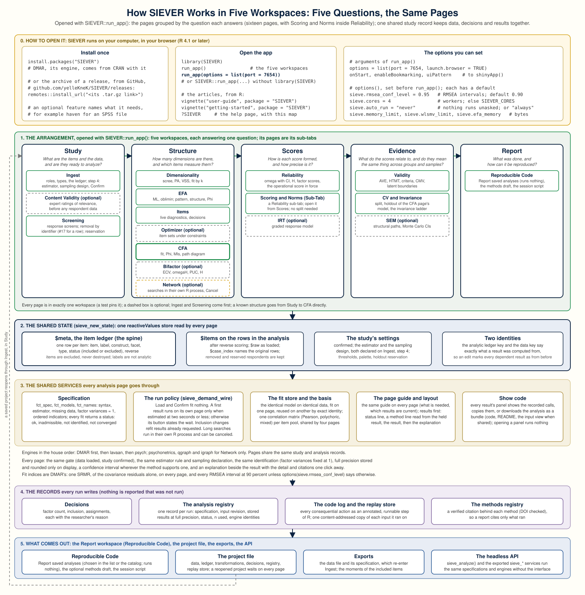

```{r setup, include = FALSE}
knitr::opts_chunk$set(collapse = TRUE, comment = "#>", fig.width = 6.5, fig.height = 4)
set.seed(1)
```

This guide is organized by what a researcher is doing, page by page, with
the pages named as they appear in the application. It is written to be
complete enough that a study can be run in SIEVER from it, and it explains
the methodology at the point where a page uses it. The guided session on the
bundled example is `vignette("getting-started", package = "SIEVER")`; this
guide is the reference you return to when a control, a status line or a
coefficient needs explaining. Every statement here about what the
application does, what a control is called, what runs by itself and what a
default is was checked against the source of this version of SIEVER.

The other articles take up what a page does not:

* `vignette("scripted-workflows", package = "SIEVER")`: the analyses and a
  reproducible session run from an R script.
* `vignette("item-wording", package = "SIEVER")`: attaching item wording
  in R, beyond an SPSS file.
* `vignette("validation", package = "SIEVER")`: SIEVER's numbers checked
  against lavaan, DMAR and derivations written out in the open.
* `vignette("standards-crosswalk", package = "SIEVER")`: each output mapped
  to the chapters on validity, reliability/precision and fairness of the
  Standards for Educational and Psychological Testing (AERA, APA, & NCME,
  2014), with the evidence those chapters call for that SIEVER does not
  provide.

## What SIEVER Is and Is Not

SIEVER (Scale Item Evaluation and Validation Environment in R; say it as
"siever," one who sieves) is an environment for theory-informed and
evidence-supported psychometric decision making. It does not automate
psychometric judgment; it makes that judgment more informed, transparent,
reproducible and defensible. The unit of work is a continuing scientific
project: a construct's meaning and intended use, the item content, the
alternative item sets and models, the score definitions, the evidence and
its uncertainty, the researcher's decisions, and the evaluation of those
decisions on data that did not shape them.

Four commitments hold on every page.

* **The researcher decides.** Flags, reference values and conventions
  inform; nothing removes an item or a respondent by itself. Items are
  excluded and included (never deleted); respondents are removed and
  restored (the source file is never changed). Every exclusion and removal
  carries a reason that is kept in the record.
* **No coefficient establishes validity.** A favorable omega, a fit index
  with its interval or an HTMT well below 1 is evidence to weigh;
  none of them declares a scale valid. The reference values shown on the
  pages are labeled as conventions for orientation, with the citation that
  supports each, and they are never verdicts.
* **Explanations at the point of use.** Each result is followed by its
  explanation: the first paragraph is visible, and the rest is one labeled
  click away. Every displayed statistic says what model produced it (the
  Items page's live EFA, for example, names its extraction, rotation,
  number of factors, correlations and n in one line above the grid).
* **Every number can be traced.** A Show code panel beside each result
  holds the actual call that produced it, the analysis registry records
  every analysis with its inputs and software versions, and the session
  script accumulates the R equivalent of every action.

### The Engines

SIEVER resolves specifications, transformations and the bookkeeping of
uncertainty around three estimation engines, and it never reimplements what
they provide.

* **DMAR** supplies the reliability coefficients and their intervals, the
  bifactor indices, HTMT, AVE, the common method variance builders, the
  content validity indices, ECVI, the AIPE planners, measurement invariance,
  alignment and dMACS, and every exploratory factor analysis: the EFA
  page's solution (`DMAR::fa_exploratory()`, with intervals for the rotated
  solution) and number of factors comparison (`DMAR::factor_count()`), the
  Items page's live exploratory model, the solutions behind the
  Dimensionality page's Very Simple Structure and the Optimizer's simple
  structure (all `DMAR::fa_exploratory()`), and the Dimensionality page's
  parallel analysis (`DMAR::parallel_analysis()`); coefficient H and its
  interval are computed by SIEVER from the lavaan one-factor fit.
* **lavaan** fits every confirmatory latent variable model: the CFA, the
  structural model, the bifactor model, the invariance ladder, the
  categorical model the IRT page reads, and the exploratory models whose fit
  indices the Dimensionality page reports (`lavaan::efa()`, used for fit
  indices only); DMAR's exploratory analyses are lavaan fits as well.
* **psych** supplies the polychoric, tetrachoric and mixed correlation
  matrices the pages share, and the skewness and kurtosis of the Screening
  page. SIEVER uses psych only where neither DMAR nor lavaan covers the
  routine. No exploratory solution is psych's, and no SIEVER computation
  needs GPArotation.

The embedded color palettes require no palette package, the app uses the
system's fonts (Source Sans 3 where it is installed), and nothing calls an
external service unless you authorize a provider review from the Scientific
task assistant with your own key. The EFA page's solution when it is
estimated above two seconds, its number of factors comparison, the
Dimensionality page's parallel analysis and Very Simple Structure when each
is estimated above two seconds, its model fit by k, the Items page's
exploratory factor analysis when it is estimated above two seconds, and the
Network search run in a separate R process (callr, which SIEVER imports),
so a long computation leaves the session usable and can be canceled.

## Starting

### Installing and Launching

Install SIEVER from CRAN (DMAR, its engine, comes with it), then launch
the environment from R:

```{r install, eval = FALSE}
install.packages("SIEVER")
library(SIEVER)
run_app()
```

The source is at <https://github.com/yelleKneK/SIEVER>, and the archive of
each release, the file submitted to CRAN with these articles built, is
attached to its release there. `remotes::install_url()` installs the
archive with the packages SIEVER imports, from CRAN; the remotes package
is not installed with SIEVER, so install it first:

```{r install-github, eval = FALSE}
install.packages("remotes")
remotes::install_url(
  "https://github.com/yelleKneK/SIEVER/releases/download/v0.9.0/SIEVER_0.9.0.tar.gz"
)
```

`run_app()` starts a Shiny application in your browser. Nothing leaves the
machine: SIEVER runs locally, and the one optional external path (a
provider review from the Scientific task assistant) requires your own key
and your explicit authorization of the exact payload.

### Options You Can Set

`run_app()` passes `options`, `onStart`, `enableBookmarking` and `uiPattern`
to `shiny::shinyApp()`: `run_app(options = list(port = 7654,
launch.browser = TRUE))` chooses the port and whether a browser opens.
It takes no other argument, and one it does not take stops the call before
the app starts, with the place the setting belongs: `run_app(port = 7654)`
says the port goes inside `options`, and `run_app(sieve.cores = 4)` says to
set `options(sieve.cores = 4)` first. There is no `workspaces` argument,
since the five workspaces are the only arrangement of the pages.

Six settings are read with `getOption()`. Set them with `options()` before
`run_app()`, or before a SIEVER function is called; they hold for the R
session, and each has a default, so none needs to be set.

| Option | What it sets | Default |
|:---|:---|:---|
| `sieve.rmsea_conf_level` | The level of every RMSEA interval and of the interval of the unbiased SRMR beside the SRMR (see Reading SIEVER Beside Other Programs); every other interval is at 95% unless a page's confidence level input sets another. | 0.90 |
| `sieve.cores` | The number of worker processes for the work that runs on several: the bootstraps, the Items page's diagnostics, and the exploratory fits by number of factors (the parallel analysis runs in one process). A setting is honored up to 64. The Dimensionality page's Workers input starts at it and goes up to the option's value when it is set, and otherwise to the default computed with a ceiling of 64 rather than 8. The environment variable `SIEVER_CORES` is read when the option is not set. | The machine's cores less one, at most 8; 1 on Windows; at most 2 under `R CMD check` |
| `sieve.auto_run` | What runs without being asked (see The Run Policy): `"never"` makes every result wait for its button, and `"always"` runs a first result on its page whatever its estimated time. | A first result runs by itself when estimated at two seconds or less |
| `sieve.memory_limit` | The memory, in bytes, that one fit may plan to hold at its peak, estimated before it starts. A larger fit is refused with its estimate and the ways forward. | Three quarters of physical memory |
| `sieve.wlsmv_limit` | The estimated peak memory, in bytes, that one fit of ordered items may need, when it should differ from `sieve.memory_limit`. The estimate counts about twenty working copies of the weight matrix of the thresholds and polychoric correlations and the casewise scores, which grow with the number of respondents. | `sieve.memory_limit` |
| `sieve.efa_memory` | The memory, in bytes, that the exploratory workers running at once may plan to hold. It limits how many run at once, never whether a solution is fit. | 8e9 |

```{r options, eval = FALSE}
options(sieve.cores = 4, sieve.auto_run = "never")
run_app(options = list(port = 7654))
```

### The Workspaces and Their Pages

The core path is Ingest, Screening, Dimensionality, EFA,
Items, CFA, Reliability, Validity, and CV and Invariance. With a theoretical
structure the CFA tab can be opened directly after Confirm; nothing on it
waits for the Dimensionality, EFA or Items tabs. The optional tabs, each
saying so when opened, are Content Validity, Optimizer, Bifactor, Network,
IRT, SEM, and Reproducible Code. Optional tabs carry a lighter label
wherever they sit, and each opens with one sentence saying that nothing in
another tab depends on it and what it adds.

SIEVER opens with five workspaces, each answering one question:

* **Study**: What are the items and the data, and are they ready to
  analyze? (Ingest, Content Validity, Screening)
* **Structure**: How many dimensions are there, and which items measure
  them? (Dimensionality, EFA, Items, Optimizer, CFA, Bifactor, Network)
* **Scores**: How is each score formed, and how precise is it?
  (Reliability (including Scoring and Norms), IRT)
* **Evidence**: What do the scores relate to, and do they mean the same
  thing across groups and samples? (Validity, CV and Invariance, SEM)
* **Report**: What was done, and how can it be reproduced? (Reproducible
  Code)

The map shows how to open SIEVER, the workspaces, the shared study record,
the analysis pages and the outputs.

```{r map-workspaces, echo = FALSE, out.width = "100%", fig.cap = "How SIEVER works in the five workspaces, opened with run_app().", fig.alt = "How SIEVER works in the five workspaces: how to install and open it and the options you can set, the workspaces Study, Structure, Scores, Evidence and Report with their pages, the shared state and services, the records, and the outputs."}

```

Every page retains its name and navigation value. Existing projects and
bookmarks remain supported. Scoring and Norms is inside Reliability and
has a direct link from the Scores heading. A workspace groups related
questions; any page can be opened at any time.

The Study workspace also offers a **study goal** ("Not chosen yet,"
"Develop or revise an item pool," "Evaluate a specified measurement model,"
or "Score an established instrument"). Choosing one shows a suggested route
through the workspaces, with a direct link to the first analysis. Choosing a goal computes nothing, changes
no data, model or setting, is kept for the session only (not in the project
file), and does not establish that a structure was specified in advance.


### The Project Bar

The project bar sits above every page. It holds the
**Project name**, **Save project**, **Save project as**, **Open project**
and **Scientific task assistant**, with a status beside them ("No project
loaded," "Saved copy acknowledged," or "Changed / download not confirmed").

In a browser, saving prepares a download under the project name; the
browser chooses the destination and may rename an existing file. SIEVER
cannot verify that the browser kept the file, so after keeping the download
you acknowledge it with **I have kept this download**, which clears the
changed indicator for that copy and for nothing later. Save project as asks
for a distinct name for a separate copy. Open project shows what the file
holds before it replaces the current project and offers **Save a copy of
the current project** first. A project file (`.siever.rds`) holds the whole
session: the data as loaded, the item data, the item ledger, the variable
roles, the transformation records, the analysis registry and the session
script.

Two more links sit at the right of the navigation bar. **Exclude / Include
items** opens a dialog for excluding or including items from any page. The
CFA Estimates table and the EFA Pattern and Structure tables open the same
dialog with their selected rows filled in (the button **Exclude or include
items** beside each table), so an item seen to misfit can be excluded where
its result is read. The dialog names the table it was opened from; its
Exclude and Include are the only writers of an item's status, so the reason,
the preview of recovered and lost respondents, the content coverage advisory
and the decision history are the same from every page.
**About and Disclaimer** opens the About dialog: the version, the versions
of the engines this session runs on, the citation, how to tell what SIEVER
is doing (a spinner over a panel or the thin bar along the top of the page
means it is computing; nothing shown means it is waiting for you), the full
statement of the run policy (next section), the core path and the optional
tabs, which arrangement of the pages this session uses, and the no-warranty
statement for research and test software.

### The Page Guide

A compact guide sits in the same place on every page, titled "*Page*:
what's needed here." Its summary line says what the page needs or what
state its results are in: "Still needed: choose the files and press Load on
Ingest (steps 1 and 2)," "Refresh before using: *result*," "Running:
*result*," or "Current inputs verified for: *result*. Returning to this page
does not require another run." When a page's results are from before an
edit, the summary names them and says that the page's one **Update**
recomputes them; the button is in the page's line about results from
before, and the guide has no button of its own. Opening the guide
shows the page's next useful action, the reminder that pages can be visited
in any order once their inputs are ready, and the run policy. Reading the
guide never requests a fit, a correlation matrix, a bootstrap or a
background worker.

## The Run Policy

What runs by itself and what waits for a button is decided by one rule,
written once in the source and stated in the About dialog and in every page
guide. The rule exists because fitting at Load, at Confirm, after every
edit and whenever a page is shown, with nothing on the page saying what is
running or how long it will take, leaves a large study unusable.

**A first result runs by itself only under one gate**: its page is shown,
its estimated time at the standard rates is two seconds or less, the times
measured on this machine do not put it above six seconds, it is the first
result of its kind for the loaded data, and the project was not reopened
from a file. The estimate at the standard rates depends only on the size of
the problem, so the same page behaves the same way on every visit; the
measured times only stop a result that this particular machine would make
slow.

The results that may run by themselves under that gate are:

* the CFA (the CFA page) and the Reliability table;
* the EFA page's selected solution (its number of factors comparison always
  waits for its button);
* the Items page's item diagnostics and overall model;
* the Dimensionality page's parallel analysis and VSS, and model fit
  by k;
* the shared correlation matrix of the included items (Pearson correlations
  take no time and are always computed; a polychoric, tetrachoric or mixed
  matrix estimated above two seconds waits for **Compute the correlations**
  on Screening and Dimensionality, where everything that reads it says it
  waits);
* Harman's single-factor screen on the Validity page.

**Everything else waits for its button**, whose label states the estimate
for this machine, whatever that estimate is: the Validity, SEM, Bifactor,
Network, IRT, and CV and Invariance models, the Optimizer, the reliability planner's
Monte Carlo (**Plan with assurance**, which always waits because a planner
reads no data and so has no first result), and every bootstrap. A result
whose time cannot be estimated waits as well. A button's label is never a
partial estimate passed off as the whole: when one component's duration is
unknown, Update reads "Update (at least *X*; one component of unknown
duration)" (or "Update (about *X* plus one component of unknown
duration)" when the known part is under two seconds; several unknown
components are counted), and when every component is unknown, "Update
(unknown time)."

Two exceptions to the first-result rule:

* The Items page's item diagnostics follow each inclusion, exclusion or
  reassignment by themselves while their estimate is within two seconds,
  because the grid is the working surface for one exclusion after another;
  otherwise they wait for Update. Their exploratory factor analysis is fit
  again after every edit (the reliability of an untouched construct is
  kept), and when it alone is estimated above two seconds (about 9 seconds
  for 68 items at six factors, against 0.3 for the nine bundled tests and 1
  for the 24 at five) Update runs it in a background R process, with its
  elapsed time against the estimate and **Cancel** in the status line; the
  reliability columns follow when it finishes.
* On the EFA page, a selected solution estimated above two seconds runs in
  a background R process once it is asked for, with its elapsed time
  against the estimate and Cancel in the status line; a changed input stops
  it, and a canceled request waits for Run selected EFA.

**After an edit**, a result whose inputs changed is marked as from before,
with one line saying what changed, and is recomputed only when you press
the page's one **Update**, which recomputes in turn every result on the
page the edit made stale (the page guide names it and has no button of its
own). A result
is marked stale only by the inputs its model reads: a facet reassignment
leaves a first-order CFA current (a higher-order or facet model goes
stale), a reversal of an excluded item leaves every model that does not read
it current, and a label or wording edit changes nothing. An inclusion,
type, keying or construct change of a modeled item, a changed value, a
respondent change or a changed setting marks the result as from before.
Bootstraps and other results never requested keep their own buttons.

**Data loaded after other data** get a first result of their own. A result
of the earlier data is withheld from the page with a line saying it is kept
in the analysis registry and the saved-results report. **A reopened project
waits on every page**: its recorded results are in the registry and the
report, and nothing is refit until you press the page's button; each page
says so in one sentence with its button.

**A page that waits still shows an identical fit the session already
holds.** Several pages fit the same correlated-factors CFA to the same data
(the CFA page, the Items page's overall model, the Validity page's
measurement model, the measurement model behind the Reliability page's
factor scores). A session fit store keys every lavaan fit by its exact
identity (the model syntax, the modeled columns and rows, the estimator,
the missing data treatment, the identification, the sampling design and
the engine versions), and a page that computes on request adopts, as soon
as it is shown and without a click, a fit the session already holds under
the identical identity, with the reuse sentence ("Reused the fit from *page*
at *time*"). Nothing is estimated for it, and a reused fit enters no
measured rate. Different models, estimators or rows are never equated; the
store is emptied when data are loaded and is never saved in a project.

## Ingest

Ingest is the way in. Its sidebar is always open and numbered in four
steps, and the pipeline-critical actions are also in the action bar of the
main panel, so they are never hidden by a narrow window: **Load (step 2)**
until a study is loaded, while loading is the next step, and at all times
the Confirm button with its state and a status line naming the step you
are at and the next one. Under its first sentence the status line lists
what needs your attention: the roles and the structure a Load proposed,
warnings from reading the file, the return of the study's estimator to the
item types when step 4 had set another for the data loaded before, and,
when a Load changed nothing, why. These stay until the next Load. A Load that reads a data file raises one
short notification, which the next Load replaces (a file that cannot be
read is reported in the status line alone); a Load of a bundled example
raises none, since the status line says what was loaded and that the study
was confirmed. Once a study is loaded, Load in step 2 of the sidebar says what a
press would do with the chosen files; a Load that would replace the study
asks first and names what would be discarded. A change in the grid (an
exclusion, a type, a construct) takes effect as it is made and needs no
Load.

Notifications in the corner of the window only confirm what just happened
(a run finished, a change was recorded) and last five seconds; a warning
or an error stays until it is dismissed, with the mouse or with Enter,
Space or Escape on its close control, and screen readers announce them.
Anything that needs attention beyond the moment is written on the page.

### The Four Steps

**Step 1. Choose the files.** Five sources: a SIEVER-ready file (a project
`.siever.rds`, or a data file that carries its constructs and facets); a
data file with its specification (two files chosen together); a data file
alone (`.csv`, `.sav`, `.dta`, `.txt`); the bundled example of the
Holzinger and Swineford primary 9 tests (n = 301, 3 factors); or the
bundled full Holzinger and Swineford data (n = 301, 24 tests). A closed
"Delimited file parsing and preview" panel previews the first ten rows of
a CSV or TXT data file and holds how it is read: its encoding (UTF-8 by
default; windows-1252 for what Excel on Windows saves as CSV (Comma
delimited)), which applies whenever it is chosen, and, once **Use explicit
CSV/TXT parsing choices** is ticked, its delimiter and decimal mark. The
choices are recorded in the script, and a file that is not valid UTF-8 is
refused with the encoding to choose there. The encoding chosen for one file
applies to the next, so a file whose bytes are valid UTF-8 and hold an
accented letter or another character outside ASCII is refused under
windows-1252 or `latin1`, with UTF-8 to choose, rather than read with each
such character turned into two to four others. Two checkboxes
govern a file's reading: **Read construct, facet, reverse and question rows
under the header** (on by default; turn it off for a file whose second row
is data) and **Treat an item with five or more response options as
continuous when loading data, applying a specification or opening a
project** (on by default; see the five-option rule below). **Open project
(shows what the file holds first)** opens a saved project from here.

**Step 2. Load.** Press **Load**. The file is read (SPSS and Stata through
haven, which maps user missing values to `NA` and keeps variable labels), a
role is proposed for every column, and the item ledger is built from the
item columns.

**Step 3. Review roles and types.** The **Construct basis** is Theoretical
(researcher-specified assignments) or Empirical (provisional assignments),
applied with **Apply construct basis**. Under a theoretical basis the
Optimizer is unavailable and the specified map is preserved; under an
empirical basis groupings remain provisional and the Optimizer can
generate candidates. Neither basis makes the assignments scientifically
true, and selecting Theoretical does not establish that a model was
specified before data exposure. **Clear constructs to Unassigned** empties
the assignments. A closed panel, "Apply a specification to the loaded
data," takes a specification file and a choice of what the reverse keyed
items in the loaded data are (checked against the specification, as
administered, or already reverse scored).

**Step 4. Confirm.** The **Estimator for every model in the study** is set
here (see "Ordered Versus Continuous" below), and so is the **Sampling
design of the study** (independent rows by default; clustered rows or
repeated observations with the cluster or respondent column), the one
declaration the Reliability, Validity, Bifactor, SEM, and CV and Invariance
pages and the report read: a procedure that assumes independent rows
refuses under another declaration rather than report an interval it cannot
support, and the continuous SEM and CFA paths use cluster-robust inference
for a declared cluster. **Confirm the study (step 4)** confirms the
measurement level of every item, which unlocks the analysis pages. A bundled example whose items are all continuous is
confirmed when it loads, and the button then reads "Confirmed on load" with
a note saying that no press was needed; a file of your own asks for the
press. The Confirm button has three states: before the confirmation,
confirmed (with the study in words, and how it was confirmed), and changed
since the confirmation (with what changed), so that a change that matters
is confirmed again. A type change withdraws the confirmation because it
changes the estimator decision.

### The Bundled Examples

Both bundled examples are the Holzinger and Swineford (1939) data from
DMAR (`holzinger_swineford`): 301 pupils from the Pasteur and Grant-White
schools, so the `school` variable supports an invariance demonstration. The
primary 9 example is the textbook nine-variable subset (the same nine
tests lavaan ships as `HolzingerSwineford1939`'s `x1` to `x9`) seeded with
three a priori factors, Visual, Textual and Speed. The full example holds
all 24 tests with five a priori ability domains seeded as the theory; the
three factor structure is a target the winnowing can arrive at, not the
starting point. The tests are raw scores, not lavaan's rescaled `x1` to
`x9`: correlations and standardized solutions agree with lavaan's data,
covariances and unstandardized loadings do not. Nothing in SIEVER is
hard-coded to this example; it is only the fixture.

### SPSS Files

Prefer an SPSS `.sav` file when one exists. Variable labels arrive as the
Item Names (the short name that follows the item through every table), the
dictionary's measurement level (Nominal, Ordinal, Scale) is read, and value
labels declare an item's response options and the bounds of its response
scale. A note above the grid names any items SPSS calls ordinal or nominal
that the five-option rule typed continuous, with one button that sets them
to ordered.

### The Specification File

A specification is a comma separated table with one row per column of the
data: its role (and, for a criterion, its validity kind), and for an item
its Item Name, wording, type, construct, facet, included or excluded
status, keying direction, the response bounds a reversal is made within,
and whether the data file already holds the item reverse scored. Two
exported functions make the step before SIEVER a script:

```{r specification}
library(SIEVER)
d <- DMAR::holzinger_swineford[, c("id", "school", "t1_visual_perception",
  "t2_cubes", "t4_lozenges")]
template <- sieve_specification_template(d)
template[, c("variable", "role", "type", "construct", "status", "reverse")]
```

`sieve_specification_template()` writes the template with what SIEVER can
propose filled in (the roles, the detected types, the labels, the
constructs and facets a file's names or description rows carry) and what
only the researcher knows left blank. Fill it in, save it beside the data,
and either choose the pair on Ingest (step 1, "Data file with its
specification") or turn the pair into a project from R:

```{r prepare-study}
template$construct[template$role == "item"] <- "Visual"
path <- tempfile("holzinger_", fileext = ".siever.rds")
project <- sieve_prepare_study(d, template, file = path, name = "Holzinger and Swineford")
```

`sieve_prepare_study()` loads the data exactly as Ingest loads a chosen file,
applies the specification through the import's own checks, reverse scores
each reverse keyed item within its bounds, confirms the types when the
specification types every item, and writes a project that opens on Ingest
confirmed. Every problem in a specification is reported at once, and no
file is written until there is none. On the Reproducible Code page,
**Download specification (.csv)** writes the specification of the loaded
study, which the Apply a specification panel can read back.

### The Item Grid

The grid lists the items, one row each, and everything in it is edited in
place. **Type** is the measurement level (auto detected, then adjustable
from the cell; the line under each Type cell says whether the type is
proposed or your choice and gives the item's response options and skew,
with the category counts on hover). **Construct** and **Facet** are theory,
not data: type-to-create comboboxes backed by a shared list, so once a name
is typed it is a dropdown suggestion in every other row. **Item Name** is
the researcher's editable label, which follows the item downstream;
**Variable** is the syntactic column name. **Question** shows the wording
the file or the specification carried (the full text on hover). **Use** is
Included or Excluded; an excluded item moves below the "Items excluded"
line, leaves every analysis, and is never deleted. **Reverse?** set to Yes
reverse scores the item within its response bounds; when none were
declared, its observed minimum and maximum are used, the row says so, and
the bounds are stored with the item. Columns are drag resizable, and
**Reset column widths** clears the browser's remembered widths.

A row of type controls sits above the grid: **Five or more options:
continuous** and **Four or fewer options: ordered** set every item with
that many options at once, and **Set the type of** sets every included
item, or the items of one construct or one facet, to ordered or continuous.
Below the grid, a batch assignment control takes a set of items by their
stable variable identifiers.

A pool of hundreds of items is easier to narrow by list than row by row.
Under **Include or exclude items from a pasted list**, above the grid,
paste item names: a column copied from a spreadsheet, or names separated by
commas, semicolons or tabs. **Exclude these** excludes the listed items,
**Include these** includes them, and **Include only these** includes them
and excludes every other item. Each entry is matched to a Variable Name as
written, then an Item Name as written, then either one ignoring case, then
an item's wording ignoring case. An entry that names no item as a whole and
holds commas or semicolons is read as several entries, so a wording that
holds a comma still matches whole; one that holds spaces is read as several
names when each names an item. An entry that matches no item, or more than
one at the step that decides, is listed under the buttons and changes
nothing. **Undo the last list** puts back the Use each item had before the
last of the three buttons, except an item changed again since, which is
named and left as it is; a Load or an opened project leaves no list to
undo.

A file often holds an item twice: as administered and reverse coded beside
it, saved under a name that adds a marker to the original's (`q5` and
`q5_r`, `q5r`, `q5.rev`, `q5_reversed`, `q5_rc`, `rev_q5` or `rq5`; case is
ignored). Both carry one response, so including both counts it twice, and
the one to keep is the one keyed with its construct. That is read as for a
corrected item-total correlation, from each member's correlation with the
mean of its construct's other included items (every item paired by name
with either member left out): the member whose correlation is positive is
the keyed one. One member's correlation decides when only it can be read
(its construct is assigned and has at least two other included items); when
both are read and have the same sign, neither runs against its construct as
the other's reversal would, and the pair is not proposed. When neither can
be read, the name decides: a file reverse codes the items worded against
their construct, so the copy is taken to be the keyed one, and the note
says so. A note above the grid lists each pair whose values run opposite
(their correlation on the cases that answered both is negative, or positive
when exactly one of the two is reverse scored in the session) and whose
copy is the keyed one, with that correlation, n and how the direction was
read, and **Exclude the originals, keep the reverse-coded copies** excludes
every such original in one step. A pair whose original is the keyed one is
not proposed: the note on the same item twice proposes excluding the copy
when the two correlate at least .98 in absolute value on at least 10 cases,
and otherwise the pair is listed with that reason. A pair whose values do
not run opposite, and a copy of a copy (`q5_r_r`), are listed apart and not
proposed. Every one of these changes is a step of the reproducible code,
and the excluded item's Use cell gives the reason.

The **Variable roles** panel lists every column with its role: an **item**
belongs to the pool; an **identifier** names the rows; a **group** defines
the groups of a multiple group analysis; a **criterion** is an external
variable the scores are related to (with a validity kind: convergent,
discriminant or criterion related); an **antecedent** exists before the
target construct and enters the SEM as an observed predictor; an
**auxiliary** variable is kept with the data and used for none of these:
it enters FIML fits as a saturated correlate (Graham, 2003) when an
analyzed item has a missing value, and is left out when every analyzed
item is observed in every row, since it then adds no information. The
method lines of the CFA, SEM, Validity, Bifactor and Reliability pages
(and of Reliability's factor scores) then say that it was not used, and so
does the recorded R of each fit.
Roles are proposed from each column's name and values when a file is read
(a numeric column is proposed as an item unless it looks like an identifier,
a grouping variable, or a background variable or outcome; a column not
stored as a number is never an item), and they are proposals to review, not
decisions, so an identifier or a criterion does not enter the item pool.
Change a role in the grid's Role cell or by name in the "Set a role by name"
editor.

The **Ledger summary** panel shows the items by construct and facet (the
included and excluded counts, the types of the included items, the reverse
scored items), each item with its question, and the seeded theory. The
**Dataset overview** panel shows a summary table, the distribution of any
one variable (a bar per value for a whole number variable with at most 20
distinct values, including the declared response points no one chose as
empty bars; a histogram otherwise; the subtitle gives n, the number
missing, the mean and the SD), and the variables that are not items with
their roles.

### Ordered Versus Continuous: What the Type Changes

The type of each item decides how its associations are estimated and which
estimator the models use. An **ordered** item (a rating scale with a few
points) or a **binary** item is modeled through the polychoric (or
tetrachoric) correlations of its latent response, and every model that
includes such an item is fit with WLSMV (diagonally weighted least squares
with a mean and variance adjusted test statistic) on the complete cases. A
**continuous** item is modeled through Pearson covariances with maximum
likelihood (ML) and full information maximum likelihood (FIML) for missing
responses, so an incomplete case still contributes. ML with FIML is DMAR's
default and SIEVER's; its
standard errors and test statistic are normal theory, and robust maximum
likelihood (MLR) with FIML is the choice for markedly non-normal items (see
the Estimator control below).

**The five-option rule.** An item with two distinct values is proposed as
binary, one with three or four distinct integer values as ordered, and one
with five or more distinct values (or values that are not integers) as
continuous. Rhemtulla, Brosseau-Liard and Savalei (2012) found that with
five or more categories, estimation that treats the items as continuous
performs comparably to the categorical estimator in many conditions,
especially when the thresholds are roughly symmetric, and avoids the
categorical estimator's cost (a polychoric matrix per item pool, a weight
matrix that grows with the square of the number of thresholds and
correlations) and its listwise deletion; with fewer categories, or with
strongly asymmetric thresholds, the categorical estimator is more accurate.
With the step 1 checkbox on, the rule also holds for a type a
specification gives and for an opened project's proposed types; a type you
chose is kept, and the note above the grid names any item switched when a
project is opened, with one click to keep it ordered. The proposal is yours
to change in any Type cell.

**The Estimator control.** The study's estimator is chosen once, in step 4,
and every page that fits a model offers the same control with one more
choice first, "The study's estimator (set on the Ingest tab)." The choices
are: follow the item types (ML with FIML, DMAR's default, when every item
is continuous, WLSMV when any is ordered or binary); MLR with FIML, every
item treated as continuous; ML with FIML, every item treated as continuous;
ML on the complete cases, every item treated as continuous; WLSMV on
polychoric correlations, every item treated as ordered. The guidance is
conditional: ML with FIML is the treatment of incomplete cases under
missing at random (Enders & Bandalos, 2001), and its standard errors and
test statistic (with the chi square, RMSEA and CFI built on it) are normal
theory; MLR keeps those
estimates and adds sandwich standard errors and a scaled test statistic
(the scaled and robust families of the fit indices), the choice for
markedly non-normal items, which inflate the normal-theory chi square and
RMSEA and lead its standard errors to be understated (Curran, West & Finch,
1996; Yuan & Bentler, 2000). The Screening page's guide to its skewness
and kurtosis table names MLR as the choice for markedly non-normal items;
SIEVER never switches to it on its own. MLR needs more respondents than free parameters (a fit that fails this
is refused before it starts, with the ways forward); ML on the complete cases is the
comparison when the missing at random assumption is in doubt, not a small
sample rule; WLSMV estimates a threshold per category boundary and the
polychoric correlations of every pair on the complete cases, and a fit
whose estimated peak memory (about twenty working copies of its weight
matrix, plus casewise scores that grow with the number of respondents)
exceeds `sieve.wlsmv_limit`, by default three quarters of physical memory,
is refused before it starts, with the ways forward.

Under ML with FIML, lavaan reports the standard model chi square, and its
robust CFI, TLI and RMSEA are the incomplete data corrections of Zhang and
Savalei (2023), not corrections for non-normality (with no value missing
they equal the standard ones); the fit tables name the family of every
value.

### Response Bounds and Reverse Coding in the Grid

The response bounds and the reverse coding of the items are edited in the
item grid, as every other attribute of an item is.

**Response bounds** are the lowest and the highest response the instrument
allowed (1 and 7 on a seven point scale), a fact about the instrument, not
about the sample. A reversal reflects an item within them, `(min + max) -
x`, which flips the scale without changing its range. The observed minimum
and maximum of a sample are not evidence of the instrument's endpoints: a
point that no respondent chose (an endpoint of a skewed item, any point in
a small sample) leaves the observed range narrower than the scale, and a
common observed range across the items shows only that the respondents
used the same points, not what the scale offered. An item reflected within
a range narrower than its scale is placed on a different metric from the
items reflected within the scale, so declare the bounds whenever the scale
is known (Bandalos, 2018). Each item's **Response bounds** cell holds its
declared bounds; type them as `1 to 7` (or `1-7`), and clear the cell to
take them back. When a data file carries value labels (SPSS, Stata) and
every observed response of an item lies within them, the lowest and the
highest labeled values are declared as its bounds at load, and its cell
says so; a cell cleared of them keeps them as its hint (loading the file
again declares them again), and an item with no labels has its observed
range as the hint. Above the grid, **Response bounds
and Reverse? for several items at once** (one line that opens) declares
(or clears) the bounds of every included item, or of the items of one
construct or one facet, at once, with one click to enter the
value labels' bounds in its two fields when every item in scope has the
same (Declare then declares them); a
specification's `rev_lo` and `rev_hi` columns declare them too. Declaring
reverses nothing: it writes the bounds to the ledger, where the next
reversal reads them. When no bounds are declared and an item's observed
range differs from the range most items share, one line above the grid
names the items, and the warning repeats in their cells.

**Reverse?** set to Yes reverse scores an item within its declared bounds,
or otherwise within its observed range, and its Response bounds cell then
shows the bounds of the reversal and which they were; set to No it returns
the item to its scoring. The reversal is an exact involution: the bounds a
reversal was made with are stored with the item, reversing it again uses
the same bounds and returns exactly the original values, and an item
already reverse scored is never reversed a second time by a specification
or a reopened project. An item recorded as already reverse scored (by a
specification, the description rows, the answer that the file holds it
reverse scored already, or a variable label that says so) is returned to
its scoring within the bounds recorded with it. With no bounds recorded,
Reverse? No is refused until the scale's bounds are typed in its Response
bounds cell, where they can be corrected while its values are as loaded,
since the observed range of the reversed values need not span the scale. The
same line above the grid sets Reverse? for
every included item, or for one construct's or facet's items, at once.
The data as loaded are never changed, and every declaration and reversal is
recorded in the session script and saved with the project.

**Deterministic item writing checks** are on the Content Validity tab (its
Item Writing Checks sub-tab), since they review the content of the items:
the guidelines computable from the text alone, after Bandalos (2018): keep
items short and readable, ask one thing at a time, avoid negations (double
negatives above all), and avoid absolute ("always," "never") and vague
("often," "sometimes") quantifiers. Each check is a plain string heuristic
run on this machine only; the reading grade is an approximate
Flesch-Kincaid level, and items above grade 12 or beyond 20 words are
flagged as hard to read. A flag is a place to look, not a verdict. Items
need wording to be checked (see `vignette("item-wording", package =
"SIEVER")`).

**Reverse keyed items per construct**, on the Ledger summary panel, reports
the count of reverse keyed items per construct. Reverse keyed items are a
design choice, not an accident: none (avoiding the method factor that mixed
keying induces) or enough to detect acquiescent responding, never a single
stray one. The table only reports the count. From R, the same two checks
are `sieve_wording_checks(meta)` and `sieve_reverse_balance(meta)`.

## Screening

Screening is the first quantitative look at the items, run before
dimensionality assessment, EFA or any factor model: each item's
distribution, the pattern of missing data, the redundancy structure among
the items, and how each item relates to the rest of its intended scale.
Poorly behaved items are best diagnosed now, because they distort the
correlation or covariance matrix every later factor model is fit to.
Screening is diagnostic, not confirmatory. Excluded items are not shown;
identifiers, groups, criteria and auxiliary variables are summarized under
Other variables and never plotted.

**Descriptives.** Per item mean, SD, skewness, excess kurtosis, percent at
floor and ceiling, and the number of distinct values. Curran, West and
Finch (1996) simulated moderate (skewness 2, excess kurtosis 7) and severe
(3 and 21) non-normality: the ML chi square was already inflated under the
moderate condition, while the Satorra-Bentler scaled statistic stayed close
to its expected value. Items are flagged when |skewness| exceeds 2 or
|excess kurtosis| exceeds 7 (the moderate condition, a reference value, not
a rule), for near-zero variance, or for missingness over 20%. Read the table
as a triage list: a flagged item is a candidate for revision or reverse
scoring, not an automatic exclusion. For a pool of 20 items or fewer, each
item's response distribution is drawn below the table.

**Missingness.** Percent missing per included item, drawn in the order of
the heatmap. The amount of missing data is only part of the story; the
mechanism matters more. Missing data treatment is specific to each
analysis (FIML for eligible continuous ML models; complete cases for
ordered items), so read the actual method and analytic n beside each
result.

**Correlation heatmap.** The type appropriate inter item matrix: Pearson
for continuous items, polychoric when any item is ordered, tetrachoric
when all are binary (Olsson, 1979, on the attenuation a Pearson correlation
of coarse responses carries). This is the one matrix the Dimensionality,
EFA and Items pages share, computed once per data and item set; a label
edit, a display control or a visit to another page recomputes nothing.
Pearson correlations are always computed; a polychoric, tetrachoric or
mixed matrix estimated above two seconds (or of a reopened project) waits
for **Compute the correlations**, whose label states the estimate. Items
are ordered by construct, then facet, with a heavy line between constructs
and a light line between facets, so a coherent facet shows as a dark block
on the diagonal. The controls change the display only: the scope (all
items, one construct or one facet), a highlight slider that grays every
tile below the chosen |r|, the coefficients in the cells, and a correlation
table view (rounded for display; the CSV holds full precision). When the
items have facets, **Box the within-construct and within-facet
correlations** outlines the blocks on the diagonal: in the heatmap a dark
box around each construct's correlations among its own items and a gold box
around each facet's, the separators then drawn light; in the table the same
blocks shaded and bordered, kept right when the table is sorted. The figure
downloads as PNG (300 dpi) or PDF, the matrix as CSV, and a pair control
reports one correlation with its kind and n. A key to the axis labels gives
each item's variable, full name, construct, facet and wording. A very
high |r| can mean that two items are near redundant or locally dependent;
the page names the three largest correlations between two items and
applies no cutoff.

**Item-total.** The corrected item total correlation within construct: the
Pearson correlation of each item's observed scores with the mean of the
other included items in its construct, the item itself excluded (no model
is fit here). The total is the mean, not the sum, computed pairwise, so a
case missing some items still contributes. A value below about .30 marks an
item that does not cohere with its intended construct (Clark & Watson,
1995). Select rows, give a reason, and press **Exclude the selected items**;
the change is the one the Ingest grid's Use cell makes, and **Include the
selected items** reverses it. Every exclusion shows a content coverage
advisory when it leaves a construct or a facet with no included item.

**Observations.** Two cards. "Respondents in the analysis, and those
removed" lists one row per respondent of the data as loaded, with the
original row (stable even when identifiers are missing or duplicated).
Select rows, write a **Reason for removing or restoring**, and press
**Remove the selected respondents** or **Restore the selected
respondents**; a removal asks for its reason when the box is empty, says
where to restore, and reaches every result that keeps one (an older result
names who was removed or restored, with n then and now, and a restore gives
back the first results exactly). A restored respondent keeps their place on
the response scale, and an off-scale restore is refused with the reason.
The ledger downloads as CSV. The second card is the validation reservation,
described next.

### The Validation Reservation

A validation sample estimates how a model fitted and selected on one sample
would fare on another only when it played no part in fitting or selecting
the model (Browne, 2000; Cudeck & Browne, 1983): a split drawn after the
full data were examined is a split of data already examined. The
**Validation reservation (optional)** card therefore draws a proportion of
the respondents, by a seed and optionally within the levels of a grouping
variable, *before* the structure and the items are examined. The reserved
rows leave the analysis through the respondent path with the reason
"reserved for validation" and a marker, so every development result (the
shared correlation matrix, Dimensionality, EFA, Items, CFA, Reliability)
reads the calibration rows only and can say so beside its n. The ordinary
Restore refuses a reserved row; only the **Release** button returns them
(it names the count, "Release the 90 reserved rows", and asks before it
releases, since a release cannot be undone), after which the reservation's
protection of an evaluation is gone.
Set the proportion (0.3 by default), an optional seed, an optional grouping
variable, and press **Reserve**.

The sizes: the reserved count is `round(n * proportion)`, with or without
a grouping variable. With one, the count is allocated across its levels by
largest remainder (Hamilton's proportional allocation): each level first
reserves the whole part of its quota, `n_h * proportion`, and the rows that
remain go one each to the levels with the largest fractional parts, the
seed choosing among levels whose fractional parts tie. The total is exact
and every level is within one row of its quota; a missing group value forms
a level of its own. A reservation is refused,
before any row is drawn, when a half would have fewer than 20 rows or when
the smaller half cannot carry the current model under the study's
estimator. One drawn after development results exist (a Dimensionality,
EFA, Items, CFA or Reliability result, or any recorded model fit; this
page's own descriptives, correlations and respondent screens are screening,
not development) is allowed and recorded as "reserved after development
began," with the results that preceded it listed, so a reader can judge the
exposure. The Standards (AERA, APA, & NCME, 2014) ask that a validity claim
rest on evidence gathered for the interpretation proposed; the sample that
shaped the item set cannot supply, on its own, evidence that the item set
generalizes beyond it. Fitting a CFA on the CFA page does not make the model
confirmatory; a model is confirmed by data that did not shape it. The seed,
the proportion, the grouping variable and the rows drawn are kept with the
project and in the session script, which draws the same rows from the same
seed. The two exported helpers are Shiny free:

```{r holdout}
sieve_holdout_sizes(301, proportion = 0.3)
sieve_holdout_sizes(301, proportion = 0.3, strata = DMAR::holzinger_swineford$school)
```

### Careless Responding

Survey data routinely contain respondents who answer without reading:
straight-liners, pattern responders and random responders. Left in, they
attenuate correlations, distort factor structure and can manufacture
spurious method factors, so screening for them precedes any psychometric
modeling (Meade & Craig, 2012). Three row-level screens are computed on the
selected items. **Longstring** is the longest run of exactly equal raw
responses among the selected items in the data file's column order, before
reverse scoring (Johnson, 2005); a missing response breaks a run unless you
choose to skip it, and the run cutoff defaults to half the selected items,
rounded up. **Within-person response variability** is the SD of a
respondent's raw responses, flagged at or below the cutoff (0 by default).
**Mahalanobis distance** is computed on the complete cases on the selected
items and read against a chi square tail (p < .001 by default), a
descriptive approximation rather than an exact reference for ordinal or
non-normal responses. Set the items and cutoffs in "Define the
response-pattern screens" and press **Apply screen definition**. The
flagged respondents are listed worst first, with the number of screens
flagged (of 3) and which; a respondent can be flagged by more than one.
Select rows, or type identifiers, write the reason, and press **Remove
from the analysis**; the "Removed respondents" table has **Restore the
selected**. With an identifier column, a typed entry is read as an
identifier only, and a row of the data as loaded is named with a leading
`#` (`#17`), so a mistyped identifier that happens to be a valid row number
removes no one; without one, every entry is a row. The line under the box
names, as you type, the respondent each entry resolves to (identifier and
row) and the entries that name no one, before anything is removed. A flag
never removes a respondent by itself.

## Content Validity (Optional)

Content validity is evidence about the items, not about the data: does the
candidate item pool cover the construct it claims to measure? The evidence
is the judgment of a panel of subject matter experts (conventionally five to
ten; Lynn, 1986), each rating every candidate item for relevance to the
construct as it has been defined, on the 4 point scale (1 = not relevant to
4 = highly relevant), before any respondent data are collected (Polit &
Beck, 2006; Bandalos, 2018). No factor analysis can repair a pool that
omits part of its domain, because a structure fit to the wrong items still
fits. The page therefore computes from a ratings file (items in rows,
experts in columns) without respondent data; **Download Template (.csv)**
gives the layout, and with the bundled nine test example loaded an
illustrative rating sheet is offered. A numeric first column is read from
its header and values: the header item (or id, name, variable) makes it
the item identifiers, a header naming an expert (expert, rater, judge,
reviewer, panelist, sme, or e1, r2 and the like) makes it an expert, values
a relevance rating cannot take make it identifiers, and repeated values make
it an expert. Distinct whole numbers from 1 to 4, which a small pool's
identifiers and an expert's ratings can both be, are not guessed: **The
first column of the file holds** (under the file box) states it, and a change
reads the file again. A blank or repeated item identifier is refused with
its rows, because the identifier says which ledger item a row rates.

Every rating statistic comes from `DMAR::content_validity_index()` (the
Item Writing Checks sub-tab, described under Ingest, reads the item wording
rather than the ratings): the item level
content validity index (I-CVI, the proportion of the panel that called the
item relevant, with 3 and 4 counted as relevant by default) with its exact
Clopper-Pearson binomial interval at the chosen confidence level, the
modified kappa, which corrects the I-CVI for chance agreement (Polit,
Beck, & Owen, 2007), Lawshe's (1975) content validity ratio (CVR), and the
scale level summaries S-CVI/Ave and S-CVI/UA (Polit & Beck, 2006). Lynn
(1986), as Polit and Beck (2006) summarize her, proposed an I-CVI of 1.00
with five or fewer experts and of at least 0.78 with six to ten, a CVR above zero means that more than half
the panel called the item essential, and Polit and Beck (2006) proposed
0.90 for S-CVI/Ave; the page names these conventions as context and
applies no cutoff, so every value is shown uncolored beside its interval.
The "Write to the
Item Ledger" panel matches rated item identifiers to ledger variables
(review the proposed matches, or set them one at a time), **Record I-CVI in
the Item Ledger** writes the index as a note on each matched item, and
**Exclude the Selected Items** excludes the items whose rows you select,
after a confirmation that lists each I-CVI with its interval and records
the reason; no item is selected for you. The rows, wording and notes are
kept, so the decision is reversible on the Items page.

## Dimensionality

Deciding how many factors to retain is the first inferential step in scale
construction and is settled before the EFA is interpreted, because the
rotated solution, the pattern of loadings and every downstream reliability
and validity claim are conditional on that count. Over-extraction splinters
a coherent construct into minor, unreplicable factors; under-extraction
collapses distinct constructs and inflates cross-loadings.

**No single rule is definitive, and no vote among rules is either.** The
criteria fail in different ways; read each for what it assumes, note where
they agree and where they do not, and decide in light of the theorized
structure and the interpretability of the competing solutions. Disagreement
among the criteria is a finding, not a problem to be averaged away. SIEVER
reports the evidence criterion by criterion and records your decision with
your rationale; it does not choose the number of factors.

* **Parallel analysis** (Horn, 1965) counts a factor only while its
  empirical eigenvalue exceeds the eigenvalue of the same rank from data
  with no common factors. SIEVER runs it with `DMAR::parallel_analysis()`
  on factor-analytic eigenvalues (the correlation matrix reduced by the
  communalities of a fixed one-factor maximum likelihood solution,
  `stats::factanal()`, every reference dataset reduced the same way), not
  on principal components. The reference value is the 95th percentile of
  the reference eigenvalues (Glorfeld, 1995; the default) or their mean
  (Horn, 1965); DMAR reports the Monte Carlo limits of the percentile
  (binomial order-statistic limits at 95%), which say how precisely the
  number of reference datasets fixes the reference, and which are not an
  interval for the observed eigenvalue or for the count. The reference data
  are independent normal responses (for ordered items, categorized at each
  item's observed category proportions and analyzed with polychoric
  correlations, as the items are; DMAR's default reference and the page's,
  so for ordered items too the reference data resemble the real items in
  their response distributions, as Garrido, Abad & Ponsoda, 2013, advise),
  or the observed responses resampled item by item and analyzed with the
  same correlations as the items (the Auto choice takes this reference
  when any item is ordered or binary). DMAR forms the correlations from the item
  responses for continuous items (the Pearson correlations of the complete
  cases, or the saturated FIML matrix of `DMAR::cov_fiml()` with the
  complete-case N as a stated benchmark reference size) and for a pool whose
  every item is ordered or binary (polychoric correlations through
  `lavaan::lavCor()`, the two-step estimator of the page's psych matrix;
  on the bundled tests cut to five categories the two matrices differ by
  2e-5); the mixed matrix, and a FIML matrix with auxiliary variables, are
  passed to DMAR as a matrix with their reference N, and then only the
  normal reference, analyzed with Pearson correlations, is available, with
  the caution that it can set the bar too low. Reference datasets whose
  reduction fails are counted and left out, as DMAR reports them, and DMAR
  withholds the reference when fewer than half are usable. Which eigenvalues parallel analysis
  should use is not settled: Timmerman and Lorenzo-Seva (2011) found a
  common factor version most accurate, while Garrido and colleagues and Lim
  and Jahng (2019) found the traditional version on the unreduced matrix
  more accurate than the factor-analytic variants they studied, and all
  report that parallel analysis can miss weak or highly correlated factors.
* **Very Simple Structure** (Revelle & Rocklin, 1979) evaluates how well a
  solution of each rank reproduces the correlations when each item is
  allowed only its largest one (complexity 1) or two (complexity 2)
  loadings. Each rank is the maximum likelihood solution of
  `DMAR::fa_exploratory()` on the page's correlation matrix (`S` with its
  N), rotated by direct oblimin from 30 random starts on the recorded seed
  (no rotation at one factor); SIEVER reconstructs correlations as L Phi
  L′, retaining the oblique factor correlations, and evaluates squared
  residuals including the diagonal. This differs from psych::vss(), whose
  ML branch omits Phi and also computes a component-based criterion. A
  rank whose exploratory model has negative degrees of freedom is not fit,
  and a rank DMAR refuses (an improper solution, one that did not converge,
  or a likelihood without a maximum, read by the refusal's class) has no
  fit to compare; the panel and the evidence table name the rank and
  DMAR's reason (`psych::fa()` holds a uniqueness at its bound of 0.005
  and reports loadings for such a rank: on the nine bundled tests, the four
  and five factor solutions). The two complexities are one family of
  evidence.
* **Model fit by k** tracks the RMSEA with its 90% interval (the RMSEA
  level, DMAR's default; the page's other intervals are at 95%), CFI and TLI of
  the exploratory factor model as factors are added, each solution fit by
  `lavaan::efa()`, unrotated, under the estimator in force (the model test and
  the standard and scaled indices do not depend on the rotation, but lavaan's
  robust CFI, TLI and RMSEA of a rotated `efa` object fit by FIML do; see The
  fit line under the EFA page). It is read beside the criteria and gives no
  count: the indices are shown for every k, the RMSEA with its interval
  (drawn as bars in the plot), what it shows is how much each added factor
  improves fit, and no value of an index is applied as a cutoff. The values
  Hu and Bentler (1999) proposed were derived for confirmatory models and do
  not generalize to every model and condition (Marsh, Hau & Wen, 2004);
  Xia (2021) and Finch (2020) evaluated sequential rules of this kind.

The Kaiser eigenvalue-greater-than-one rule is not a criterion here: it
applies to the eigenvalues of the unreduced matrix, over-factors, and has
no inferential basis. The Scree plot panel draws those eigenvalues with a
line at 1 marked as a reference, not a rule, beside the factor-analytic
eigenvalues of the reduced matrix. A rank slider sits above the plot.
**Eigenvalue ranks shown** narrows the plot to a range of ranks, so that
the leading eigenvalues are not compressed by a long tail; it changes only
the drawing, and the parallel analysis figure has the same control.
The reduced series always uses one-factor maximum likelihood communalities
on the diagonal (Fabrigar, Wegener, MacCallum, & Strahan, 1999), from
`stats::factanal()`, the fixed reduction `DMAR::parallel_analysis()` uses,
so it is the parallel analysis's observed series whenever DMAR forms the
same matrix (`psych::fa()`'s ML reduction stops about 1e-5 away on the
same flat optimum). Whatever number a criterion
suggests is an estimate with unknown error; Lim and Jahng (2019) advise
treating the numbers within one of the parallel analysis estimate as
viable candidates, and SIEVER shows that neighborhood as a heuristic range
of solutions worth fitting, not as a confidence interval.

**Settings** (sidebar): the correlations (the study's setting, Pearson, or
polychoric or tetrachoric; a choice here applies to this page only), the
parallel analysis reference value (the 95th percentile, DMAR's default)
and reference data (normal data, DMAR's default), the reference datasets
(1,000 for each kind of reference data, `DMAR::parallel_analysis()`'s
default `B`; fewer give a less
precise reference, which the Monte Carlo limits show, and a quicker run),
the maximum factors to probe
(8), the workers of the model fit by k (separate R processes; the result is
the same on any number of workers), and an optional seed (one is drawn and
shown with the results when the input is empty, and the recorded code, the
`DMAR::parallel_analysis()` calls with every argument, replays it exactly).

**What runs by itself.** Parallel analysis and VSS, and the model fit
by k follow the run policy: a first result for the data runs by itself when
its estimate is two seconds or less (VSS fits one DMAR solution per rank,
point estimates only, whose time grows with the number of items: about 2
to 4 seconds for the 24 bundled tests at eight factors and about 15 for 68
items; a
rank DMAR refuses after its optimizer stops short of convergence can take
much longer, as the nine tests' four factor solution does; a VSS run on
request estimated above two seconds runs in a background R process with its
elapsed time and **Cancel**, and a canceled run keeps nothing) (parallel analysis with Pearson
correlations takes seconds; with polychoric correlations, which are
estimated again for every reference dataset, about 0.03 to 0.2 seconds a
dataset on 6 to 24 items, it can take minutes; at DMAR's 1,000 reference
datasets of each kind parallel analysis is estimated at about 5 seconds for
the bundled nine tests and 8 for the 24, so on the bundled examples it
waits for its button), and otherwise the panel
shows the estimate and a **Run parallel analysis** or **Run the model fit
by k** button. The parallel analysis's estimate counts the respondents as
well as the items, since each reference dataset is drawn at the page's N
and its correlations computed again (measured: about 0.004 seconds a
dataset at 30 items and 2,000 respondents, 0.03 at 20,000), and on the
saturated FIML route it adds the FIML matrix that each DMAR call estimates
again, at the time the page's own matrix took; the estimate is rescaled by
the rate the session's runs measure. A parallel analysis on request
estimated above two seconds runs in a background R process, the EFA
page's mechanism, while the page
stays usable: the status line shows its elapsed time against the estimate
and **Cancel** (DMAR's function reports no progress of its own, so a canceled
run keeps nothing), and a changed setting stops it. The model fit by k runs
in background workers while the page stays usable, with one Cancel. The status line at the
top of the page carries the page's one **Update** after an edit. The EFA
page's fit is that of its own DMAR solution and its number of factors
comparison is DMAR's; at the same count, estimator and cases it reports the
same unrotated model and test statistic as this page's model fit by k, with
the RMSEA interval at 90% on both pages.

**Recording the decision.** The card at the top of the page sets "What the
evidence shows" beside **Number of factors retained**, an optional
rationale, and **Record decision**. Each record keeps the choice, the
rationale (or that none was given), what the evidence table showed at the
time, and the data and item pool in force, and is written to the
reproducible code. A later decision does not erase an earlier one; it is
added as a new record naming the one it replaces. A recorded decision
proposes the EFA page's number of factors (the EFA page says so, and
changing the number there leaves the record unchanged). The "Decision
records" panel lists them and downloads them as CSV.

## EFA

The EFA page fits the exploratory factor analysis with
`DMAR::fa_exploratory()`: the common factor model (never principal
components), fit through lavaan, with Wald intervals for the rotated
solution from rotation-aware standard errors (Jennrich, 1973; Browne,
2001). DMAR is the page's only engine, so the loadings and the fit come
from one model. The page reports the
solution with SPSS parity, in SIEVER's own layout filled with DMAR's
values. The Pattern and Structure tables select rows, and **Exclude or
include items** beside each opens the shared Exclude / Include dialog with
the selected items filled in; after the decision a solution already fit
updates by itself, and the method line says Current, when the solution was
fit, and that it was refit by itself after your item change. The status
line begins with the same words every page uses for where a result stands
(listed in the CFA section).

**Settings** (sidebar, in the order of what each governs). The **Method**:
by default the item responses are fit with the **Estimator** below (ML
with FIML for continuous items, DMAR's default; MLR with FIML or ML on the
complete cases when the study or this page says so; and WLSMV on the raw ordered items when the
items are ordered, as everywhere in SIEVER); **minimum residual (minres)
on the item responses**, DMAR's unweighted least squares on the correlation
matrix (Harman & Jones, 1966), on the complete cases since minres has no
likelihood and DMAR does not delete cases unasked; or **minimum residual on
a correlation matrix**, the matrix route, which fits minres to the
**Correlations (minres on a matrix)** chosen below it (the study's setting:
Pearson for continuous items, polychoric for ordered, tetrachoric for
binary, mixed when the types mix; or the saturated FIML matrix), supplied to
DMAR with its n. A supplied matrix carries no covariance matrix of the
correlations, so on the matrix route DMAR reports the estimates without
standard errors or intervals, and the page says so. Principal axis,
weighted and generalized least squares extraction are not DMAR routes; a
project that chose one opens with the default method and a line saying
what was saved. Then the **Number of factors** (3 by default, or the
number a recorded Dimensionality decision proposes); the **Rotation**, each
a DMAR criterion applied by lavaan's gradient projection algorithm from 30
random starts: direct oblimin (oblique, delta = 0) as the standard, geomin
and quartimin as the other oblique criteria, **target** rotation toward
each construct's items (Browne, 1972; below), varimax (with Kaiser row
weights) and quartimax as the orthogonal options, and none. Promax and
equamax are not offered, since `DMAR::fa_exploratory()` does not offer
them: a saved study or
saved settings that chose promax opens with direct oblimin, the oblique
rotation in its place, and one that chose equamax with varimax, the
orthogonal one, each with a line under the Rotation saying what was saved
and what is in its place. **Hide loadings below** (0.30 by
default), **Sort items by dominant factor (simple structure)** and **Show
the 95% confidence intervals beside the coefficients** change the display
only. Factors are correlated unless you choose an orthogonal rotation,
because real constructs are correlated and forcing orthogonality distorts
simple structure (Thurstone, 1947).

**The selected solution** runs by itself for a first result when its
estimate is two seconds or less (it is then fit in the session, under a
progress message), and otherwise waits for **Run selected EFA** in the
status line, which states the estimate. The estimate counts the items,
the cases and the factors, and, under FIML, the patterns of missing values,
since the likelihood and its robust corrections are evaluated pattern by
pattern (measured: at 18 items and 300 respondents with 10% of each item
missing, 165 patterns, about 13 seconds under MLR where complete data take
1). A solution estimated above two
seconds runs in a background R process: the status line shows its elapsed
time against the estimate and **Cancel**; a changed input stops it, so a
result is only ever shown for the inputs it was fit for, and a canceled
request waits for Run selected EFA. After an edit the status line carries
**Update**. The rotation's random starts are seeded once per request (the
seed is recorded, and DMAR sets it locally, restoring the session's
stream). Show construct and Show facet filter the display only, and
**Download numeric EFA tables (.tar.gz)** writes the numeric matrices with
their limits, DMAR's full parameter table in both metrics, the fit
measures (the manifest records the level of their RMSEA interval) and, when it is current, the
number of factors comparison
(nothing in them is rounded).

**The panels.** The **Pattern matrix** holds each item's standardized
regression weight on a factor, holding the other correlated factors
constant: the unique contribution of that factor to the item, the
coefficients you read for simple structure; beside each is its 95%
interval. The intervals describe the selected rotated solution at the
selected number of factors; they do not include the uncertainty of choosing
that number or rotation. The **Structure matrix** holds the zero-order
correlation between each item and each factor, not partialling the others;
under an oblique rotation it equals the pattern matrix multiplied by Phi,
which is how it is formed from DMAR's estimates (DMAR reports no interval
for it). **Factor correlations (Phi)** is the factor correlation matrix,
with each correlation's interval below it (an orthogonal rotation fixes
them at zero). With an orthogonal rotation the pattern matrix, the
structure matrix and the factor loading matrix coincide.
**Communalities and complexity** gives h2 with its interval (one minus the
standardized residual variance, so the interval reverses that variance's
limits; limits are not clipped to [0, 1]), the uniqueness with its
interval, and Hofmann's (1978) complexity per item. **Variance accounted**
reports each factor's diagonal element of Phi Lambda' Lambda (the column
sum of pattern times structure coefficients, what psych labeled SS
loadings under an oblique rotation), its proportion of the items' total
variance and of the common variance; the factors add to the total
communality, and no cumulative row is shown since the order of the factors
is arbitrary. These are not SPSS's rotation sums of squared loadings (the
column sums of the squared structure coefficients, which with correlated
factors do not add to a total). **Determinacy and H** reports, for each
factor, its determinacy (the correlation of its regression factor score
with the factor; Grice, 2001), whose square is the largest reliability any
weighted sum of the items reaches for it; beside it DMAR's guardrail 2
rho^2 - 1, the lowest correlation two sets of factor scores equally
consistent with the model can have (Guttman, 1955), zero when the squared
determinacy is .50 and negative below; and Hancock and Mueller's (2001)
coefficient H on the factor's own loadings, each item's variance from the
other factors counted as error (Rodriguez, Reise & Haviland, 2016), all
with logit-scale limits and no threshold. For ordered items both describe
the latent responses behind the categories. **Simple structure** reports
item complexity, the hyperplane proportion (the share of loadings with
|loading| < .10) and the counts of pure versus complex items at the
salience cutoff, without a verdict. The **Factor plot** draws each item's
pattern or structure coefficients on any named pair of factors, reusing the
fitted solution without refitting, with hover identification, an expanded
view, PNG and PDF downloads, and the plot's R
(`SIEVER::sieve_efa_factor_plot()`, which reads DMAR's result).

**The fit line** above the tables reads DMAR's `fit_measures` attribute,
which is computed from the unrotated solution of the same model: the chi
square and the standard indices do not depend on the rotation, but
lavaan's FIML-corrected indices of a rotated object do, so every rotation
reports the unrotated fit. It gives the chi-square with its df and p, the
RMSEA with its 90% interval, CFI, TLI and SRMR, and DMAR's version lines
(after FIML, the corrected indices of Zhang and Savalei, 2023; the SRMR of
the covariance residuals). DMAR forms the RMSEA interval at the call's
`rmsea_conf_level` (0.9 by default), separate from `conf_level`, the
level of the coefficients' intervals (95%). This is the conventional
RMSEA interval (Steiger & Lind, 1980; Browne & Cudeck, 1993), whose two
limits settle the tests of close fit and of not close fit at .05
(MacCallum, Browne & Sugawara, 1996); lavaan's summary prints the same
interval, and the Dimensionality page's model fit by k is at the same
level. Under minres the
statistic has no chi-square reference distribution: the line gives N - 1
times the ULS discrepancy with its df, the NFI and the SRMR, and no p-value,
RMSEA, CFI or TLI.

**Number of factors.** This panel is `DMAR::factor_count()` under the same
method and estimator as the solution: the exploratory model at one factor,
two, and so on to the **Largest number of factors** (by default the largest
count whose model keeps a degree of freedom, at most 8), each fit
unrotated. Beside each count are its fit and the test of the previous count
against it (lavaan's difference test, scaled under MLR), its AIC, BIC and
sample-size adjusted BIC with each count's difference from the lowest and
its weight under the **Information criterion of the weights** (BIC by
default; for BIC and HBIC the weights approximate posterior probabilities
under equal prior odds, conditional on the counts compared), the reduced
eigenvalue (beside it, the Dimensionality page's parallel analysis
reference, when that page's run is of the same item pool and the same
correlation matrix; see below), and Velicer's (1976) minimum average
partial. Its RMSEA intervals are at 90% (`conf_level = 0.9`, DMAR's
default for `factor_count()`, which sets only the RMSEA intervals; the
page's other intervals are at 95%). A count whose model does not
converge, or converges to an improper solution, or whose likelihood has no
maximum, is a row with DMAR's reason, not a stopping rule. DMAR applies no
cutoff and chooses nothing; the lines under the table say what each
criterion shows, and the selected and theorized counts are in bold. The
comparison always runs in a background R process, on **Compare numbers of
factors** (whose label states the estimate) or the page's Update, with its
elapsed time and Cancel. The parallel analysis is computed once in the
application, on the Dimensionality page: the reference `DMAR::factor_count()`
carries is `DMAR::parallel_analysis()` with the normal reference on the same
correlations (measured on DMAR 1.1.0: the same draws under the same seed),
so this panel calls `factor_count()` with `B = 0` and reads the
Dimensionality page's run beside its reduced eigenvalues when they are the
same reduction of the same matrix (they agree to 1e-8), naming its
reference and seed; otherwise a line says where the reference is and why it
is not shown. Minimum residual on a polychoric or tetrachoric matrix is
such a case that no setting resolves: the Dimensionality page's run
estimates those correlations through DMAR from the item responses
(`lavaan::lavCor()`), and the page's matrix is psych's estimate, about
1e-5 apart, so the line says so, and that the Method "The estimator below"
(WLSMV on the ordered item responses) reads the run. The Dimensionality page's model fit by k is separate
(`lavaan::efa()`).

**Refusals.** DMAR refuses an improper or unidentified solution rather than
report it: a solution that did not converge, converged to an improper
solution (lavaan's post-estimation check failed), left the rotation-aware
standard errors unavailable, or whose likelihood has no maximum (an error
variance runs off below zero while the likelihood is flat or still
rising). The page reads each refusal by its condition class
(`dmar_efa_no_solution`, `dmar_no_maximum`, and for a target
`dmar_target_invalid` and `dmar_target_unidentified`) and shows DMAR's
reason, with DMAR's full message (for no maximum, the lavaan code that
reproduces the fit) one click below; nothing is shown as a result.

**Target rotation.** With **Target: each construct's items**, each
construct on the Ingest page names a factor, and each item is targeted at
zero on every factor but its own and left unspecified on its own (an item
with no construct is unspecified on every factor); the number of factors
must equal the number of constructs. DMAR checks that the target identifies
the rotation before fitting (Algina, 1980) and refuses one that does not.
The intervals condition on a target fixed before the data were seen.

**FIML differs by design from a two-step route.** With incomplete
continuous items the default estimator fits the raw responses by full
information maximum likelihood: every respondent with an observed item
contributes, under missingness at random given the included items. A
two-step route, which estimates the saturated FIML (EM) correlation matrix
and fits `psych::fa()` to it with the complete-case n, is a different
estimator: the loadings and fit differ, and the FIML fit reports the
number of respondents it used. (On the bundled nine tests with about half
the rows incomplete at random, the loadings differed by up to 0.016.)
`DMAR::fa_exploratory()` and `DMAR::factor_count()` take no auxiliary
variables, so auxiliary variables declared for FIML on the Ingest page
(Graham, 2003) are not used by this route, which then assumes missingness
at random given the included items alone; the method line, the Number of
factors panel and the recorded R say so and name them. Minimum residual on
a correlation matrix uses them when that matrix is the saturated FIML
matrix (the study's setting for incomplete continuous items), without
standard errors or intervals.

**Factor column order and sign.** EFA factor numbers are engine labels that
identify columns within this fit (DMAR names them f1, f2, and so on); the
page prints the actual column order under each matrix. Match whole loading
columns across programs, allowing for different order or signs, then apply
the same mapping to both rows and columns of Phi. Sorting items changes
rows; factor column labels remain the same.

**Show code** sits below the result: the `DMAR::fa_exploratory()` call with
every argument written out (the seed of the rotation starts under the
generator the app used, so the script reproduces the run whatever
generator its session has chosen), the correlations first on the matrix
route, and the readout that builds the pattern, structure and Phi tables
from DMAR's table; the Number of factors panel has its own
`DMAR::factor_count()` call.

## Items

Items is the iterative item refinement workspace: the item pool by
construct with live diagnostics, where an item is excluded by a click,
every diagnostic updates, and nothing is destroyed.

**The model line.** One visible line above the grid states the model behind
the loadings and h2: `DMAR::fa_exploratory()`, maximum likelihood on the
shared correlations of the included items (`S` with the complete-case n),
direct oblimin rotation (delta = 0) from 30 random starts, k = the number of
constructs (or, for a study of one construct split into facets, the number
of facets), with n and the rotation seed. On the bundled tests the
loadings, communalities and factor correlations agree with `psych::fa()`'s
within 6e-5, at the same or a smaller maximum likelihood objective. The
diagnostics read the point estimates only.
DMAR refuses an improper solution (a residual variance below zero) rather
than holding a uniqueness at a bound as `psych::fa()` does, so after an exclusion
that leaves one, the loading, h2 and cross loading columns are empty and
the status line gives DMAR's reason; the reliability columns are computed
as before. When the EFA page's solution is the same model, the
diagnostics read it instead of fitting again, and the line says so: maximum
likelihood (ML or MLR, whose estimates are the same) on the item responses,
every row it analyzed complete, at the Items page's k with direct oblimin,
since maximum likelihood is invariant to the scale of the items and its
standardized solution is then the solution of the Pearson correlations of
those cases. Any other EFA route (WLSMV on ordered items, minres, FIML
with values missing, another k or rotation) is another model, and the line
says how the two differ. This view is exploratory and data driven: it does
not assume the construct assignments are correct and is distinct from the
confirmatory model on the CFA page.

**The grid.** One row per item, grouped by construct, with **loading** (the
item's standardized loading on its own construct's factor), **h2**
(communality), **Construct item-rest r** and **Facet item-rest r**
(corrected: the correlation of the item with the mean of the *other*
included items in its construct, or in its facet within that construct,
the item itself left out; focus a cell or select a row for the analytic n
and the reason an estimate is undefined), **Robust ω if dropped** (the
change in the construct's robust omega, observed denominator, if this item
were excluded; a positive value means reliability would rise without it;
alpha if dropped when the legacy coefficient is chosen in the sidebar),
**max |r|** (the item's largest absolute correlation with another item of
its construct, in the shared matrix whose kind the header names), the
**Diagnostic flags** (load, comm, itc, rel up, dup, and keying), and the
**Cross loading** (a salient off-target loading within 0.10 of the target,
with the other factor named, or "complex"). Low loading is judged by the
size of the loading, so a strongly reverse keyed item is not flagged as low
loading; the keying flag marks a salient loading opposite in sign to the
other items of its factor. Every item-rest r and change if dropped of its
construct then reads a total in which that item subtracts from the common
part: its own negative item-rest r and the rise in omega without it, and
the lowered item-rest r and rises of the correctly keyed items beside it.
So itc and rel up are flagged for no item of that construct until the
keying is resolved, and the note above the grid says that the action, if
the item is reverse keyed, is to set its Reverse? cell to Yes on the
Ingest tab rather than to exclude it. The review brief (below, with
**Include diagnostics**) reads the same flags at the same thresholds. The Basic view keeps the essential
columns; Advanced adds the rest. Select rows and press **Exclude selected**
or **Include selected**; a Construct or Facet cell is edited in place, and
the full wording of the selected item is read in the sidebar.

**Thresholds.** The sidebar's diagnostic thresholds (low loading below
0.40, salient cross loading at 0.30, low communality below 0.30, low
construct item-rest r below 0.30, redundant inter-item r above 0.80) are
screening conventions, not decision rules: they only color the flags, so
changing one is instant and never refits the model.

**Baselines.** Each construct's current robust omega (observed denominator)
is shown above the grid, with the rows it uses (its own rows: by FIML for
continuous items, as on the Reliability tab, so its value does not change
when items of another construct are included or excluded) and the largest
residual correlation of its
one-factor model and the item pair, so "if dropped" has its baseline and a
rise that keeps a large residual pair reads as redundancy rather than
better measurement. The **overall measurement model** (the correlated
factors CFA of all constructs, with its RMSEA interval and AIC; orthogonal
factors and a page estimator are sidebar choices) is stated in one line
with its Show code, so the item-level diagnostics are read in the context of
the whole model.

**Content coverage.** Psychometric item selection can drop items but
cannot identify the content that is then missing, and narrowing a pool
raises internal consistency at the expense of breadth (Clark & Watson,
2019); the Standards ask that the content of each construct remain
represented (AERA, APA, & NCME, 2014). An exclusion that leaves a construct
or a facet with no included item therefore shows an advisory beside the
decision, with the counts before and after and a link to the Content
Validity page, and the note under the grid names constructs below three
included items and facets below two (a facet is identified through the rest
of its construct), including those at zero. Nothing is prevented; the
exclusion stands as you made it. The same count is exported:

```{r coverage}
meta <- data.frame(
  item = paste0("x", 1:6),
  construct = rep(c("Visual", "Textual"), each = 3L),
  facet = c("Spatial", "Spatial", "Closure", NA, NA, NA),
  status = c("active", "parked", "active", "active", "active", "active"),
  stringsAsFactors = FALSE
)
sieve_item_coverage(meta)
```

**The review brief.** "Prepare an Expert Review Brief" gathers one
construct's included items (or every construct) with their wordings and,
optionally, their diagnostics as a structured expert brief or a written
description, for a second opinion or for pasting into a tool of your own.
Nothing is sent anywhere; the brief only formats text you already have.

## CFA

With a theoretical structure the CFA page can be opened directly after
Confirm; nothing on it waits for Dimensionality, EFA or Items.

**Where the result stands, and how an item leaves the model.** The method
line above the tabs begins with the state of the fit, in the same words
every page uses for its results: Current; Running, or Refitting when a
background run replaces a result from before; Update needed; Stopped; Failed;
Not fit yet (Not computed yet for a result that is computed rather than
fit); and Waiting on inputs. A current fit says what the diagram and the
tables below are from (the modeled items and the respondents the fit used)
and whether it was refit by itself after an item was excluded or included.
To leave an item out of this model, and of every other analysis of the
study, select its row on the Estimates sub-tab and press **Exclude or
include items**: the shared dialog opens with the item filled in, you give
the reason, and the model refits by itself; nothing is deleted, and the item
can be included again from the same dialog, the Items page or the navigation
bar. A construct left with one included item leaves the model and is named
in the note above the diagram; whenever the model uses fewer items than
are included, for that or any other reason the note gives, the method line
counts the items the model used against the included items (5 of the 6
included items, for example). When the refit cannot run (a WLSMV weight
matrix above the limit, for example), the line keeps Update needed and says
Not refit with the reason, and the results below stay marked as from before.

**Model choices** (sidebar). The **CFA scope** is Constructs (one factor per
construct with included items) or Facets (a direct first-order CFA of
selected facets as freely correlated factors; a single factor needs at
least three indicators, and no equal-loading constraint is added to
identify a small facet). The **Model structure** is first-order (correlated
factors) or higher-order (construct to facet to items); the direct facet
model is separate from the higher-order model. **Identification** fixes
each factor variance to 1 (free loadings, the factors on a standardized
scale and the items on their own; the completely standardized solution is
a separate output) by default, or fixes a marker indicator to 1. The **Estimator** control and
its conditional guidance are those of the Ingest section; an MLR fit whose
free parameters reach the number of respondents, or whose estimated memory
need exceeds `sieve.memory_limit` (three quarters of physical memory by
default), is refused before it starts, with the ways forward.
The diagram controls change what is drawn and never refit.

The model is fit from **Fit the model** above the tabs (or by itself for a
first result within the run policy), and the page's **Update** refits it
after an edit. The one-line method statement names the estimator and the
missing data treatment that were resolved and why.

**Path diagram.** The page opens on the fitted model: each ellipse a latent
factor, each rectangle an item, each small circle the item's unique term; a
single-headed arrow a loading, a double-headed loop a variance, a curved
arrow between factors their covariance (correlation in the standardized
display), a dashed line a parameter fixed to set a scale. The diagram is
drawn by SIEVER itself with base graphics from one model-derived
specification (`sieve_diagram_spec()`), and the panel downloads it as PDF,
SVG or PNG (300 dpi); the same functions are exported for plain R use
(`sieve_draw_diagram()`, `sieve_export_diagram()`, `sieve_diagram_code()`).

**Fit.** Value boxes for RMSEA with its 90% interval, CFI, TLI and SRMR,
the model test and fit index table, and every family lavaan reports
(standard, scaled, robust) side by side, named beside every value, with the
reason a value is not reported. The SRMR is of the covariance residuals
alone, the SRMR `DMAR::sem_fit_measures()` reports (lavaan's
`srmr_bentler_nomean`). lavaan's own `srmr`, which `summary()` prints, also
averages in the mean residuals of a model with a mean structure, so under
FIML it is the smaller number for the same misfit; the note under the boxes
gives it. With auxiliary variables the SRMR is of the model's own
variables, as DMAR forms it: lavaan averages an auxiliary variable's
variances and covariances in, with residuals of zero or nearly so, which
makes its SRMR of the same model smaller, and the note says when a fit has
them and gives lavaan's number. No reference values are listed: Hu and
Bentler (1999) proposed values for these indices from simulations of
particular confirmatory models, the models and conditions they simulated
limit how far such values generalize (Marsh, Hau & Wen, 2004), and no value
of an index makes a model acceptable or not, so SIEVER applies none. The
RMSEA is read with its interval in the AIPE spirit (Browne & Cudeck, 1993;
MacCallum, Browne & Sugawara, 1996): a wide interval expresses uncertainty
about the population value, and with few degrees of freedom the RMSEA is
estimated imprecisely (Kenny, Kaniskan & McCoach, 2015). The interval is at
90%, the RMSEA level (DMAR's default for it, and lavaan's), whose limits
settle the tests of close and not close fit at .05 (MacCallum, Browne &
Sugawara, 1996); the interval of the unbiased SRMR is at the same level,
and the page's other intervals are at 95%. The recorded R
passes `fm.args = list(rmsea.ci.level = 0.9)` (to `summary()`,
`fit.measures = list(fit.measures = TRUE, rmsea.ci.level = 0.9)`) so it
reproduces the interval shown; `options(sieve.rmsea_conf_level = 0.95)`
before `run_app()` sets another level everywhere, and every label names
the level. AIC and BIC compare competing models on the same data and say
nothing about absolute fit.

**The unbiased SRMR.** The sample SRMR overestimates the population SRMR,
since sampling error adds to every residual, so the SRMR box, the fit
table and the overview line also give the unbiased SRMR of Maydeu-Olivares
(2017), which removes that bias on the squared scale, with its large
sample normal reference interval (Maydeu-Olivares, Shi & Rosseel, 2018) at
the RMSEA level, 90% by default: `DMAR::sem_residual_fit()`. The fit table
lists Unbiased SRMR and its two limits after the SRMR, each labeled with
the level, and its limits are as lavaan returns them, not truncated at
zero. In the simulations of Maydeu-Olivares, Shi and Rosseel (2018) this
interval was accurate in models of 10 to 60 observed variables, where the
RMSEA interval was accurate only in small models. DMAR computes it for one
group of continuous items fit by maximum likelihood to complete data. For
any other fit (incomplete data under FIML, ordered items, several groups)
the note under the boxes gives DMAR's reason at once, with no number. A
fit that carries auxiliary variables while its model variables are all
observed in the analyzed rows is summarized, as DMAR advises, by the same
model fit to the same respondents without them, and the note and the
recorded R say so. SIEVER's pages leave a declared auxiliary out of a fit
whose analyzed items are all observed (Ingest's Variable roles panel), so
the bundled example, which declares age an auxiliary, is fit without it,
and its unbiased SRMR is that fit's own. Its time grows with the
cube of the number of residual covariances (about half a second at 24
items, 4 seconds at 40 and 4.5 minutes at 80), so it is computed with the
fit when the run policy lets a result of its estimated time run by itself,
and otherwise a button under the boxes states the estimated time and
computes it on request; the value it computes is kept with the fit, written
into the analysis record that the report of saved analyses reads, and its
call is recorded. The SEM page's method line gives it the same way, the
methods draft takes the CFA page's value for the identical fit from its
record, or DMAR's refusal of it, and otherwise computes it on request, its
button stating the estimated time when it is over two seconds (the
`unbiased_srmr` argument leaves it out), and the pages that do not show it (Validity, Bifactor) read
fit measures without it, whichever page fit the model first.

**Compare structures.** The confirmatory counterpart of a range of factors
is a set of structures over the same first-order groups: one factor, the
correlated groups, the higher-order model (three or more groups) and the
bifactor model (a general factor plus one orthogonal group factor per group
of three or more items, with at least three such groups). **Fit the
structures** fits all four under the estimator the item types imply, reads
their fit in one family, and reports lavaan's chi square difference test
for the nested pairs only (the one-factor model in each of the others, the
higher-order model in the correlated and the bifactor models; Yung, Thissen
& McLeod, 1999), with a note where a constraint lies on the boundary of the
parameter space and the test is approximate (Stoel, Garre, Dolan & van den
Wittenboer, 2006) or a solution is improper. SIEVER draws no verdict.

**Inter-factor correlations** and **Parameter estimates** report lavaan's
fully standardized (std.all) factor correlations and loadings with delta
method standard errors under the selected estimator (the robust ones under
MLR and WLSMV) and 95% Wald intervals. **Model specification** shows the
items, the assumptions and the generated lavaan syntax. **Residuals and
composite reliability** holds the residual associations and a model-linked
composite. **Modification indices** are exploratory and data driven: an
estimate of how much the chi square would drop if a fixed parameter were
freed, with the expected parameter change; they capitalize on chance and
should be acted on only with a substantive rationale and, ideally, cross
validation. The index does not depend on the scale of the items, but
lavaan's `modindices()` leaves a candidate without an index when its
information falls under a fixed tolerance, which happens on raw score
scales with large variances (the bundled speeded tests); SIEVER computes
such a candidate by the equivalent score test on the same fit
(`lavaan::lavTestScore()`) and says so above the table, so no pair is
silently omitted.

**Bollen-Stine.** The model chi square's p-value assumes multivariate
normality. The Bollen-Stine bootstrap (Bollen & Stine, 1992) transforms the
data so the fitted model holds exactly, resamples, refits on each
resample, and takes as p-value the share of bootstrap chi squares at least
as large as the observed one. It is defined for the ML discrepancy on
continuous items, and DMAR's `sem_exact_fit_bootstrap()` computes it. With
complete data the model is refit by ML on the complete cases. With missing
responses it is refit by FIML on every respondent, and the transformation
is the extension of Savalei and Yuan (2009) under which the saturated FIML
estimates of the transformed data are the model implied moments: one
matrix for every missing data pattern by default, or each pattern on its
own (which needs every pattern to have more respondents than observed
variables). DMAR finds the one matrix with the items in standard deviation
units, so the bootstrap does not depend on the units in which the items are
scored; semTools' `bsBootMiss()` finds it in the raw units, so with items on very different scales the two
transform the data differently, although both make the model hold exactly. Each resample keeps the missing values of the rows it draws,
so no available response is deleted. The refit needs at least 30
respondents (complete cases with complete data, respondents with an
observed item otherwise). Every resample is counted: used in
the p-value, improper (converged to an inadmissible solution; kept in the
p-value by default, since its chi square is still a value of the statistic,
or set aside on request), or failed (did not converge). Declared auxiliary
variables enter the FIML refit as saturated correlates (Graham, 2003), so
the bootstrap tests the statistic of the model fit with them. In that
parameterization lavaan's admissibility check, which DMAR 1.1.0 applies to
the fit and to every resample, also tests the covariance matrix of the
item residuals and the auxiliary variables together, and that matrix can
be indefinite when an auxiliary variable relates to a factor although the
model's own parameters are proper. So with auxiliary variables the
resamples DMAR counts as improper are reported as flagged by lavaan's
check, they are always kept (setting them aside would select the resamples
by the auxiliary block; on six of the bundled tests, two factors, with
values missing at random and age as the auxiliary variable, it would have
set aside 125 of 300 resamples, against 12 without it), and a refit whose own parameters are proper but which
lavaan's check flags is not bootstrapped, with that reason given. DMAR reports no
p-value when fewer than half of the attempted resamples were used, since a
p-value from the resamples that happened to converge would describe a
selected distribution. Beside the bootstrap p the panel shows the Wilson
interval for its Monte Carlo error, the uncertainty from using a finite
number of resamples, which is not an interval for anything about the
model. It runs on request (**Run Bollen-Stine bootstrap**, 1,000
replications by default, DMAR's default, up to 10,000, with an optional
seed; an empty seed is drawn for the run and recorded) and in the
background. DMAR does not report its
progress while the bootstrap runs, so the progress message shows the time
elapsed against the estimate; **Cancel the bootstrap** ends the run, and a
stopped run reports nothing. The Reproducible Code records the refit and
the one DMAR call, with its seed and settings.

**Robust two-stage ML.** With missing responses, **Robust Two-Stage ML
(Sensitivity Analysis)** fits the model to the EM estimates of the means
and covariances (Yuan & Bentler, 2000; Savalei & Bentler, 2009), with
robust two-stage standard errors and lavaan's scaled test, beside the FIML
fit. Below it the panel reports the residual based statistic of Savalei and
Bentler (2009, Eq. 8; Eq. 14 with auxiliary variables), computed by DMAR's
`sem_fit_measures()` from the same model refit by normal theory two-stage
ML, with every observed variable treated as random, on the respondents the
robust two-stage fit used. That matters when the model has an observed
covariate (an antecedent in the SEM tab) with missing values: the robust
fit holds it fixed, as lavaan does by default, and so sets aside every
respondent missing it, and the refit sets aside the same respondents. The
panel compares the two fits' estimates and says they are the same only when
every shared parameter agrees (within a relative 0.001); otherwise it says
by how much they differ. The statistic weights the residuals of the first-stage moments by the
observed information of the saturated model, so it is referred to chi
square under normal data missing at random; under nonnormality the test to
read is the scaled statistic of the robust two-stage fit.

**Plan the Next Study.** Accuracy in parameter estimation planning for the
RMSEA (Kelley & Lai, 2011; the program is reviewed in Maxwell, Kelley &
Rausch, 2008) asks how many respondents the next study needs for the RMSEA
interval to be no wider than a target; the computation is DMAR's
`ss_aipe_rmsea()`, normal theory, with the planning RMSEA and the model df
prefilled from the fit on this page. It plans the width of the interval at
the level the Fit sub-tab shows (90%, `conf_level = 0.9`, DMAR's default
for `ss_aipe_rmsea()`). **Add this plan to the Reproducible Code** records
it with the inputs at full precision.

**Reuse.** When another page has already fit the identical model (the
Items page's overall model, say), the CFA page shows that fit with the
reuse sentence instead of fitting it again, and the session script records
the reuse.

## Reliability

Reliability is reported per construct, with its interval, from a one-factor
model of each construct's items, and the coefficient is **robust omega
(observed denominator)**.

**What it is.** Omega is the proportion of total score variance
attributable to the common factor in the congeneric (one-factor)
measurement model, the squared sum of the loadings over the total variance
of the composite (McDonald, 1999); because it lets loadings differ across
items, it is the right estimate for the realistic case of unequally good
indicators. Robust omega (observed denominator) is what Kelley and
Pornprasertmanit (2016) introduced as hierarchical omega (it is not the
bifactor omega hierarchical of Zinbarg et al., 2005): (Σλ)² / 1'S1, the
squared sum of the loadings of the one-factor model with the factor
variance fixed to 1 over the variance of the unit-weighted composite
actually scored, from the unrestricted covariance matrix S of the items (ML
divisor N; under FIML the saturated FIML estimate). **Omega (model-implied
denominator)** divides instead by the variance the fitted model reproduces,
(Σλ)² + Σψ. The two differ by exactly 1'(S − Σ̂)1, the sum of the residual
covariances: the model-implied version treats covariance the model leaves
out as nonexistent, while robust omega counts it as composite variance not
due to the target factor. Under a correct model the two estimate the same
parameter. For a construct whose items are all ordered or binary, the
coefficient is categorical omega, computed from the polychoric solution and
assembled by Green and Yang's (2009) formula for the sum of the items'
category ranks (each item's observed categories scored 0, 1, ..., C - 1 in
the order of its codes, as DMAR scores them): with the observed denominator
its total variance is built from the unrestricted polychoric correlations
and the thresholds (Kelley & Pornprasertmanit, 2016), and with the
model-implied denominator from the polychoric correlations the one-factor
model implies (Green & Yang, 2009). That sum has the same reliability as
the sum of the codes SIEVER scores only when every item's codes step by one
shared amount. When they do not (an unused category between two used ones,
a missing-value code such as 9 left among the responses, or codes such as
1, 2, 5, 10), the method note names each such item with its codes as
administered and as scored, and gives SIEVER's point estimate of the coded
composite's reliability under the same fitted model (DMAR forms intervals
for the rank composite only).

**Categorical omega under MAR.** The separate sensitivity panel on Reliability
uses `DMAR::reliability_omega_categorical(missing = "mi")`. Choose a construct
whose included items are ordered or binary, then request its omega and
bootstrap-then-imputation percentile interval. Declared auxiliaries predict
missing values without entering the composite. The panel records the seed,
bootstrap count, imputations per replication, actual point-estimate imputation
count and completed-data refusals. It displays DMAR's FMI planning and imputation
diagnostics. Each bootstrap replication averages its own completed-data
estimates before the percentile interval is formed (Schomaker & Heumann,
2018; Bartlett & Hughes, 2020). The imputation model must be substantively
appropriate under MAR; this analysis is a sensitivity comparison with the
ordinary complete-case categorical result. Changing its data or settings
withholds the previous result until it is computed again. Repeating an
unchanged successful request reuses it. With DMAR's defaults (1000
bootstrap replications of 20 imputations each) a run can take hours, so it
runs in a background R process: the page stays usable, a progress line
counts the replications and estimates the time left once they start, and
Cancel ends the run with nothing recorded.

**What "robust" covers and does not.** Robust means robust to
misspecification of the total variance only. It is not robustness to
outliers (Zhang & Yuan, 2016, use "robust omega" in that sense) and not
robust ML standard errors. The numerator still comes from the one-factor
model under both denominators, so robust omega does not repair a
misspecified model (Flora, 2020): a doublet or a method factor among a few
same-signed items inflates omega either way. That is why the table gives,
beside robust omega, the model-implied omega with DMAR's default interval
(the MLR (sandwich) standard error, its limits formed on the logit scale),
which is in the compact table too, so every construct of continuous items
has an interval in view before any bootstrap is run (for ordered items
every interval DMAR gives is a bootstrap that refits the model on each
replication, so their model-implied omega is a point estimate, and their
interval is robust omega's bootstrap), the one-factor RMSEA
with its 90% interval (the RMSEA level; the page's confidence level sets
omega's and H's intervals), and the
largest residual correlation of the one-factor model with its item pair, so
the assumption can be judged: omega is reported with the fit of the model
it comes from (Flora, 2020).

**The interval.** Following the AIPE principle, a coefficient is reported
with a confidence interval wherever the method supports one, and the table
states, row by row, which interval was used. The default intervals are
DMAR's ("DMAR's defaults", the first choice of the Confidence interval
method control). Model-implied omega takes `DMAR::reliability_omega()`'s
default, `ci_method = "mlr_logistic"`: the MLR (sandwich) standard error
with the limits formed on the logit scale and transformed back (Browne,
1982), so they lie inside (0, 1) and are asymmetric near one. DMAR made it
its default in version 1.1.0 on a Monte Carlo study whose design and
decision rule were written before it ran (40 cells of 5,000 replications;
one-factor models of four and six items and a three-factor model of
three-item factors, N of 50 to 500): with normal data and the normal
theory ML standard error the logit-scale limits covered between .939 and
.956 in every factor and sample size, against .910 to .952 for limits on
the scale of omega, and with nonnormal data fitted by MLR between .919 and
.951, the shortfall shrinking with N. That study did not include SIEVER's
default interval, the percentile bootstrap of Robust omega (observed
denominator); the validation article gives the details. Categorical omega takes `reliability_omega_categorical()`'s default,
the BCa bootstrap. Robust omega has no closed form interval (the delta
method and the profile likelihood are derived for the model-implied ratio
and ignore the sampling of the observed denominator; DMAR refuses them for
it, and its own default for robust omega is the point estimate with a
message naming the percentile bootstrap), so its interval is the
percentile bootstrap of Kelley and Pornprasertmanit (2016), which stays
available on request from the same control. The point estimate is shown
when the table is computed; a bootstrap runs on request from **Run the
bootstrap**, with B = 10000 replications by default (DMAR's) and the wait
stated before it starts. B is never lowered to shorten a wait (Hesterberg,
2015). Every bootstrap is DMAR's counted bootstrap
(`DMAR::reliability_omega()`, or `reliability_omega_categorical()` for
ordered items, with `ci_method = "percentile"`, `"bca"`, or
`"bootstrap_se_logistic"`; DMAR 1.1.0), run in a background R
process so the page stays responsive, its replications spread over several
R processes (`ncpus`, recorded in the call; for a given seed the limits do
not depend on it). The progress bar follows DMAR's count of replications,
and **Cancel the bootstrap** cancels it at the next replication (with
several processes DMAR completes the replications in blocks, about B/50 at
a time, and stops at the end of the block in progress; if it has not
stopped five seconds after the press, the background process is ended): the
constructs completed keep their intervals, and the construct in progress
gets none and stays not run, because DMAR forms its limits and counts from
all B replications. DMAR resamples the rows the estimate used, refits each
replication, and counts every replication's fate; the table reports how
many replications were attempted, converged, were admissible and were used.
Its rule: a replication is used when its refit returns a finite estimate;
an improper solution (a negative error variance) that still yields a
coefficient is kept and counted (`improper = "keep"`, DMAR's default), one
that yields none is set aside and counted, as are refits that fail or do not
converge; when the replications set aside and the improper ones kept reach
the tail area beyond a limit, a caution says the limits depend on how they
were treated; and no interval is formed when fewer than half of the B
replications return a value (DMAR's half rule, an estimability safeguard,
not a coverage guarantee). Percentile limits follow boot's rule
(`boot::boot.ci`). With a declared cluster design, which DMAR's bootstrap
does not resample, SIEVER's own counted bootstrap draws whole clusters, in
batches in the app's process, and its Stop keeps the replications
completed. Alpha's interval for comparison is DMAR's bootstrap of analytic
alpha in the same run. An estimate outside 0 to 1, or from an improper
solution, is inadmissible and gets no bootstrap. The other methods are Wald
intervals from the delta method standard error (MLR, from a sandwich
standard error; ML, the normal theory version; ADF, the asymptotic
distribution-free standard error of a weighted least squares fit, Browne,
1984, complete cases only), each with its limits on the scale of omega or,
for the logit scale choices, on the logit scale; profile likelihood
(complete cases only); and the bootstrap standard error on the logit scale
(Kelley & Pornprasertmanit, 2016, Eq. 32), a counted bootstrap like the
others. A point omega of .82 means
little if the interval runs from .68 to .91; a narrow interval is the goal.
Judge a construct on where its lower limit sits and on the width of the
interval.

**Settings** (sidebar). The **Reporting scope** is construct totals, facets
within constructs, or both (facet coefficients describe each facet's own
items and are distinct from construct totals and bifactor subscale
coefficients). The **Item treatment** follows the study's setting (as typed
on Ingest) or treats every item as continuous or as ordered. **Missing
data** follows the study (the default), or is FIML, which fits the one
factor model to the raw item data so a respondent contributes exactly the
information their observed items hold, or listwise deletion; FIML is not
offered for ordered or binary items. In R, `sieve_reliability_spec()`
defaults to `missing = "fiml"`, DMAR's default for the reliability family,
and passes it to DMAR by name. The **Variant of Coefficient Omega, ω** control chooses the
denominator, and an optional column shows robust minus model-implied omega,
the denominator diagnostic.
The **Confidence level** is .95 by default.

**Coefficient H** (construct replicability, maximal reliability; Hancock &
Mueller, 2001) is the reliability of the optimally weighted composite under
the one-factor model, the best any weighted sum of these items could do;
the gap between it and model-implied omega is what unit weighting gives up.
H and its interval are `DMAR::reliability_H()`'s at its defaults: the delta
method with the full covariance matrix of the estimates, the MLR
(sandwich) standard error (`ci_method = "mlr_logistic"` on the item scores; for a
model with ordered items, the WLSMV fit's own standard errors,
`"delta_logistic"`), with the limits on the logit scale. It equals the
delta method applied to lavaan's covariance matrix of the standardized
loadings (within 4e-9 on the bundled nine tests). For ordered items H refers to the latent response
variables, whereas categorical omega refers to the sum of the items'
category ranks, so the two are then not on the same footing.

**Alpha** is the flagged legacy alternative (**Also show Coefficient Alpha,
α (for comparison with older reports)** in the sidebar), never the primary
coefficient. Alpha equals the
reliability of the sum score only under essential tau equivalence (equal
loadings) with uncorrelated errors; with unequal loadings it falls below
the reliability, and with correlated errors or a multidimensional item set
it can exceed it, so the lower bound reading holds only under its
assumptions (Cronbach, 1951; Kelley & Pornprasertmanit, 2016; Flora,
2020). Alpha's interval under DMAR's defaults, and while omega's bootstrap
waits, is DMAR's default for analytic alpha: Bonett's (2002) interval with
complete cases and the ML standard error under FIML.

**Reading the table.** The table is compact by default: each
construct's coefficient with its interval and interval method, N, the
largest one-factor residual correlation, and Omega (model-implied
denominator) with its interval, so a construct of continuous items has an
interval in view before the bootstrap is run. **Show all columns** adds
the method of the model-implied interval, the one-factor RMSEA, the
missing data treatment and H. The method line above the table states the coefficient,
the treatment and n; "Data and method behind each row" lists the exact
settings. Nunnally and Bernstein (1994) suggested about .70 in the early
stages of research, .80 for basic research and .90 or more where important
decisions are made about individuals; they are conventions about the use of
scores, not thresholds a coefficient passes or fails. The table runs by
itself for a first result within the run policy, and otherwise from
**Compute reliability**; the omega plot draws the point estimates and
intervals.

### The Operational Score Specification

One operational score per construct is kept on the "Operational scores"
panel: the **Score** (the mean of the answered items by default, the sum
prorated from the answered items, or a Bartlett or regression factor score
read from the fitted measurement model), the **Minimum answered items**
count and the **Minimum answered proportion** a respondent needs to receive
it, and the item weights. **Keep This Construct's Score Specification**
stores it with the project; the table below shows the specification in
force for every construct with the number of respondents eligible for a
score under its rule (for a factor score, a model fit on the complete cases
scores only those). The specification governs the criterion correlations
and the marker adjustment on the Validity page, the sample reference table
and frozen references on Scoring and Norms (composite scores only), the
scoring syntax and the methods draft, each showing the eligible n. A
requested factor score without a current fit is unavailable with the Fit
action and an explicit choice of mean scores; nothing falls back to a mean
score by itself. Requiring more answered items does not change a
reliability coefficient's estimand, and **Compare Response Policies** is
descriptive: complete-score omega does not certify a partial-response
procedure. Available-item means can represent different content for
respondents with different missing responses. The scorer is exported and
Shiny free:

```{r composite}
items <- DMAR::holzinger_swineford[, c("t1_visual_perception", "t2_cubes", "t4_lozenges")]
items$t2_cubes[1:5] <- NA
visual <- sieve_composite_score(items, names(items), min_count = 2L)
table(answered = visual$answered, eligible = visual$eligible)
head(visual$scores)
```

### Factor Scores

The "Factor scores (latent)" panel computes model-based factor scores per
construct from the correlated-factors CFA of all constructs (fit on request,
or adopted from the session store when another page already holds the
identical fit). **Bartlett** scores (the weighted least squares estimate of
the factor given the items) are unbiased for each person's factor value
under the linear model with known parameters, with estimation error added
to their variance; **regression** scores (the posterior mean, the EAP
estimator for the normal model) are shrunken toward the factor mean, with
the smaller mean squared error. Under FIML the available item responses
contribute (Estabrook & Neale, 2013). For ordered items the scores are
categorical ML or empirical Bayes modal scores of the latent responses, and
extreme response patterns can have no finite estimate. **Compute Score
Uncertainty and Determinacy** reports each score's uncertainty and the
determinacy of the chosen method; a structural model with the latent
variable (the SEM and Validity pages) avoids forming a score at all. Prefer
a latent structural model over an error-laden composite when the question
concerns relations among constructs.

### Plan the Next Study

Accuracy in parameter estimation asks how many respondents are needed for
the omega interval to be no wider than a target (Kelley & Pornprasertmanit,
2016; Maxwell, Kelley & Rausch, 2008; Kelley & Maxwell, 2003). The planner
takes a planning omega (prefilled from a construct estimated on this
sample, or entered), the number of items and the target full width, and
computes DMAR's `ss_aipe_reliability()` under a parallel model; the closed
form is live as you change the inputs and makes the interval narrow in
expectation. This does not control the chance that a realized interval
meets the target. Add **assurance** to target that probability; assurance is
computed by Monte Carlo, so it always waits for **Plan with assurance**,
whose label states the estimate, and accepts an optional seed (one is drawn
and recorded when the input is empty). The requested assurance is labeled
separately from DMAR's attained Monte Carlo estimate. Available final-pass
simulation and failure counts and a descriptive Monte Carlo standard error
are retained; the latter is not a confidence guarantee for the planner's
sample-size search. **Record this plan in the
reproducible code** writes the exact call, seed included. "Plan From Unequal
Loadings and Uniquenesses" calls DMAR's factor-analytic planner for a
congeneric model from population loadings and uniquenesses you supply.

## Validity

Construct validity asks whether the scale measures the construct it claims
to (Cronbach & Meehl, 1955): the construct should relate to what theory
says it should and not to what it should not. Convergent evidence is strong
relations with kindred measures; discriminant evidence is weak relations
with distinct ones (Campbell & Fiske, 1959). The conventional values on
this page are evidence to weigh; none of them declares a scale valid.

**The measurement model.** The correlated-factors CFA behind the latent
correlations, AVE and the factor scores is fit from **Fit the measurement
model** (its label states the estimate), or adopted without a click from
the session store when the CFA page, the Items page or the Reliability page
already fit the identical model, with the reuse sentence. The page's
**Update** refits it after an edit.

**Construct correlations and AVE.** The inter-construct latent correlations
with intervals at the page's confidence level (95% by default), then the average variance extracted per construct
(`DMAR::average_variance_extracted()`, the mean squared standardized
loading) with its square root beside the construct's largest absolute
correlation with another construct and the construct it is with, the
comparison of Fornell and Larcker (1981); SIEVER applies no cutoff. "Your Latent Correlation
Boundary" takes a signed correlation boundary from theory for a pair of
factors and compares an equality-constrained CFA with the current model; it
is not an automatic validity verdict.

**Optional AVE intervals.** The point-only AVE table remains the default.
After fitting the current measurement model, **Compute AVE Intervals**
requests DMAR's fitted-model percentile bootstrap. Its settings name the
confidence level, requested count and seed. At 95%, at least 400 requested
replications are needed; higher levels need more. The call refits the
model and runs synchronously, with that wait stated before it starts.
Factor names, counts of used and unsuccessful replications, withheld
limits and engine warnings are retained. A completed identical request is
reused; changed data, model, settings or engine make it historical until a
new run. This route supports independent rows and a single-group,
single-level fitted model; it does not average across groups or levels or
supply a whole-cluster interval.

**Criterion validity.** Criterion variables are the numeric columns whose
role is criterion or auxiliary on Ingest's Variable roles panel. Each row
is the Pearson correlation between a construct's operational score (the
specification in force, named with each construct's eligible n) and a
criterion, with its two-sided Fisher z interval at the page's confidence
level (95% by default; the column headers, the note, the counts and the
recorded `stats::cor.test()` calls state the level in force) from the cases
that have an eligible score and the criterion (n in the table). A criterion
stored as a factor is read by its labels, never by its level codes, and a
column with entries that are not numbers is not offered. The declared sampling
design decides whether an interval applies: under clustered or repeated
observations the correlations are descriptive. State your predictions, then read the estimates against them: a
correlation is evidence about validity only in relation to what theory said
it should be, so a prediction chosen after seeing the estimate is not a
test of it. For each pair choose no prediction (reported and not scored;
leaving a pair blank is not a prediction that it is small), a direction
(optionally with a smallest expected magnitude), or small (a discriminant
prediction with your own bound; the .30 starting bound is Cohen's, 1988,
convention, not a rule). The table says where each interval lies in
relation to your prediction; it does not say that a prediction is
supported. Predictions are kept for the session by construct and criterion
name and written to the reproducible code. These are correlations of
observed scores, pulled toward zero by measurement error in the score and
the criterion; the **Structural model** panel estimates the relation at the
latent level (**Fit the structural model**), with variance explained and
fit.

**HTMT.** The heterotrait-monotrait ratio of correlations (Henseler, Ringle
& Sarstedt, 2015) runs on request (**Compute HTMT** on the
HTMT panel). It is computed from the item correlations (`DMAR::htmt()` on
each construct's items, pairwise complete), not from construct scores.
Henseler, Ringle and Sarstedt (2015) proposed 0.85, and 0.90 for
conceptually similar constructs, as conventions; the page names them as
context, applies no cutoff and shows each value unshaded. **Compute HTMT
CIs** runs the
bootstrap on the Reliability page's request pattern: the method (a
one-sided percentile bootstrap upper bound through `DMAR::htmt()`), the
confidence level, the resampling unit (independent rows; the bootstrap is
refused under a declared clustered or repeated design), B (1000 by default)
and the seed are stated before the run with an advance estimate, the
resamples attempted, used and dropped after it, and a completed request
that matches is reused rather than run again. The table gives each pair's
HTMT and its one-sided upper bound and reads neither against a value; an
upper bound well below 1 is evidence that two constructs separate and does
not by itself establish discriminant validity.

**Measurement direction.** Every model in this environment treats
indicators as reflective: the construct causes the item responses, so the
items are exchangeable indicators of one common cause, should correlate,
and the construct is defined independently of any one of them. That
exchangeability is about the cause, not the content: dropping items can
narrow the content the scale represents, and choosing items for their
intercorrelation alone raises internal consistency at the expense of
validity, the attenuation paradox (Loevinger, 1954; Clark & Watson, 2019).
Formative (causal or composite) indicators define the construct instead
(socioeconomic status from education, income and occupation): causality
runs from items to construct, indicators need not correlate, and dropping
one changes the construct's meaning (Bollen & Lennox, 1991; Bollen &
Bauldry, 2011). Fitting a reflective CFA to formative indicators is a
specification error no fit index reliably flags. Three questions about
theory, for each construct, examine the assumption; a formative-leaning
answer raises a warning. SIEVER does not estimate formative structures.

**Common method variance.** Three diagnostics, none decisive alone.
Harman's single-factor screen, as DMAR computes it
(`DMAR::common_method_single_factor()`): one common factor fit by maximum
likelihood to the Pearson correlations of the included items, and the sum of
the squared loadings over the number of items, the share of the total item
variance that one factor accounts for. Podsakoff, MacKenzie, Lee and
Podsakoff (2003) describe the convention of taking a share above .50 as a
sign of method variance; SIEVER applies no cutoff to the value. The screen
runs under the gate or from **Compute Harman's screen**, and it is a weak diagnostic
that a single substantive factor also passes. The marker-variable
adjustment (Lindell & Whitney, 2001; `DMAR::common_method_marker()`)
adjusts the Pearson correlations of the operational construct scores in
force by r_adjusted = (r − r_M) / (1 − r_M), where r_M is the smallest
positive correlation between a theoretically unrelated marker variable
(**CMV marker variable** in the sidebar) and the construct scores; the
adjustment assumes a constant method effect (the same r_M removed from
every correlation), each adjusted correlation is tested with Lindell and
Whitney's t statistic on N − 3 degrees of freedom, and the sensitivity
table reads the adjustment at larger values of r_M (r_M + .05 and r_M +
.10 by default, or two values you enter). An absent positive marker
correlation leaves the adjustment undefined rather than establishing the
absence of method variance, and a correlation that survives the adjustment
is consistent with, not proof of, a relationship beyond method. The
unmeasured latent method factor (**Fit the method-factor model**) adds a
single method factor, orthogonal to the substantive constructs, loading on
every item, and reports the proportion of item variance it captures and the
change in fit; a small result under this particular model does not
establish negligible method bias. The sensitivity is exported:

```{r marker}
hs <- DMAR::holzinger_swineford
scores <- data.frame(
  Visual = rowMeans(hs[, c("t1_visual_perception", "t2_cubes", "t4_lozenges")]),
  Textual = rowMeans(hs[, c("t6_paragraph_comprehension", "t7_sentence", "t9_word_meaning")]),
  Speed = rowMeans(hs[, c("t10_addition", "t12_counting_groups_of_dots", "t13_straight_and_curved_capitals")])
)
sieve_marker_sensitivity(cor(scores), marker_r = c(0.05, 0.10), n = nrow(hs))
```

## CV and Invariance

Two safeguards against over-fitting the scale to one sample, and the tools
for comparing groups.

### Holdout / Cross-Validation

**With a reservation in force** (made on Screening before development),
**Evaluate on the reserved rows** freezes the measurement model as it
stands (the included items with their constructs, the model syntax the CFA
page fits with its structure and identification, read from the CFA page's
settings, the estimator in force and the scoring specification), names the
version with a hash and a time, fits that model on the calibration rows and
evaluates it on the reserved rows once, through `sieve_cross_validate()`
with the rows given rather than drawn and the frozen syntax passed to it;
the table of evaluations names each version's model. The label says what the evaluation
is: **specified before evaluation** (the version predates the first
evaluation of this reservation, so the reserved rows played no part in
fitting or selecting it; Browne, 2000) or **revised during development** (a
development change created the version after an evaluation existed, so the
reserved rows have been looked at; the earlier evaluation becomes
historical). A version is evaluated once; pressing again with the same
version shows that evaluation and fits nothing.

**Without a reservation**, the sidebar's calibration/validation split
(**Create split**, with a validation percentage and an optional seed) is an
internal assessment: a split made after examining the full data does not
undo prior exposure or item selection, and the page says so. Either way
the panels report the calibration versus validation fit with ECVI (the
expected cross-validation index, Browne & Cudeck, 1989, with its interval
from the noncentral chi square), the cross-validation discrepancy of the
training solution on the validation data (the tight discrepancy applies the
frozen training parameters; the loose one re-estimates; the gap is
shrinkage), and the internal reliability comparison by construct (robust
omega in each half as point estimates, model-implied omega with its robust
ML interval and the difference between the halves with a delta method
interval, and the largest residual pair in each half).

### Measurement Invariance

The invariance ladder (Meredith, 1993) is fit by
`DMAR::measurement_invariance()` on the correlated-factors measurement model
that is the CFA page's default (one factor per construct, variances fixed at
1), across a declared grouping variable, from **Run invariance**. The ladder
uses this first-order model whatever structure the CFA page is set to fit;
the invariance of a higher-order or direct facet model is not tested here. The rungs are cumulative: **configural** (the same pattern,
every parameter free by group), **metric** (equal loadings, so relations
involving the factor are comparable), **scalar** (equal intercepts as well,
required before comparing means), and **strict** (equal residual variances
as well, required before comparing observed score variances). With ordered
or binary items a **thresholds** rung is fit between configural and metric,
because for an ordered item the thresholds, not an intercept, locate the
item on the latent scale (Millsap & Yun-Tein, 2004; Wu & Estabrook, 2016),
so the ladder has five rungs and the table reports whatever rungs were fit.
Read each step from the scaled chi square difference test together with the
changes in CFI and RMSEA: a fall in CFI of no more than .01 and a rise in
RMSEA of no more than .015 are widely used reference values (Cheung &
Rensvold, 2002; Chen, 2007), but they are conventions from simulations with
maximum likelihood and continuous indicators, not a test, and the table
states which family of fit indices its changes are in. The continuous-item
analysis sample follows the resolved estimator, FIML, or complete cases;
ordered-item models use complete cases, and the sampling declaration must
be independent.

**Partial invariance** (Byrne, Shavelson & Muthén, 1989): when a rung
fails, **Diagnose noninvariance** scores each equality constraint of the
chosen rung (how much the chi square would drop if that one constraint were
released, the constrained-model analogue of a modification index), and
**Refit freeing selected** frees the selected parameters while the rest
stay constrained. Freeing parameters found this way is data driven, so
disclose the freed set, tie it to item content where possible, and confirm
on fresh data. An anchor comparison (**Compare and freeze anchor
decisions**) compares at least two defensible anchor sets with a
substantive rationale. **Compute dMACS** (Nye & Drasgow, 2011;
`DMAR::dmacs()`) sizes the noninvariance of each item on the scale of a
standardized mean difference, from a model that constrains the intercepts
(the scalar or strict rung, or a partial refit); it is refused for ordered
items, for which the thresholds carry location. For ordered items, the
separate ordinal expected-score impact control
(`sieve_ordinal_fit_impact()`) gives each item's and the total score's
signed, absolute, and RMS impact on a verified common metric, focal minus
reference in category-score units, integrated over a declared common normal
trait distribution. Each value has a 95% pointwise interval from 1,000
draws of the item parameters from their joint asymptotic normal
distribution, with the trait distribution, the category scores, and the
anchors held fixed; the absolute and RMS limits are biased upward near 0,
because those values cannot be negative. This impact is not dMACS.

**Alignment** (Asparouhov & Muthén, 2014; `DMAR::measurement_alignment()`)
takes the configural solution as given and asks which group factor means
and variances make the loadings and intercepts as close to invariant as
possible, for the many-group case where exact invariance essentially never
holds. One construct is aligned at a time, under fixed (first group the
reference) or free identification, from several starting values with an
optional seed, with the items standardized first by default; the solution
diagnostics report the distinct optima reached, and the per item R-squared
and simplicity contribution name the noninvariant items. **Longitudinal
invariance** fits the same rungs across ordered waves of wide data from a
construct, wave, item and variable mapping you declare (**Fit This
Longitudinal Rung**); the mapping is a researcher declaration that a
numerically valid map cannot verify.

### Scoring and Norms

Scores follow each construct's operational score specification from the
Reliability page, including its minimum answered rule and weights. The
**sample reference table** is descriptive: per construct, the eligible n,
the mean and SD, and T = 50 + 10 (score − mean) / SD on this sample, with
point quantiles (R quantile type 7) and distribution-free pointwise
percentile limits from binomial order statistics (ties retained
conservatively; infinite limits show insufficient tail information;
dependent-design intervals are withheld). A sample reference alone does not
establish population norms: describe the eligible population and the
calibration limitations, then **Freeze current calibration reference** to
keep a named reference whose original mean, SD and empirical percentile
function are applied unchanged to later cohorts (applied percentile ranks
use percent below plus half the percent equal in the frozen calibration
sample). **Stored reference to apply** scores the loaded data against a
frozen reference, and a frozen reference downloads as `.rds` and imports
again. **Estimate calibration transformation uncertainty** bootstraps the
calibration transformation on the request pattern (B = 999 by default, the
confidence level, the seed, an advance estimate, the counts attempted and
used, reuse of a matching request). **Download scoring syntax (.R)** writes
scoring code with an explicit raw or processed input contract, each item's
reversal bounds applied once, and the construct to score-column mapping;
**Download sample reference table (.csv)** and **Download fixed-reference
scores (.csv)** export the table and the scores, which keep each
respondent's original row after missing-data exclusions. From R, the same
services are `sieve_construct_norms()`, `sieve_norm_freeze()`,
`sieve_norm_apply()` and `sieve_scoring_code()`.

## The Optional Analysis Pages

**Bifactor.** A bifactor model adds one general factor that loads every
included item plus orthogonal group factors, one per construct with at
least three included items (or one per facet when the study has one
construct split
into facets), with at least three group factors, the rule Compare
structures on the CFA page applies as well (Reise, 2012). It is fit from
**Fit bifactor model**, whose label states the estimate, and reports ECV,
omega, omegaH, omegaHS, PUC and H per factor from `DMAR::bifactor_indices()`
(Rodriguez, Reise & Haviland, 2016), with bootstrap intervals from
**Bootstrap index CIs** on request. The intervals are DMAR's counted
bootstrap, `DMAR::ci_bifactor_indices()` on the fit shown, with the
model-implied denominator (the indices in the table) and `improper =
"keep"`: each replication resamples the rows the fit used and refits the
same model with its options; an improper solution whose indices are all
proportions is kept and counted, one whose indices are not (an omega above
one, or H not defined) is set aside and counted, as are refits that raise an
error (DMAR names the item whose error variance runs off below zero when the
likelihood has no maximum) or do not converge. DMAR's own default for these
indices is `"drop"`; SIEVER passes `improper = "keep"` and flags the
improper replications. DMAR forms no interval when fewer than half of the
replications return values (its half rule, which its result reports for these
indices too). DMAR first requires at least 400 requested replications for
a 95 percent percentile interval. SIEVER also requires at least 39 used
replications, the fewest from which boot's percentile rule reaches a limit
inside the sample. These are different safeguards; neither establishes
coverage or adequate Monte Carlo precision. A model that gives an improper solution in the sample, or many in
the resamples, is slow to bootstrap: DMAR checks each runaway solution for a
likelihood with no maximum, which takes seconds a replication. PUC depends on
the model's structure alone and has no interval. The bootstrap runs in a
background R process with progress shown, and Cancel ends it at the next
replication, or with several processes at the end of the block of
replications in progress (the process is ended if DMAR has not stopped five
seconds after the press); DMAR forms no interval from a canceled run. The
wait is stated as a range before the run: DMAR waits for the slowest
replication of each block, so a few slow resamples can take most of the
gain of several processes away; the progress bar then estimates the time
left from the rate so far. With a declared
cluster design SIEVER's own aligned bootstrap resamples whole clusters
instead. A high ECV and PUC and an omegaH close to
omega, with low subscale omegaHS, are evidence for a total score only;
substantial omegaHS on well-defined subscales is evidence for reporting
subscales too. No cutoff is established. The page refuses to fit a model
with too few group factors before anything is fit, flags an improper
(Heywood) solution in its status line rather than trusting its indices, and
the bootstrap refuses to run on an improper solution until it is refit;
the bifactor versus one-factor test is marked as a boundary test.

**Network.** A trial of psychometric network models,
estimated in psychonetrics (Epskamp, 2020) and read beside the factor
models of the other pages. The item network is a Gaussian graphical model:
each edge is the partial correlation between two items given every other
item in the pool, and a missing edge is a conditional independence (Epskamp
& Fried, 2018). The residual network keeps the ledger's correlated-factors
CFA (factor variances fixed at 1) and estimates a partial correlation
network among the residuals, the local dependence the constructs leave
behind (Epskamp, Rhemtulla & Borsboom, 2017). The latent network is the
same CFA with a partial correlation network among the constructs in place
of their correlations; saturated, it is the CFA exactly, and its implied
correlations are Phi. Each model waits for its own button, which states
the estimate, read from the search's times measured at 9 to 48 items and,
once a search has run, corrected to this machine's speed; the search grows
much faster than the number of items (from 36 to 48 items the residual
network's time grew with about the power 3.25 of the item pairs, from 137
seconds to 15 minutes, so a residual network of 68 items is estimated at
about 2.5 hours under ML). The search
runs in a separate R process, so the session stays usable meanwhile: its
line shows the time so far and a Cancel button, and a result from before
stays on the page, marked as such, until the new one arrives. The sparse
solution prunes the edges not significant at
alpha (.01 by default) and steps edges back in by modification index while
each is significant and the BIC improves, the search psychonetrics
documents. Every edge is reported with its standard error and a Wald
interval; strength and expected influence summarize the nodes; walktrap
communities (the algorithm of exploratory graph analysis) are read against
the constructs. The page says what the figures do not show: node
placement is a layout, edge width is a point estimate, and a one-factor
model and a fully connected network imply the same covariances (van Bork
et al., 2021), so the network is a different parameterization of the same
structure, not a competitor the data can crown. The page needs the
Suggests package psychonetrics and says so when it is absent.

**IRT.** The item response theory reading of the same categorical
measurement model: Samejima's (1969) graded response model for ordered
items, unidimensional by construction and so fit within one construct at a
time (**Fit the graded response model**), with the item parameters in the
normal ogive or logistic metric (logistic slopes are about 1.702 times
larger for the same items; the boundary locations do not depend on the
metric), parameter uncertainty from the joint covariance matrix, local
dependence, category response traces, and the item and test information
functions with the standard error of theta. It answers a question omega
cannot: not how precise the scale is but precise for whom (Lord, 1980;
Embretson & Reise, 2000). The graded response model requires ordered
categorical responses: a scope that holds items not confirmed ordered or
binary is refused with the reason, and the page says not to relabel
genuinely continuous responses as ordered to unlock it (the categorical
parameterization is not defined for a continuous indicator). Ordered items
holding non-integer values are named, and a WLSMV fit whose estimated peak
memory exceeds `sieve.wlsmv_limit` (see Options You Can Set) is refused
before it starts.

**SEM.** Structural relations among the constructs and onto outcomes,
estimated at the latent level and free of measurement-error attenuation.
Choose the outcomes (other constructs, or the columns given the Criterion
role) and the predictors (constructs, and the columns given the Antecedent
role, which enter as observed exogenous predictors carrying their own
measurement error) and the treatment of missing observed covariates, then
**Fit the structural model**. The page states the study's sampling design
(independent, clustered or repeated rows), which is declared on the Ingest
page, step 4, for every page; a declared cluster or respondent column gives
the continuous path cluster-robust inference. The page reports standardized structural coefficients with
intervals, R-squared per outcome (for a binary or ordered outcome, WLSMV
models an underlying response with a probit link, and the R-squared
describes that response), and mediation: a construct chosen as both
predictor and outcome is a mediator, mediators are ordered by the
researcher (serial mediation), the model is fitted once, and indirect and
total effects receive Monte Carlo intervals from the joint sampling
distribution of the estimates (Preacher & Selig, 2012; **Compute Monte
Carlo Effect Intervals**). A criterion or antecedent column whose entries
are not numbers is refused by name, clustered or repeated rows need a
declared unit, and a WLSMV fit whose estimated peak memory exceeds
`sieve.wlsmv_limit` (see Options You Can Set) is refused before it starts.

**Optimizer.** A bounded search over the item sets reachable by excluding
items within the content constraints you set (the maximum items to exclude
and the minimum to keep per construct, an optional minimum per facet, items
that must be kept), each candidate listed with the same statistics (robust
omega, fit, and optionally simple structure) for you to compare. It
proposes; you decide: nothing is applied until you select a row and press
**Apply selected item-set to the ledger**, and the current item set is
always the first row. The statistics are descriptive and selection
dependent: the best of many candidates is best partly by chance, so its
reliability and fit are optimistic (MacCallum, Roznowski & Necowitz, 1992),
and a chosen item set needs independent data (Cudeck & Browne, 1983).
Shortening a scale also changes what it covers, so judge content first
(Smith, McCarthy & Anderson, 2000). The page is available only under an
empirical construct basis (a theoretical basis preserves the specified
map), a search above the evaluation cap is refused before anything is
built, a constraint value that cannot be used is refused with the reason
rather than replaced, and the candidates' omega treats the item codes as
continuous on complete cases, so the Reliability page is the place to
estimate the chosen set. The simple structure columns (the mean Hofmann
complexity and the hyperplane proportion, loadings below 0.10 in absolute
value; Thurstone, 1947) come from one `DMAR::fa_exploratory()` solution of
each candidate's kept items: maximum likelihood on the complete rows
(`missing = "listwise"`, the cases these statistics describe; with no
value missing, FIML, DMAR's default, gives the same estimates in about
three times the time), direct oblimin from 30 random starts on the
recorded seed, as many factors as constructs. A candidate whose solution
DMAR refuses (improper, not converged, or without a likelihood maximum)
has no simple structure statistics, and its status says DMAR's reason.
DMAR is asked for the point estimates alone, about 0.3 seconds a
candidate on the nine bundled tests and 0.7 on the 24.

## Scientific Task Assistant

Nothing is sent anywhere by default: SIEVER runs entirely on your machine,
and no item text, label or score leaves the session unless you deliberately
enable the external path. The Scientific task assistant dialog, available in the project bar, holds the disclosure and authorization for optional external review. Response bounds and reverse coding are on Ingest, and wording checks are on Content Validity.

The **Scientific task assistant** opens from the project bar on every page.
Its "Goal and plan" tab takes a goal and a task (understand the project,
fit the construct CFA, estimate construct reliability, review content and
response processes, formulate external predictions, record a judgment, plan
the next study), prepares a reviewable plan with its specification and
computational cost (**Prepare plan**), and runs a supported local task
through the same statistical services and inference gates as the pages
(**Run reviewed local task**). Local tasks need no provider. A researcher
decision can be kept with the goal and the exact saved analyses on the
current data and item revision. The "Construct and claim" tab keeps
versioned construct definitions (earlier versions are preserved; saving a
definition does not reassign items), freezes a falsifiable claim with the
current item and score revision and an exposure declaration that the
software cannot verify, and appends evaluations (supported within stated
limits, contradicted, inconclusive, failed analysis, or not yet evaluated)
without changing the frozen claim.

The "Optional external review" tab is the one place an external request
can be authorized. An OpenAI or Anthropic adapter takes an explicit model
identifier and a session-only key, used for one request and then cleared,
never logged or written to disk. **Prepare exact external payload** builds
the complete, immutable request for inspection: the goal and task, item
identifiers and assignments, the sampling design, saved definitions,
selected claims, decisions and compact current analysis records;
respondent-level data are excluded, and private item wording is included
only when you select it. Nothing is sent until you tick the authorization
("I authorize sending this exact disclosed payload to the selected
provider, and I accept responsibility and liability...") and press **Send
disclosed review request**. A provider's response is a proposal, never
executable R and never an automatic edit to constructs, scoring or frozen
claims: you record it as not adopted, rejected, or a researcher-edited
decision, with your reasoning. A provider request may incur charges and is
subject to the provider's terms; by sending it you assume liability for
the disclosed content under your data agreements and ethics approval.

## Reproducible Code

**Report saved analyses** leads the page and runs nothing. Select the
analyses to include in the list or by clicking rows of the catalog under
it; the two stay in step (a row clicked in the table joins the list, an
analysis removed from the list is deselected in the table, and the list
keeps the order you chose), and a line under the table counts the
selection. The catalog is the analysis registry: one row per analysis run
in this session. The table shows each analysis's ID, its label, its scope,
its result, whether its inputs are current, and when it ran (UTC); the
other columns (its kind and note, what changed since an earlier record,
its input and fitted rows, its estimator, its missing data treatment, the
method behind its intervals, and the versions of SIEVER, DMAR, lavaan,
psych and R that made it) are hidden from the table, searched by its
filter, and printed in the report. Current refers to the data and the item
pool: a current record was made from the data and items now in the
analysis, which does not mean that its settings match every control now
shown on another page. The report states each selected record's specification, its
revision (current, or earlier with what changed), its actual sample, its
estimator and missing data treatment, its uncertainty method and the
software versions, then its stored results; a requested result that is
absent or failed is listed as such, never refit. A record of earlier inputs
is a record of that earlier analysis, never a result for the data now in
the analysis. The report ends with a bibliography of the methods those
analyses used and the software they ran in, with the versions recorded:
each record carries the keys of its methods (the estimator family, the
missing data treatment, the fit indices of a fitted model, each reliability
coefficient with the interval actually used, a bootstrap only when it ran
to completion, the invariance rungs, and so on), and no unrun method is
cited (Flake & Fried, 2020). **Download report (.txt)** writes it; the
button appears once at least one analysis is selected, and the download
refuses an empty selection with the same instruction.

**Rename an analysis**, a closed disclosure under the catalog, gives a
record a researcher label: choose the analysis in its own list (which
fills in its current label), edit the label, and press **Keep analysis
label**. The rename has its own target, so it never depends on which
analyses are selected for the report, and it changes neither the
selection nor the stored record: the report heads the record with the new
label and adds a line, "Recorded analysis:", with the record's original
description. Loading another dataset or opening another project clears
the selection and the rename choice before anything else runs, so a record
of the new project that reuses an ID such as A1 is never selected or
renamed by an earlier click.

**Run a new analysis and draft**, under the closed disclosure **Optional
draft from a new analysis**, is the refitting draft, under its own
name: a starting draft of the measurement portion of a methods and results
section with every number computed when the button is pressed, apart from
two results named below. It
refits its own model, the correlated-factors CFA the ledger implies with
the study's estimator on the data as they stand, behind the same memory
refusal as the CFA page, and reports reliability as the Reliability page's
defaults with the operational score specification stated. The unbiased
SRMR beside the SRMR is computed whatever its estimated
time, which grows with the cube of the number of residual covariances
(about 4 seconds at 40 items and 4.5 minutes at 80), so the button states
that time when it exceeds two seconds. The draft reads no result shown on
another page, with two exceptions, each taken from a record of the same
computation on the same data and named where it appears: a bootstrap
interval the Reliability page ran for the same request, and the unbiased
SRMR, or DMAR's refusal of it, the CFA page computed for the identical fit
(the same model, data, respondents and engines), which is then not
computed again. The draft is current only while everything it reads is unchanged (the
dataset, the item data, the ledger and rows, the study estimator, the
sampling design, the Reliability page's item treatment, scope and
confidence level, the bootstrap records it cites, and the score
specification); the status line says when it is from before, and the
page's Update assembles it again. Square brackets mark what only you can
write.

**Session script.** Every action records its equivalent R and a short
explanation, so the annotated script is the reproducible record of the
session. **Download script and inputs (.tar.gz)** writes the script with
its companion input file: source data are stored once and checked by their
content hash, each operation uses its recorded input revision, and a replay
stops if its item data differ from the recorded output. Unpack the two
together and run the script from that directory, or from R use
`sieve_project_read()` and `sieve_replay()` on a saved project, which
writes the hash-verified script and input sidecar and sources the script in
an explicit environment (reading a project or preparing a report never
executes recorded code; `sieve_replay_verify()` verifies the result of a
recorded session operation against what was recorded). The script names removed respondents by their row of the
data as loaded, never by an identifier, and carries the reason typed for
each removal as a comment; the input file contains research data, so apply
the study's sharing arrangements before distributing either. The
**sharing choice** on this panel ("Include recorded input data in Download
this analysis bundles", the bundles of the Show code panels) belongs to the
session, not the project, and is off by default.

**Export.** The data file (`.sav`, raw as read or processed as analyzed,
with the label of a reverse scored variable saying so) and the
specification (`.csv`) are a pair; the summary (`.csv`) holds the
covariance matrix of the included items on the complete cases, with the
means (a checkbox, on by default) and the polychoric or tetrachoric matrix
after it when the basis is categorical; the matched study bundle (`.tar.gz`) holds item
columns only, an analytic specification without private wording or notes,
a processed complete-case covariance summary, a fresh sharing project and
an exact revision manifest, with removed respondents, identifiers,
auxiliary columns, narratives, analysis history and external-review records
excluded from every file; and **Save project (.siever.rds)** is the
complete private backup, which keeps what the bundle excludes: the removed
respondents, the analysis registry and the session script.

## Where Every Number Comes From

**Show code at the point of use.** A closed Show code panel sits beside
every result: the Items diagnostics and overall model, the EFA tables and
fit indices, the CFA fit, correlations and estimates, the reliability
table, AVE, HTMT, the criterion relations and the marker adjustment, the
calibration split, the invariance ladder and partial models, alignment, the
sample reference table and transformation uncertainty, SEM, Bifactor and
the Optimizer. Opening it shows the actual call first, then **Copy recorded
code** and **Download this analysis** (the recorded code, a README naming
the input revision, rows and versions, and the recorded input view only
when the session's sharing choice allows it), and, one click deeper,
"Recorded inputs and provenance" (the step, the time, the input revision,
the ledger of that moment, the versions). The panel says whether the result
is current, from before (naming what changed), unavailable or failed.
Opening, copying or downloading runs nothing.

**The analysis registry.** Every analysis is registered with its
specification, the exact input revision (a content hash of the item data
and the ledger), the respondent rows, the estimator and missing data
treatment, the uncertainty method, the keys of the methods it used and the
engine versions. Each fitted model carries a status (converged and
admissible, improper, not identified, not converged, or failed), and
nothing is shown from a model without a solution. From R,
`sieve_project_analyses()` reads a saved project's registry and
`sieve_project_report()` writes the saved-results report.

**Versions and the fit store.** A result's revision ties it to the inputs
its model reads, so the page can say exactly what changed since. The
session fit store (`sieve_fit_store()`, `sieve_fit_identity()`) keys every
lavaan fit by its exact identity, so an identical model is estimated once
per session and every page that reuses it says which page fit it and when.

The verified methods registry behind every reference list is exported, with
the claim each citation supports and where it applies:

```{r registry}
refs <- sieve_method_references()
refs[refs$key %in% c("omega_robust", "fiml", "invariance_fit"), c("key", "claim")]
sieve_method_bibliography(c("cfa", "mlr", "fiml", "omega_robust", "bootstrap_percentile"),
  software = FALSE)
```

## Reading SIEVER Beside Other Programs

An EFA in SIEVER, in `lavaan::efa()` and in SPSS can differ for reasons
that have nothing to do with the data. Before comparing, match:

* **The data and the rows.** SIEVER's EFA fits the item responses (by FIML
  by default, so every respondent with an observed item contributes; on
  the complete cases under ML on the complete cases when chosen, under
  WLSMV, and under minres),
  or, on the matrix route, minres on a Pearson, polychoric, tetrachoric,
  mixed or FIML correlation matrix with its n; the page states which and
  the N.
* **The estimation and the rotation.** SIEVER's standard is DMAR's ML
  with FIML (DMAR's default; MLR when chosen gives the same estimates with
  robust standard errors) with direct oblimin, delta = 0, which is
  SPSS's default oblimin, applied from 30 random starts;
  `lavaan::efa()` defaults to geomin. Minres is DMAR's ULS, which equals
  `psych::fa(fm = "minres")` on the same matrix. Varimax applies Kaiser row
  weights, as SPSS does; `stats::varimax()`, which psych calls, stops
  about 1e-3 from the optimum on loadings. Promax and equamax are not
  offered: `DMAR::fa_exploratory()` does not yet offer them, and every
  exploratory solution in SIEVER is DMAR's. The Items page, VSS and the
  Optimizer fit maximum likelihood on the correlation matrix (or the
  complete rows) with direct oblimin, which equals `psych::fa(fm = "ml",
  rotate = "oblimin")` on the same matrix to the optimizers' tolerance.
* **The factor columns and signs.** Factor numbers are engine labels. Match
  whole loading columns across programs, allowing for a permutation and
  sign reversals, then apply the same permutation to both axes of Phi;
  `lavaan::efa()` orders factors by its own rule.
* **The variance accounted table.** DMAR's partition of the common
  variance (the diagonal of Phi Lambda' Lambda, pattern times structure,
  psych's SS loadings) is not SPSS's rotation sums of squared loadings,
  which do not add to a total with correlated factors.
* **The fit indices.** The EFA page's fit is DMAR's `fit_measures` of the
  unrotated solution of the same model, with DMAR's version lines (after
  FIML, the corrected indices of Zhang and Savalei, 2023) and the RMSEA
  interval at 90% (DMAR's `rmsea_conf_level`), the coefficients' intervals
  at 95%; the Dimensionality page's model fit by k comes from
  `lavaan::efa()`, whose CFI, TLI and RMSEA come in up to three families
  (standard, scaled, robust), and SIEVER names the family beside every
  value.
* **The RMSEA interval.** Every RMSEA interval SIEVER shows, records or
  reports is at 90%, the RMSEA level, and its label names the level
  ("RMSEA 90% CI lower"). A 100(1 - 2 alpha) percent interval decides the
  one-sided tests of close fit and of not close fit at level alpha
  (MacCallum, Browne & Sugawara, 1996), so the limits of the 90% interval
  are those tests at .05, and its lower limit is 0 exactly when the test
  of exact fit does not reject at .05. The level is DMAR's default for the
  RMSEA interval, and lavaan's, so lavaan's
  `summary()` and `fitMeasures()`, psychonetrics and most programs print
  the same interval. The interval of the unbiased SRMR beside the SRMR
  (`DMAR::sem_residual_fit()`, whose default is 90% too) is at the same
  level. The page's other intervals (loadings, omega, H, HTMT, ECVI,
  factor correlations) are at 95%, and a page's confidence level input
  reaches neither the RMSEA interval nor that of the unbiased SRMR.
  `options(sieve.rmsea_conf_level = 0.95)` before `run_app()`, or before
  SIEVER's functions are called, gives 95% intervals everywhere, labeled
  so; `fitMeasures(fit, fm.args = list(rmsea.ci.level = 0.95))` or
  `DMAR::sem_fit_measures(fit, conf_level = 0.95)` reproduces them. The
  point estimate and the tests of close and not close fit do not depend on
  the level; a 95% interval is wider than the 90% one around the same
  estimate. (DMAR's scaled
  version puts the scaled statistic in the usual formulas, as EQS and Mplus
  do, where lavaan's default scaled interval under MLR does not; SIEVER
  shows the robust version under MLR and WLSMV, on which the two agree.)
* **The confirmatory model.** The estimator (ML with FIML by default, MLR
  with FIML, ML on the complete cases, WLSMV), the missing data treatment, the identification
  (factor variance 1 by default, or a marker indicator) and the sampling
  design each change estimates, standard errors or both.
* **Reliability.** Robust omega's denominator is the unit-weighted
  composite's variance from the unrestricted covariance matrix with ML
  divisor N (under FIML the saturated FIML estimate); another program's
  omega may use the model-implied denominator, the divisor N − 1, listwise
  rows, or categorical omega's polychoric construction, and the Reliability
  page labels each.
* **The bundled example.** The Holzinger and Swineford tests are DMAR's
  raw scores, not lavaan's rescaled `x1` to `x9`: correlations and
  standardized solutions agree, covariances and unstandardized loadings do
  not.

## Glossary of the Interface Words

* **Included / excluded**: an item's status. An excluded item leaves every
  analysis, stays in the data and the ledger with its wording and notes,
  and can be included again anywhere items are listed: the Exclude /
  Include dialog (from the navigation bar, or from the button beside the
  CFA Estimates and the EFA Pattern and Structure tables), the Ingest
  grid's Use cell, and the Items page.
* **Removed / restored**: a respondent's status. A removed respondent
  leaves the data every page reads, with a reason; the source file is never
  changed, and a restore gives back the earlier results exactly.
* **Current / from before**: whether a result's inputs are those now in the
  analysis. A result is from before when something its model reads changed
  (an inclusion, a type, keying or construct change of a modeled item, a
  value, a respondent, a setting); the page names what changed and offers
  Update.
* **Withheld**: a result of data loaded earlier in the session, kept in the
  analysis registry and the saved-results report and not shown on the page
  for the data now loaded.
* **Reserved**: a respondent set aside by the validation reservation,
  removed from every development result with the reason "reserved for
  validation," returned only by the Release button of the reservation.
* **Reused**: a fit the session already made under the identical identity
  on another page, shown without estimation, with the page and time of the
  original fit.
* **Standard rates**: the per-unit times SIEVER uses to estimate a
  computation from the size of the problem alone, so that whether a first
  result runs by itself is the same on every machine and every visit.
* **Measured rates**: the times measured on this machine for each kind of
  computation, which refine the estimate shown on a button and can only
  stop an automatic result (above six seconds), never start one.
* **Estimate**: the stated wait on every Run, Fit, Compute and Update
  button, from the standard rates and the measured rates; a result whose
  time cannot be estimated waits.
* **Registry**: the analysis registry, one record per analysis run in the
  session, with its inputs, settings, methods and versions.
* **Specification**: either the comma separated file that describes a
  study's columns (roles, types, constructs, facets, keying) or, for a
  recorded analysis, the exact settings it was run with.

## References

The entries with a DOI, together with Hancock and Mueller (2001), a book
chapter that has none, are the registry entries SIEVER cites in its reports
(`sieve_method_references()`); the rest are the citations the pages carry
at the point of use.

Algina, J. (1980). A note on identification in the oblique and orthogonal
factor analysis models. *Psychometrika, 45*(3), 393--396.

American Educational Research Association, American Psychological
Association, & National Council on Measurement in Education. (2014).
*Standards for educational and psychological testing*. American
Educational Research Association.

Asparouhov, T., & Muthén, B. (2014). Multiple-group factor analysis
alignment. *Structural Equation Modeling, 21*(4), 495--508.
https://doi.org/10.1080/10705511.2014.919210

Bandalos, D. L. (2018). *Measurement theory and applications for the social
sciences*. Guilford Press.

Bartlett, J. W., & Hughes, R. A. (2020). Bootstrap inference for multiple
imputation under uncongeniality and misspecification. *Statistical Methods
in Medical Research, 29*(12), 3533--3546.
https://doi.org/10.1177/0962280220932189

Bollen, K. A., & Bauldry, S. (2011). Three Cs in measurement models: Causal
indicators, composite indicators, and covariates. *Psychological Methods,
16*(3), 265--284. https://doi.org/10.1037/a0024448

Bollen, K., & Lennox, R. (1991). Conventional wisdom on measurement: A
structural equation perspective. *Psychological Bulletin, 110*(2),
305--314. https://doi.org/10.1037/0033-2909.110.2.305

Bollen, K. A., & Stine, R. A. (1992). Bootstrapping goodness-of-fit
measures in structural equation models. *Sociological Methods & Research,
21*(2), 205--229.

Bonett, D. G. (2002). Sample size requirements for testing and estimating
coefficient alpha. *Journal of Educational and Behavioral Statistics,
27*(4), 335--340. https://doi.org/10.3102/10769986027004335

Browne, M. W. (1972). Oblique rotation to a partially specified target.
*British Journal of Mathematical and Statistical Psychology, 25*(2),
207--212.

Browne, M. W. (1982). Covariance structures. In D. M. Hawkins (Ed.),
*Topics in applied multivariate analysis* (pp. 72--141). Cambridge
University Press.

Browne, M. W. (1984). Asymptotically distribution-free methods for the
analysis of covariance structures. *British Journal of Mathematical and
Statistical Psychology, 37*(1), 62--83.
https://doi.org/10.1111/j.2044-8317.1984.tb00789.x

Browne, M. W. (2000). Cross-validation methods. *Journal of Mathematical
Psychology, 44*(1), 108--132. https://doi.org/10.1006/jmps.1999.1279

Browne, M. W. (2001). An overview of analytic rotation in exploratory
factor analysis. *Multivariate Behavioral Research, 36*(1), 111--150.

Browne, M. W., & Cudeck, R. (1989). Single sample cross-validation indices
for covariance structures. *Multivariate Behavioral Research, 24*(4),
445--455.

Browne, M. W., & Cudeck, R. (1993). Alternative ways of assessing model
fit. In K. A. Bollen & J. S. Long (Eds.), *Testing structural equation
models* (pp. 136--162). Sage.

Byrne, B. M., Shavelson, R. J., & Muthén, B. (1989). Testing for the
equivalence of factor covariance and mean structures: The issue of partial
measurement invariance. *Psychological Bulletin, 105*(3), 456--466.
https://doi.org/10.1037/0033-2909.105.3.456

Campbell, D. T., & Fiske, D. W. (1959). Convergent and discriminant
validation by the multitrait-multimethod matrix. *Psychological Bulletin,
56*(2), 81--105.

Chen, F. F. (2007). Sensitivity of goodness of fit indexes to lack of
measurement invariance. *Structural Equation Modeling, 14*(3), 464--504.
https://doi.org/10.1080/10705510701301834

Cheung, G. W., & Rensvold, R. B. (2002). Evaluating goodness-of-fit indexes
for testing measurement invariance. *Structural Equation Modeling, 9*(2),
233--255. https://doi.org/10.1207/S15328007SEM0902_5

Clark, L. A., & Watson, D. (1995). Constructing validity: Basic issues in
objective scale development. *Psychological Assessment, 7*(3), 309--319.

Clark, L. A., & Watson, D. (2019). Constructing validity: New developments
in creating objective measuring instruments. *Psychological Assessment,
31*(12), 1412--1427. https://doi.org/10.1037/pas0000626

Cohen, J. (1988). *Statistical power analysis for the behavioral sciences*
(2nd ed.). Lawrence Erlbaum.

Cronbach, L. J. (1951). Coefficient alpha and the internal structure of
tests. *Psychometrika, 16*(3), 297--334.
https://doi.org/10.1007/BF02310555

Cronbach, L. J., & Meehl, P. E. (1955). Construct validity in psychological
tests. *Psychological Bulletin, 52*(4), 281--302.

Cudeck, R., & Browne, M. W. (1983). Cross-validation of covariance
structures. *Multivariate Behavioral Research, 18*(2), 147--167.

Curran, P. J., West, S. G., & Finch, J. F. (1996). The robustness of test
statistics to nonnormality and specification error in confirmatory factor
analysis. *Psychological Methods, 1*(1), 16--29.
https://doi.org/10.1037/1082-989X.1.1.16

Efron, B. (1987). Better bootstrap confidence intervals. *Journal of the
American Statistical Association, 82*(397), 171--185.
https://doi.org/10.1080/01621459.1987.10478410

Efron, B., & Tibshirani, R. J. (1993). *An introduction to the bootstrap*.
Chapman and Hall. https://doi.org/10.1007/978-1-4899-4541-9

Embretson, S. E., & Reise, S. P. (2000). *Item response theory for
psychologists*. Lawrence Erlbaum.

Enders, C. K., & Bandalos, D. L. (2001). The relative performance of full
information maximum likelihood estimation for missing data in structural
equation models. *Structural Equation Modeling, 8*(3), 430--457.
https://doi.org/10.1207/S15328007SEM0803_5

Epskamp, S. (2020). Psychometric network models from time-series and panel
data. *Psychometrika, 85*(1), 206--231.
https://doi.org/10.1007/s11336-020-09697-3

Epskamp, S., & Fried, E. I. (2018). A tutorial on regularized partial
correlation networks. *Psychological Methods, 23*(4), 617--634.
https://doi.org/10.1037/met0000167

Epskamp, S., Rhemtulla, M., & Borsboom, D. (2017). Generalized network
psychometrics: Combining network and latent variable models.
*Psychometrika, 82*(4), 904--927. https://doi.org/10.1007/s11336-017-9557-x

Estabrook, R., & Neale, M. (2013). A comparison of factor score estimation
methods in the presence of missing data: Reliability and an application to
nicotine dependence. *Multivariate Behavioral Research, 48*(1), 1--27.
https://doi.org/10.1080/00273171.2012.730072

Fabrigar, L. R., Wegener, D. T., MacCallum, R. C., & Strahan, E. J. (1999).
Evaluating the use of exploratory factor analysis in psychological research.
*Psychological Methods, 4*(3), 272--299.
https://doi.org/10.1037/1082-989X.4.3.272

Finch, W. H. (2020). Using fit statistic differences to determine the
optimal number of factors to retain in an exploratory factor analysis.
*Educational and Psychological Measurement, 80*(2), 217--241.

Flake, J. K., & Fried, E. I. (2020). Measurement schmeasurement:
Questionable measurement practices and how to avoid them. *Advances in
Methods and Practices in Psychological Science, 3*(4), 456--465.
https://doi.org/10.1177/2515245920952393

Flora, D. B. (2020). Your coefficient alpha is probably wrong, but which
coefficient omega is right? A tutorial on using R to obtain better
reliability estimates. *Advances in Methods and Practices in Psychological
Science, 3*(4), 484--501. https://doi.org/10.1177/2515245920951747

Flora, D. B., & Curran, P. J. (2004). An empirical evaluation of
alternative methods of estimation for confirmatory factor analysis with
ordinal data. *Psychological Methods, 9*(4), 466--491.
https://doi.org/10.1037/1082-989X.9.4.466

Fornell, C., & Larcker, D. F. (1981). Evaluating structural equation models
with unobservable variables and measurement error. *Journal of Marketing
Research, 18*(1), 39--50. https://doi.org/10.1177/002224378101800104

Garrido, L. E., Abad, F. J., & Ponsoda, V. (2013). A new look at Horn's
parallel analysis with ordinal variables. *Psychological Methods, 18*(4),
454--474.

Glorfeld, L. W. (1995). An improvement on Horn's parallel analysis
methodology for selecting the correct number of factors to retain.
*Educational and Psychological Measurement, 55*(3), 377--393.
https://doi.org/10.1177/0013164495055003002

Graham, J. W. (2003). Adding missing-data-relevant variables to FIML-based
structural equation models. *Structural Equation Modeling, 10*(1), 80--100.
https://doi.org/10.1207/S15328007SEM1001_4

Green, S. B., & Yang, Y. (2009). Reliability of summed item scores using
structural equation modeling: An alternative to coefficient alpha.
*Psychometrika, 74*(1), 155--167. https://doi.org/10.1007/s11336-008-9099-3

Grice, J. W. (2001). Computing and evaluating factor scores. *Psychological
Methods, 6*(4), 430--450.

Guttman, L. (1955). The determinacy of factor score matrices with
implications for five other basic problems of common-factor theory.
*British Journal of Statistical Psychology, 8*(2), 65--81.

Hancock, G. R., & Mueller, R. O. (2001). Rethinking construct reliability
within latent variable systems. In R. Cudeck, S. du Toit, & D. Sörbom
(Eds.), *Structural equation modeling: Present and future* (pp. 195--216).
Scientific Software International.

Harman, H. H., & Jones, W. H. (1966). Factor analysis by minimizing
residuals (minres). *Psychometrika, 31*(3), 351--368.

Henseler, J., Ringle, C. M., & Sarstedt, M. (2015). A new criterion for
assessing discriminant validity in variance-based structural equation
modeling. *Journal of the Academy of Marketing Science, 43*(1), 115--135.
https://doi.org/10.1007/s11747-014-0403-8

Hesterberg, T. C. (2015). What teachers should know about the bootstrap:
Resampling in the undergraduate statistics curriculum. *The American
Statistician, 69*(4), 371--386.
https://doi.org/10.1080/00031305.2015.1089789

Hofmann, R. J. (1978). Complexity and simplicity as objective indices
descriptive of factor solutions. *Multivariate Behavioral Research,
13*(2), 247--250.

Holzinger, K. J., & Swineford, F. (1939). *A study in factor analysis: The
stability of a bi-factor solution* (Supplementary Educational Monographs
No. 48). University of Chicago.

Horn, J. L. (1965). A rationale and test for the number of factors in
factor analysis. *Psychometrika, 30*(2), 179--185.
https://doi.org/10.1007/BF02289447

Hu, L.-T., & Bentler, P. M. (1999). Cutoff criteria for fit indexes in
covariance structure analysis: Conventional criteria versus new
alternatives. *Structural Equation Modeling, 6*(1), 1--55.
https://doi.org/10.1080/10705519909540118

Jennrich, R. I. (1973). Standard errors for obliquely rotated factor
loadings. *Psychometrika, 38*(4), 593--604.

Johnson, J. A. (2005). Ascertaining the validity of individual protocols
from web-based personality inventories. *Journal of Research in
Personality, 39*(1), 103--129.

Jöreskog, K. G. (1969). A general approach to confirmatory maximum
likelihood factor analysis. *Psychometrika, 34*(2), 183--202.
https://doi.org/10.1007/BF02289343

Kelley, K., & Lai, K. (2011). Accuracy in parameter estimation for the root
mean square error of approximation: Sample size planning for narrow
confidence intervals. *Multivariate Behavioral Research, 46*(1), 1--32.

Kelley, K., & Maxwell, S. E. (2003). Sample size for multiple regression:
Obtaining regression coefficients that are accurate, not simply
significant. *Psychological Methods, 8*(3), 305--321.
https://doi.org/10.1037/1082-989X.8.3.305

Kelley, K., & Pornprasertmanit, S. (2016). Confidence intervals for
population reliability coefficients: Evaluation of methods,
recommendations, and software for composite measures. *Psychological
Methods, 21*(1), 69--92. https://doi.org/10.1037/a0040086

Kenny, D. A., Kaniskan, B., & McCoach, D. B. (2015). The performance of
RMSEA in models with small degrees of freedom. *Sociological Methods &
Research, 44*(3), 486--507. https://doi.org/10.1177/0049124114543236

Lawshe, C. H. (1975). A quantitative approach to content validity.
*Personnel Psychology, 28*(4), 563--575.

Lim, S., & Jahng, S. (2019). Determining the number of factors using
parallel analysis and its recent variants. *Psychological Methods, 24*(4),
452--467.

Lindell, M. K., & Whitney, D. J. (2001). Accounting for common method
variance in cross-sectional research designs. *Journal of Applied
Psychology, 86*(1), 114--121. https://doi.org/10.1037/0021-9010.86.1.114

Loevinger, J. (1954). The attenuation paradox in test theory.
*Psychological Bulletin, 51*(5), 493--504.

Lord, F. M. (1980). *Applications of item response theory to practical
testing problems*. Lawrence Erlbaum.

Lynn, M. R. (1986). Determination and quantification of content validity.
*Nursing Research, 35*(6), 382--385.

MacCallum, R. C., Browne, M. W., & Sugawara, H. M. (1996). Power analysis
and determination of sample size for covariance structure modeling.
*Psychological Methods, 1*(2), 130--149.

MacCallum, R. C., Roznowski, M., & Necowitz, L. B. (1992). Model
modifications in covariance structure analysis: The problem of
capitalization on chance. *Psychological Bulletin, 111*(3), 490--504.

Marsh, H. W., Hau, K.-T., & Wen, Z. (2004). In search of golden rules:
Comment on hypothesis-testing approaches to setting cutoff values for fit
indexes and dangers in overgeneralizing Hu and Bentler's (1999) findings.
*Structural Equation Modeling, 11*(3), 320--341.
https://doi.org/10.1207/s15328007sem1103_2

Maxwell, S. E., Kelley, K., & Rausch, J. R. (2008). Sample size planning
for statistical power and accuracy in parameter estimation. *Annual Review
of Psychology, 59*, 537--563.

Maydeu-Olivares, A. (2017). Assessing the size of model misfit in
structural equation models. *Psychometrika, 82*(3), 533--558.
https://doi.org/10.1007/s11336-016-9552-7

Maydeu-Olivares, A., Shi, D., & Rosseel, Y. (2018). Assessing fit in
structural equation models: A Monte-Carlo evaluation of RMSEA versus SRMR
confidence intervals and tests of close fit. *Structural Equation
Modeling, 25*(3), 389--402. https://doi.org/10.1080/10705511.2017.1389611

McDonald, R. P. (1999). *Test theory: A unified treatment*. Lawrence
Erlbaum. https://doi.org/10.4324/9781410601087

Meade, A. W., & Craig, S. B. (2012). Identifying careless responses in
survey data. *Psychological Methods, 17*(3), 437--455.

Meredith, W. (1993). Measurement invariance, factor analysis and factorial
invariance. *Psychometrika, 58*(4), 525--543.
https://doi.org/10.1007/BF02294825

Millsap, R. E., & Yun-Tein, J. (2004). Assessing factorial invariance in
ordered-categorical measures. *Multivariate Behavioral Research, 39*(3),
479--515.

Nunnally, J. C., & Bernstein, I. H. (1994). *Psychometric theory* (3rd
ed.). McGraw-Hill.

Nye, C. D., & Drasgow, F. (2011). Effect size indices for analyses of
measurement equivalence: Understanding the practical importance of
differences between groups. *Journal of Applied Psychology, 96*(5),
966--980.

Olsson, U. (1979). Maximum likelihood estimation of the polychoric
correlation coefficient. *Psychometrika, 44*(4), 443--460.

Podsakoff, P. M., MacKenzie, S. B., Lee, J.-Y., & Podsakoff, N. P. (2003).
Common method biases in behavioral research: A critical review of the
literature and recommended remedies. *Journal of Applied Psychology,
88*(5), 879--903. https://doi.org/10.1037/0021-9010.88.5.879

Polit, D. F., & Beck, C. T. (2006). The content validity index: Are you
sure you know what's being reported? Critique and recommendations.
*Research in Nursing & Health, 29*(5), 489--497.

Polit, D. F., Beck, C. T., & Owen, S. V. (2007). Is the CVI an acceptable
indicator of content validity? Appraisal and recommendations. *Research in
Nursing & Health, 30*(4), 459--467. https://doi.org/10.1002/nur.20199

Preacher, K. J., & Selig, J. P. (2012). Advantages of Monte Carlo
confidence intervals for indirect effects. *Communication Methods and
Measures, 6*(2), 77--98. https://doi.org/10.1080/19312458.2012.679848

Reise, S. P. (2012). The rediscovery of bifactor measurement models.
*Multivariate Behavioral Research, 47*(5), 667--696.
https://doi.org/10.1080/00273171.2012.715555

Revelle, W., & Rocklin, T. (1979). Very simple structure: An alternative
procedure for estimating the optimal number of interpretable factors.
*Multivariate Behavioral Research, 14*(4), 403--414.
https://doi.org/10.1207/s15327906mbr1404_2

Rhemtulla, M., Brosseau-Liard, P. É., & Savalei, V. (2012). When can
categorical variables be treated as continuous? A comparison of robust
continuous and categorical SEM estimation methods under suboptimal
conditions. *Psychological Methods, 17*(3), 354--373.
https://doi.org/10.1037/a0029315

Rodriguez, A., Reise, S. P., & Haviland, M. G. (2016). Evaluating bifactor
models: Calculating and interpreting statistical indices. *Psychological
Methods, 21*(2), 137--150. https://doi.org/10.1037/met0000045

Rosseel, Y. (2012). lavaan: An R package for structural equation modeling.
*Journal of Statistical Software, 48*(2), 1--36.
https://doi.org/10.18637/jss.v048.i02

Samejima, F. (1969). Estimation of latent ability using a response pattern
of graded scores. *Psychometrika, 34*(S1), 1--97.
https://doi.org/10.1007/BF03372160

Savalei, V., & Bentler, P. M. (2009). A two-stage approach to missing data:
Theory and application to auxiliary variables. *Structural Equation
Modeling, 16*(3), 477--497. https://doi.org/10.1080/10705510903008238

Savalei, V., & Yuan, K.-H. (2009). On the model-based bootstrap with
missing data: Obtaining a p-value for a test of exact fit. *Multivariate
Behavioral Research, 44*(6), 741--763.
https://doi.org/10.1080/00273170903333590

Schomaker, M., & Heumann, C. (2018). Bootstrap inference when using
multiple imputation. *Statistics in Medicine, 37*(14), 2252--2266.
https://doi.org/10.1002/sim.7654

Smith, G. T., McCarthy, D. M., & Anderson, K. G. (2000). On the sins of
short-form development. *Psychological Assessment, 12*(1), 102--111.

Steiger, J. H., & Lind, J. C. (1980, May). *Statistically based tests for
the number of common factors* [Paper presentation]. Annual meeting of the
Psychometric Society, Iowa City, IA, United States.

Stoel, R. D., Garre, F. G., Dolan, C., & van den Wittenboer, G. (2006). On
the likelihood ratio test in structural equation modeling when parameters
are subject to boundary constraints. *Psychological Methods, 11*(4),
439--455.

Thurstone, L. L. (1947). *Multiple-factor analysis*. University of Chicago
Press.

Timmerman, M. E., & Lorenzo-Seva, U. (2011). Dimensionality assessment of
ordered polytomous items with parallel analysis. *Psychological Methods,
16*(2), 209--220. https://doi.org/10.1037/a0023353

van Bork, R., Rhemtulla, M., Waldorp, L. J., Kruis, J., Rezvanifar, S., &
Borsboom, D. (2021). Latent variable models and networks: Statistical
equivalence and testability. *Multivariate Behavioral Research, 56*(2),
175--198. https://doi.org/10.1080/00273171.2019.1672515

Velicer, W. F. (1976). Determining the number of components from the matrix
of partial correlations. *Psychometrika, 41*(3), 321--327.
https://doi.org/10.1007/BF02293557

Wu, H., & Estabrook, R. (2016). Identification of confirmatory factor
analysis models of different levels of invariance for ordered categorical
outcomes. *Psychometrika, 81*(4), 1014--1045.
https://doi.org/10.1007/s11336-016-9506-0

Xia, Y. (2021). Determining the number of factors when population models
can be closely approximated by parsimonious models. *Educational and
Psychological Measurement, 81*(6), 1143--1171.

Yuan, K.-H., & Bentler, P. M. (2000). Three likelihood-based methods for
mean and covariance structure analysis with nonnormal missing data.
*Sociological Methodology, 30*(1), 165--200.
https://doi.org/10.1111/0081-1750.00078

Yung, Y.-F., Thissen, D., & McLeod, L. D. (1999). On the relationship
between the higher-order factor model and the hierarchical factor model.
*Psychometrika, 64*(2), 113--128.

Zhang, X., & Savalei, V. (2023). New computations for RMSEA and CFI
following FIML and TS estimation with missing data. *Psychological
Methods, 28*(2), 263--283.

Zhang, Z., & Yuan, K.-H. (2016). Robust coefficients alpha and omega and
confidence intervals with outlying observations and missing data: Methods
and software. *Educational and Psychological Measurement, 76*(3),
387--411.

Zinbarg, R. E., Revelle, W., Yovel, I., & Li, W. (2005). Cronbach's α,
Revelle's β, and McDonald's ω_H: Their relations with each other and two
alternative conceptualizations of reliability. *Psychometrika, 70*(1),
123--133.

Zwick, W. R., & Velicer, W. F. (1986). Comparison of five rules for
determining the number of components to retain. *Psychological Bulletin,
99*(3), 432--442.

## Session Information

```{r session-info}
sessionInfo()
```
